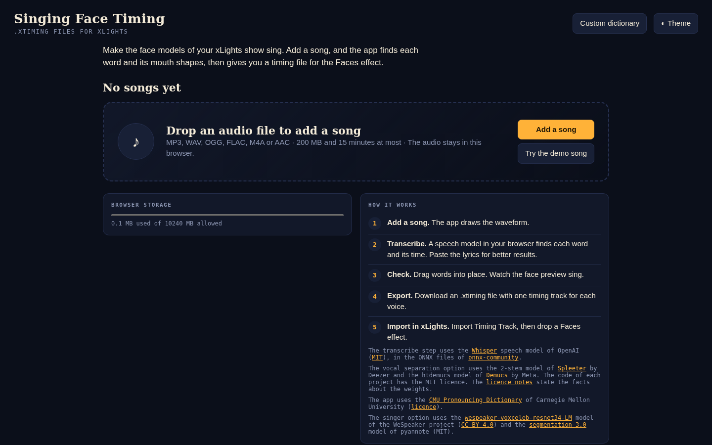
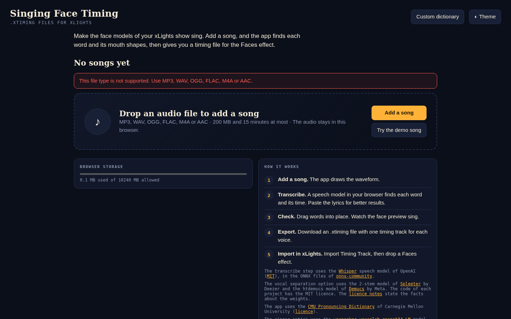
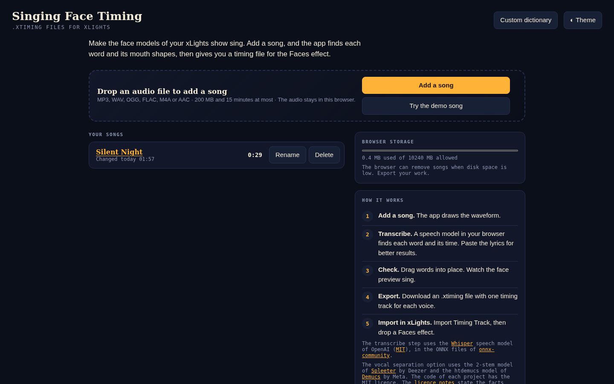
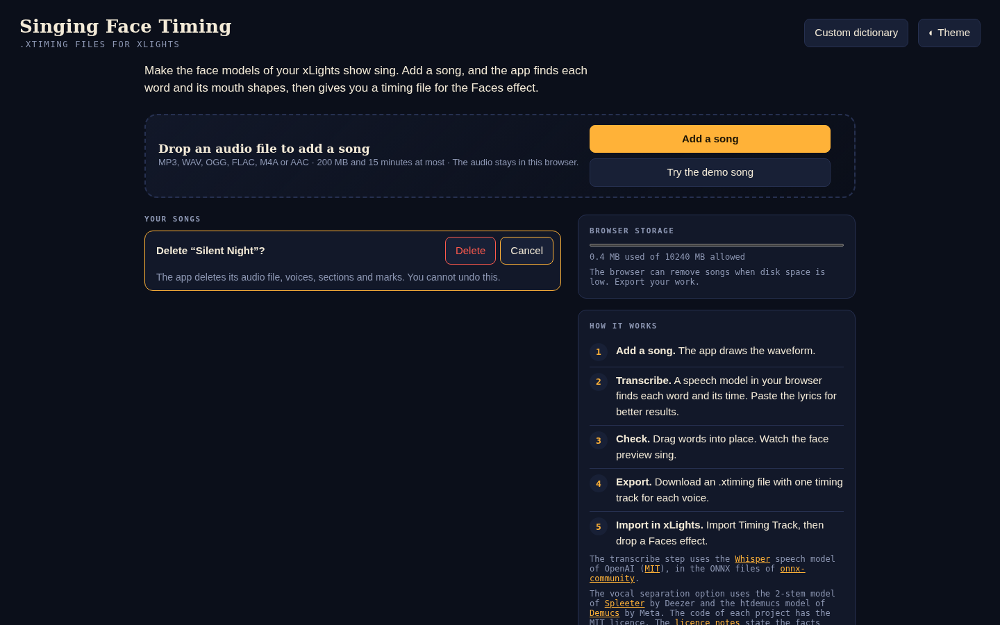
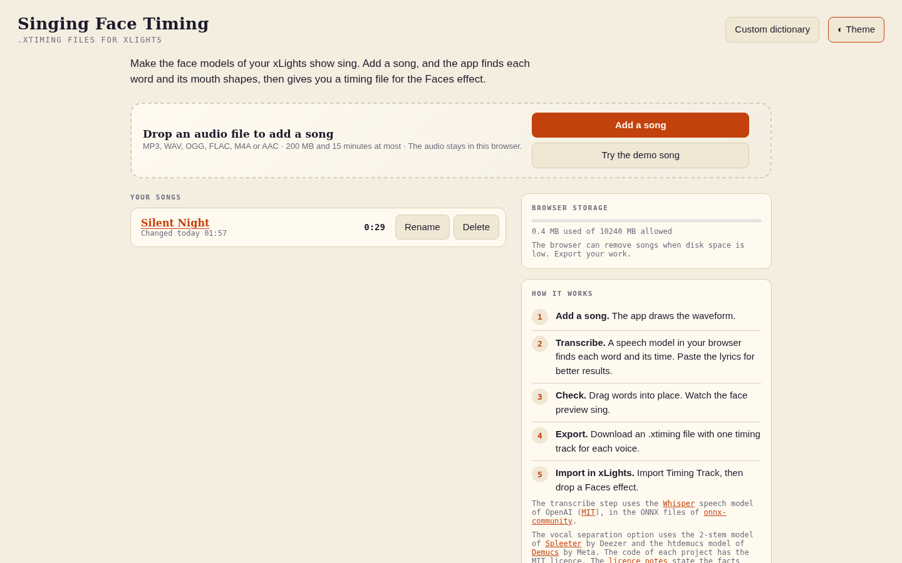

# Song library

The song library is the first page of the app. You add, open, rename and delete songs here.

## Add a song

1. Open the app. The first page shows the purpose of the app and the drop zone "Drop an audio file to add a song".

   

2. Select "Add a song". Or drag an audio file on the drop zone. The drop zone then shows "Drop to add".
3. Select an audio file in the file picker.
4. Wait. The drop zone shows "Decoding" and the file name with a progress bar.
5. Look at the editor. It opens when the app has decoded the audio. The song has the name of the file, without the extension. The song has one voice, "Lead Vocals".

If you drop more than one file, the app takes the first audio file. The editor then shows "Only one file was added."

### Limits and files

| Limit | Value |
|---|---|
| File types | MP3, WAV, OGG, FLAC, M4A, AAC |
| File size | 200 MB at most |
| Duration | 15 minutes at most |

### Messages for a file that the app does not accept

The message shows above the drop zone. The app creates no song.

| Case | Message |
|---|---|
| The file type is not in the list | "This file type is not supported. Use MP3, WAV, OGG, FLAC, M4A or AAC." |
| The file is larger than 200 MB | "This file is larger than 200 MB." |
| The browser cannot decode the file | "This browser cannot decode this file. Convert it to MP3 or WAV and try again." |
| The song is longer than 15 minutes | "This song is longer than 15 minutes." |
| The browser storage is full | "Browser storage is full. Delete a song and try again." |

## Try the demo song

1. On the first page, select "Try the demo song".
2. Wait. The editor opens with a short public-domain carol, "Silent Night", with its words and phonemes.

The demo song is a normal song. You can edit it and delete it. If the files of the demo song do not load, the app shows "The demo song did not load. Check the connection and retry."

## Open a song

1. Select the name of a song in the list "Your songs".

The list shows the name, the duration and the date of the last change. The newest change is first.

## Rename a song

1. Select "Rename" on the row of the song.
2. Type the new name in the field "Song name".
3. Select "Save".

A song name has 1 to 80 characters. The app removes the spaces at both ends. Select "Cancel" to keep the old name.

## Delete a song

1. Select "Delete" on the row of the song.
2. Read the question. It reads "Delete “<song name>”?" and "The app deletes its audio file, voices, sections and marks. You cannot undo this."
3. Select "Delete".

Select "Cancel" to keep the song.

## Storage meter

The panel "Browser storage" shows the space that the app uses and the space that the browser allows. For example, "0.4 MB used of 10240 MB allowed". The meter counts the separated audio tracks too.

If the browser did not grant persistent storage, a note shows: "The browser can remove songs when disk space is low. Export your work."

## Theme

1. Select "Theme" in the header.

The app has a dark theme and a light theme. The first visit follows the setting of your operating system. After you select "Theme", the browser keeps your choice.

## Where the songs are

The app saves each song, its audio file and your custom dictionary in this browser only. No server holds them. The theme is in the local storage of the browser.

These actions remove your songs:

- You clear the site data of the app in the browser.
- You use a private window. The browser removes the data when you close the window.
- The browser removes the data when the disk space is low and the browser did not grant persistent storage.

Another browser, another profile or another computer does not show your songs. To keep your work, export it. The zip file of the export window holds the timing files, the audio file and the song data. See [06 Export to xLights](06-export-to-xlights.md).

## Notes and limits

- The waveform shows one mixed channel. The audio plays with all channels.
- The app saves the open song 1 second after your last change. See [03 Edit marks](03-edit-marks.md).
- Two songs can have the same name.
- The credits of the speech models, the vocal separation models, the singer models and the dictionary are in the panel "How it works".
- If the library shows "This browser holds data from a newer version of the app. Reload the page. If the message stays, close the other tabs of the app and reload." see [08 Troubleshooting](08-troubleshooting.md).
