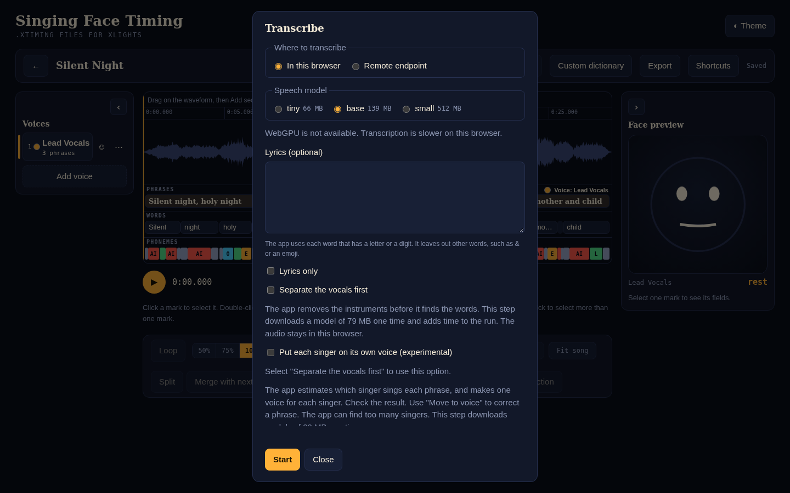
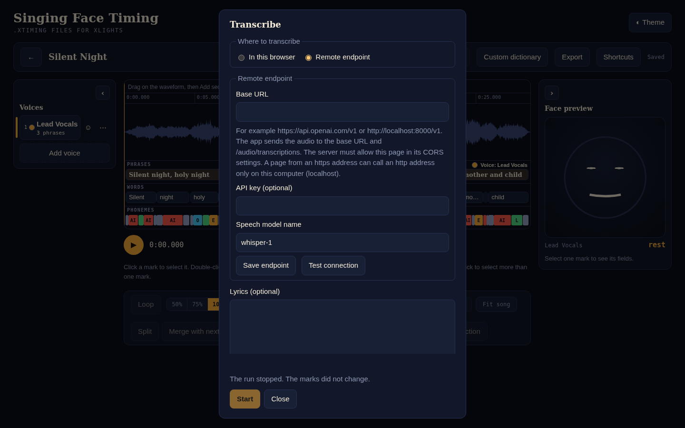
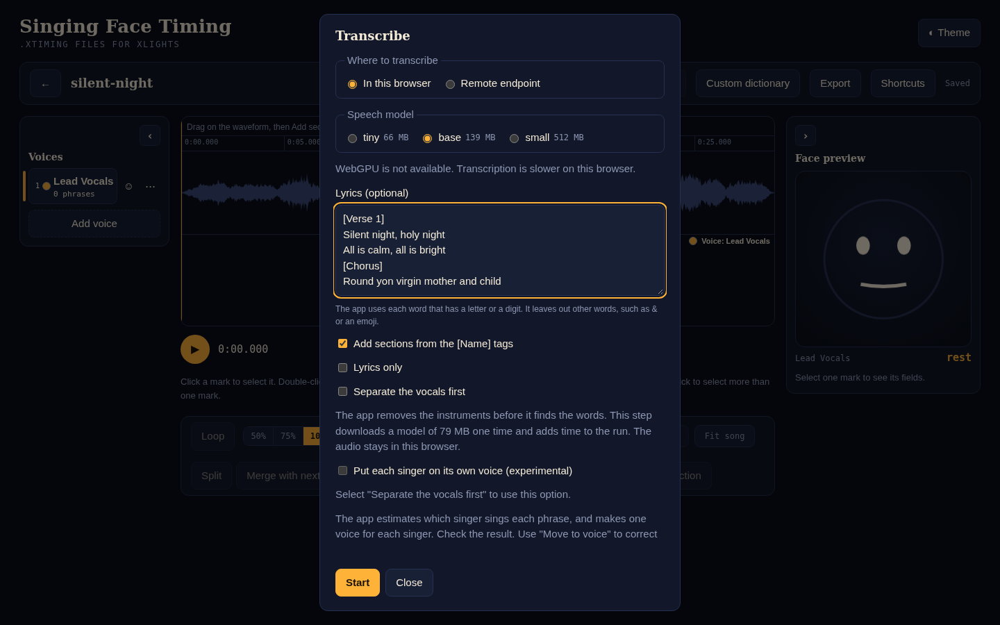
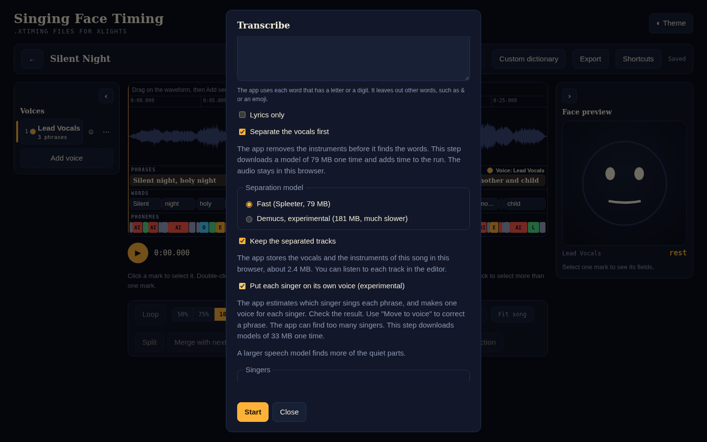
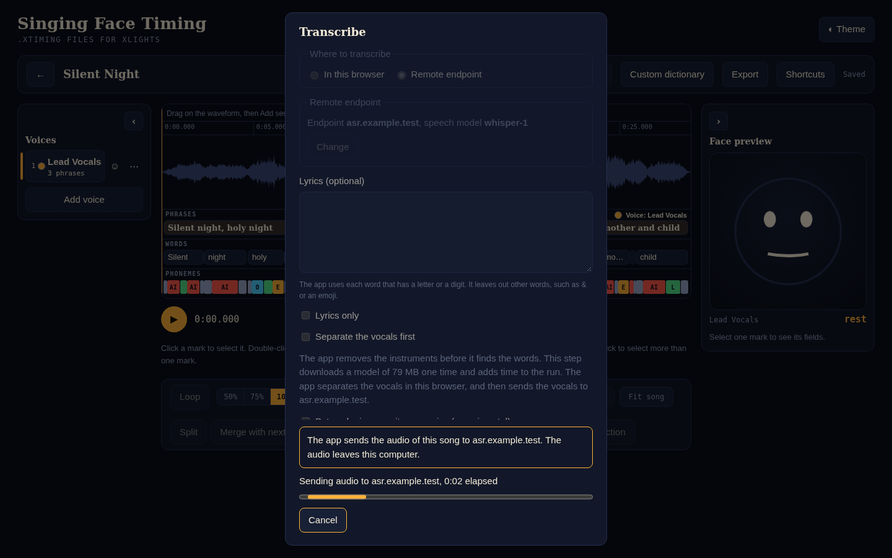
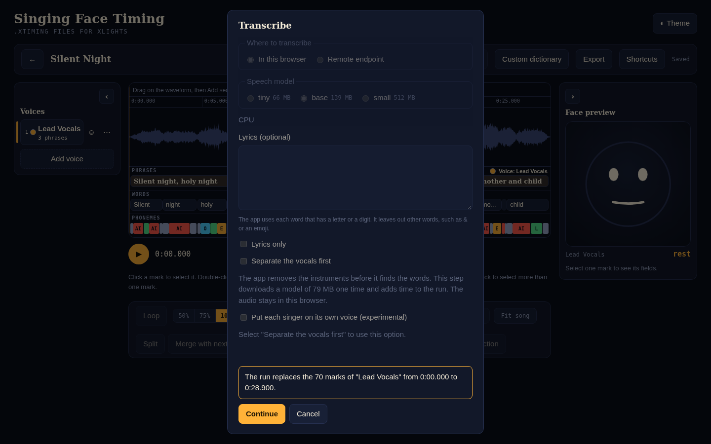
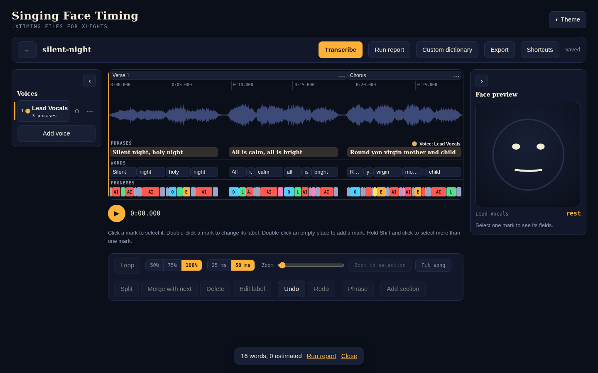

# Transcribe

The "Transcribe" window finds the words of a song and the time of each word. It then writes the marks on the three layers of the selected voice.

## Run a transcribe

1. Open a song in the editor.
2. Select "Transcribe" in the top bar. The empty layers have the same button.

   

3. Select a speech model. Select "base" if you do not know which one to use.
4. If you have the lyrics, paste them in the field "Lyrics (optional)".
5. Select "Start".
6. Wait. The window closes when the run ends.
7. Read the toast at the bottom of the editor. For example, "16 words, 0 estimated".

The first run of a speech model downloads its files. The browser keeps them for the next runs. The editor stays unchanged until the run ends. If you select "Cancel", the window shows "The run stopped. The marks did not change."

## Where to transcribe

The group "Where to transcribe" has two choices.

| Choice | What happens |
|---|---|
| "In this browser" | A speech model runs in your browser. The audio stays on your computer. |
| "Remote endpoint" | A server that you select transcribes the audio. |

> **Warning:** With "Remote endpoint", your audio leaves this computer. The window shows "The app sends the audio of this song to <host>. The audio leaves this computer." before "Start". The app sends nothing else to the host. The API key goes to the base URL only.

To use a remote endpoint:

1. Select "Remote endpoint".
2. Type the address in "Base URL". For example, `https://api.openai.com/v1` or `http://localhost:8000/v1`.
3. Type the key in "API key (optional)". A self-hosted server can work with no key.
4. Type the name of the model in "Speech model name". For example, `whisper-1`.
5. Select "Test connection". The window shows "The connection works. <host> returned word times." when the server answers.
6. Select "Save endpoint".
7. Select "Start".

The panel then shows "Endpoint <host>, speech model <name>" and the button "Change".

Rules for a remote endpoint:

- The server must be compatible with the OpenAI transcription API and return word times.
- The server must allow the page of the app in its CORS settings.
- A page from an https address can call an http address only on this computer (`localhost` or `127.0.0.1`).
- The server must accept a file of 25 000 000 bytes. That is about 13 minutes of audio. For a longer song, transcribe a time selection.

## Speech models

| Model | Size | Use |
|---|---|---|
| tiny | 66 MB | Fastest. Finds fewer quiet words. |
| base | 139 MB | The default. |
| small | 512 MB | Slowest. Finds more quiet words. |

The window shows the device. "Uses your graphics card (WebGPU)" is fast. "WebGPU is not available. Transcription is slower on this browser." means that the CPU runs the model. During the run, the window shows how fast the run is. For example, "CPU, about 2 times faster than the song".

If a run on the graphics card sends no progress for 45 seconds, the window shows "The graphics card was too slow. The run continues on the CPU."

## Lyrics

Lyrics are optional. With lyrics, the app uses your words with the times of the audio.

- The field takes 20 000 characters. With more, the window shows "The lyrics are too long. Use 20 000 characters at most." and disables "Start".
- The app uses each word that has a letter or a digit. It leaves out other words, such as `&` or an emoji. The toast then reads "The app left out <n> words that it cannot use."
- Write one line of lyrics for each phrase.
- A line that is only `[Name]` is a tag. It is never a phrase or a word. With a tag and a word in the lyrics, the check box "Add sections from the [Name] tags" shows. It is on by default. Each tag starts a section at the first phrase after it. See [04 Voices and sections](04-voices-and-sections.md).

If fewer than 30% of your words match the audio, the window asks "Only <n>% of the lyrics matched the audio. Check that the lyrics belong to this song." Select "Cancel" and check the lyrics, or select "Continue".

### Lyrics that do not fit

A song has room for one word for each frame size. For example, a song of 28.9 s with a frame size of 50 ms has room for 578 words. If the lyrics have more words, the window asks before the run: "The lyrics have <n> words. This song has room for about <m> words. The app leaves out the lines after line <k>." If line 1 alone does not fit, the last sentence names the words of line 1 that the app leaves out. Select "Continue" to run with the lines that fit. Select "Cancel" to change no mark. For a time selection, the second sentence reads "The time selection has room for about <m> words."

### Lyrics only

Select "Lyrics only" to make the marks from the lyrics with no speech model. The app spreads the words over the range. Each such word has an estimated time. The window then shows "Lyrics only uses no speech model." and disables the groups that it does not need. "Start" needs at least one word: "Paste the lyrics to use Lyrics only."

## Range

The group "Range" has "Full song" and, when you selected a time range on the waveform, the time selection. A run on a range replaces the marks that overlap the range. Marks outside the range stay.

## Separate the vocals first

Select "Separate the vocals first" when loud instruments hide the voice. The app removes the instruments before it finds the words. The audio stays in this browser. For a remote run, the app separates the vocals in this browser, and then sends the vocals to the host.

The group "Separation model" has two choices.

| Choice | Size | Notes |
|---|---|---|
| "Fast (Spleeter, 79 MB)" | 79 MB | The default. |
| "Demucs, experimental (181 MB, much slower)" | 181 MB | Experimental. It takes about 5 to 6 minutes for a song of 4 minutes on the CPU. It needs about 4 GB of memory. Without WebGPU, the window warns about this before the run. |

Each model downloads one time.

If the separation fails, the window gives the choices "Continue with no separation" and "Cancel". After a memory failure of Demucs, it also gives "Use the fast model".

### Keep the separated tracks

With "Keep the separated tracks" on, the app stores the vocals and the instruments of the song in this browser. The note shows the size, for example about 2.4 MB. You can then listen to each track in the editor. See [05 Audio tracks and run report](05-audio-tracks-and-run-report.md).

## Put each singer on its own voice (experimental)

This option is experimental. The app estimates which singer sings each phrase. It then makes one voice for each singer: "Singer 2", "Singer 3" and so on. The option needs "Separate the vocals first". The window states this under the disabled option. The option downloads models of 33 MB one time.

- The app can find too many singers.
- The app cannot keep apart two voices of the same kind, for example two men.
- A wrong count gives wrong singers.
- A phrase in which a second singer answers can get a copy on both voices.
- With the tiny or base speech model, the app finds few of the quiet lines. The window shows "A larger speech model finds more of the quiet parts."

"Singers" has the choices "Automatic", "2", "3" and "4". Select the count if you know it. The result is better. Check each voice after the run. See [05 Audio tracks and run report](05-audio-tracks-and-run-report.md).

## Split the singers (experimental)

This option is experimental. The app divides the vocals into two singer tracks. It then finds the words of each track and puts each track on its own new voice. The marks of the two voices can overlap in time, so this option works where two people sing at the same time.

- The option needs "Separate the vocals first". The window states this under the disabled option.
- The option needs WebGPU. In a browser with no WebGPU, the option is disabled. The window shows "This browser has no WebGPU. The singer split needs it."
- "Split mode" has the choices "Male and female" and "Lead and backing". "Male and female" makes the voices "Female" and "Male". "Lead and backing" makes the voices "Lead" and "Backing".
- The option and "Put each singer on its own voice (experimental)" exclude each other. When you select one, the app clears the other.
- The app cannot tell which lyrics line belongs to which singer. So the lyrics field is disabled, and the window shows "Lyrics are not used when the singers are split."
- With a remote endpoint, the app sends two requests, one for each singer track. The window states this before the run.
- With "Keep the separated tracks" on, the editor shows each singer track as a track row with the name of its voice.
- The song needs room for two more voices. A song has 12 voices at most.

One undo removes the result of the run, with the two voices. The run report has the section "Singer split" with the mode and the count of words of each singer track.

### Which options do I need?

| Case | Options |
|---|---|
| A solo song | Select a speech model. Paste the lyrics if you have them. Leave the other options off. |
| A song with loud instruments | Select "Separate the vocals first". Keep "Fast (Spleeter, 79 MB)". |
| A lead singer and a chorus that take turns | Select "Separate the vocals first". Select "Put each singer on its own voice (experimental)". Select "2" in "Singers". Select "small" if the chorus lines are missing. |
| A lead singer and a chorus that sing at the same time | Select "Separate the vocals first". Select "Split the singers (experimental)". Select "Lead and backing". |
| Two people who sing at the same time | Select "Separate the vocals first". Select "Split the singers (experimental)". For a man and a woman, keep "Male and female". |

## What the progress texts mean

| Text | Meaning |
|---|---|
| "Preparing audio" | The app decodes the audio and converts it to 16 kHz mono. |
| "Loading vocal separation model" | The app reads the model from the browser cache. |
| "Downloading vocal separation model" | The app downloads the model. |
| "Separating vocals" | The app removes the instruments. |
| "Loading speech model" | The app reads the speech model from the browser cache. |
| "Downloading speech model" | The app downloads the speech model. The text shows a percentage. |
| "Transcribing" | The speech model finds the words. The text shows the audio time, for example "1:12 of 3:40". |
| "Sending audio to <host>" | A remote run uploads the audio. |
| "Waiting for <host>" | The server transcribes the audio. |
| "Aligning lyrics and breaking down words" | The app matches the words with the lyrics and makes the phonemes. |
| "Loading singer model", "Downloading singer model" | The app prepares the singer step. |
| "Finding the singers" | The app estimates the singers. |
| "Loading singer split model", "Downloading singer split model" | The app prepares the singer split. |
| "Splitting the singers" | The app divides the vocals into two singer tracks. The text shows a percentage. |

A bar that has no end means that the app cannot tell the time that remains. "Cancel" is on during each step. "Escape" during a run only moves the focus to "Cancel". The window shows "Select Cancel to stop the run."

## The replace question

If the range has marks of the shown voice, the window asks before the run. For example, "The run replaces the 70 marks of "Lead Vocals" from 0:00.000 to 0:28.900." Select "Continue" to replace the marks. Select "Cancel" to change nothing.

If the last run wrote marks to other voices, for example singer voices, the question names those voices too. It also names the voice of the last run when you run on a different voice. A run with no singer step leaves those voices as they are. The question then adds "The voices of the last singer step do not change."

## The toast

After a run, a toast shows at the bottom of the editor. For example, "16 words, 0 estimated". With two voices or more, it reads "<n> words on <k> voices, <m> estimated". The toast has the links "Run report" and "Close". It stays until you select "Close" or start a new run.

"Estimated" words are words that the app placed between two matched words. Their time is a guess. Check them.

## Undo a run

1. Select "Undo" in the editor.

A run is more than one undo step. The steps are, in this order:

1. The marks of the run.
2. The sections of the `[Name]` tags.
3. The singer voices and the phrase divisions.

The first undo after a run removes the singer voices and the divisions. The marks of the run stay on the voice of the run. Select "Undo" again to remove the sections. Select "Undo" once more to remove the marks and bring back the old marks.

## Notes and limits

- The language is English.
- The window runs one run at a time. "Transcribe" is off during a run.
- If you close the tab during a run, no mark changes.
- The app breaks down each word into phonemes with the dictionary. See [07 Custom dictionary](07-custom-dictionary.md).
- The app keeps your choices in the window for the next run.
