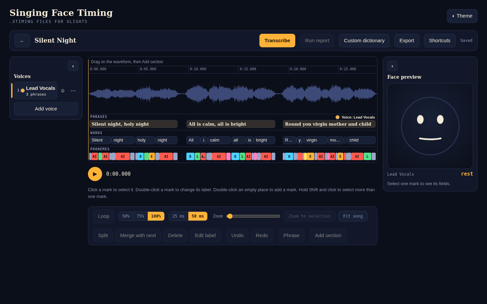
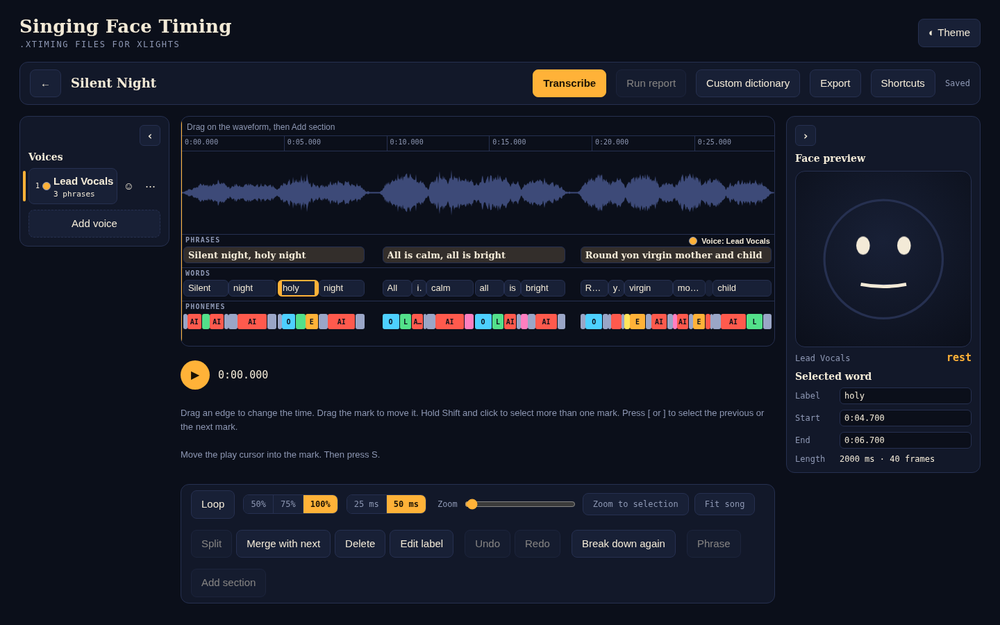
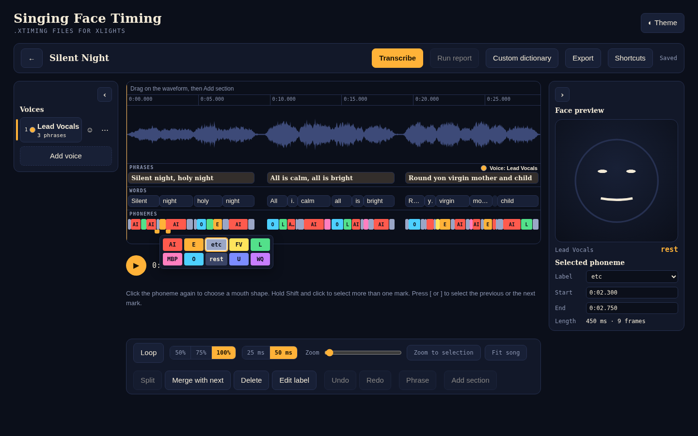
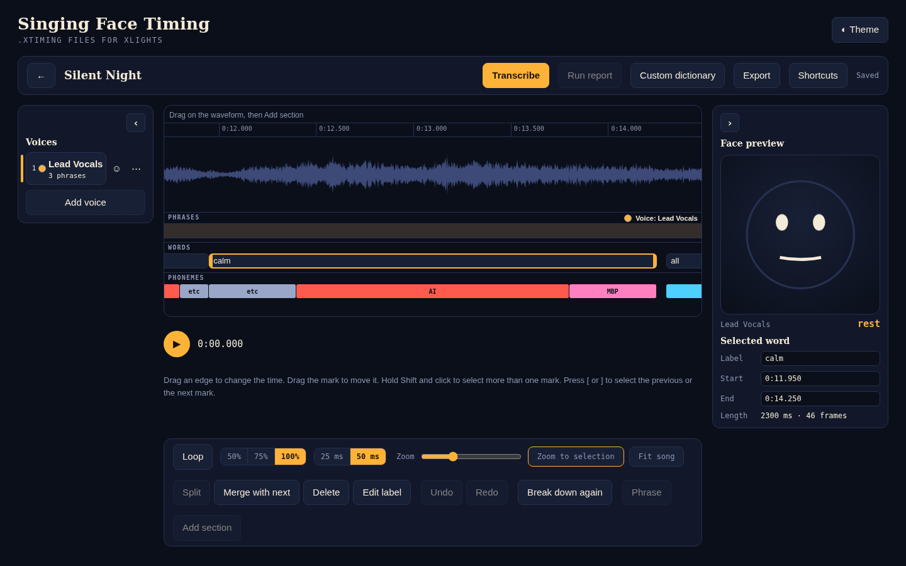
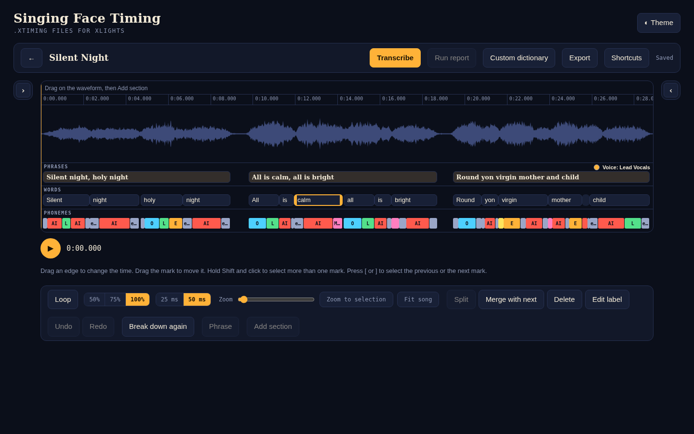

# Edit marks

The editor shows the waveform and the marks of the selected voice. You correct the marks here until the face preview sings as you want.

## The editor

The editor has these regions:

| Region | What it holds |
|---|---|
| Top bar | The link back to the song library, the song name, "Transcribe", "Run report", "Custom dictionary", "Export", "Shortcuts" and the save state. |
| Voice rail (left) | The voices of the song. See [04 Voices and sections](04-voices-and-sections.md). |
| Stage (centre) | From top to bottom: the section band, the time ruler, the waveform, the group "Audio tracks" (only after a run that kept tracks), the phrase layer, the word layer and the phoneme layer. |
| Transport (below the stage) | "Play" and the play time. |
| Help line | One line that tells you what you can do with the selection. |
| Status line | The reason that your last action did nothing. |
| Toolbar | "Loop", the play speed, the frame size, "Zoom", "Zoom to selection", "Fit song", the group "Mark", "Undo", "Redo", "Phrase" and "Add section". |
| Inspector (right) | The face preview, and the fields of the selected mark. |

The heading "Voice: <voice name>" above the phrase layer names the voice that the layers show.

The editor needs a window that is 1024 px wide or more. A narrower window shows "The editor needs a window that is 1024 px wide or more." and a link "Back to the song library".

## Select a mark

1. Click a mark.

The mark gets an outline. The inspector shows its fields under "Selected phrase", "Selected word" or "Selected phoneme". To select more than one mark, hold `Shift` and click. To clear the selection, press `Escape`.

To select the previous or the next mark of a layer, press `[` or `]`. To select the mark on the layer above or below, press `Up` or `Down`.

## Move and resize a mark

1. Select a word.
2. Drag the word to move it. Its phonemes move with it.
3. Drag an edge of the word to change its time.
4. Release the pointer.

The times snap to the frame size. If an edge reaches the next mark, the next mark gets shorter, down to one frame size. The drag then stops. A phrase edge stops at its first word or its last word. A word that you move loses the "estimated" style.

To move by one frame size with the keys, press `Left` or `Right`. With no selected mark, these keys move the play cursor.

If a drag does nothing, the status line states the reason: "The mark has no room to move." or "The edge of the mark has no room to move."

The inspector has the fields "Start" and "End". Type `m:ss.mmm` or seconds, for example `0:03.500` or `3.5`, and press `Enter`.

## Change a label

1. Double-click a phrase or a word. Or select it and select "Edit label". Or press `Enter` or `F2`.
2. Type the new label.
3. Press `Enter`.

Press `Escape` to cancel. If you change the words of a phrase, the app asks "The app rebuilds the words and phonemes of this phrase." Select "Continue" or "Cancel". The app keeps the times of the words that match.

## Change a mouth shape

1. Click a phoneme to select it.
2. Click the phoneme again. A list shows the ten phoneme labels.
3. Select a label.

Or select the phoneme and use the field "Label" in the inspector. The ten labels are `AI`, `E`, `etc`, `FV`, `L`, `MBP`, `O`, `rest`, `U` and `WQ`. The labels are case-sensitive.

A word that you changed by hand keeps its phonemes. To make the phonemes again, select the word and select "Break down again".

## Add, split, merge and delete

The group "Mark" has the buttons "Split", "Merge with next", "Delete" and "Edit label". Each button runs the action of its key on the selected mark.

| Action | Button | Key | Rule |
|---|---|---|---|
| Add | none | Double-click an empty place of a layer | The app adds a mark of 10 frame sizes that starts at the pointer. |
| Split | "Split" | `S` | Select one mark. Put the play cursor inside it. |
| Merge | "Merge with next" | `M` | Select one mark. The next mark must be in the same parent. |
| Delete | "Delete" | `Delete` | A phrase takes its words and phonemes with it. |

A word that you add outside a phrase also adds a phrase. You cannot delete the last phoneme of a word. Delete the word instead.

A button that cannot act stays on the screen with a dim style. Its tooltip and the status line give the reason. For example, "Select one mark first." or "Move the play cursor into the mark. Then press S."

## The help line and the status line

The help line changes with the selection.

| Selection | Help line |
|---|---|
| No mark | "Click a mark to select it. Double-click a mark to change its label. Double-click an empty place to add a mark. Hold Shift and click to select more than one mark." |
| A phrase or a word | "Drag an edge to change the time. Drag the mark to move it." |
| One phoneme | "Click the phoneme again to choose a mouth shape." |

The status line goes away after 5 seconds, or at your next key or pointer press.

## Zoom

- Drag the slider "Zoom". An arrow key on the slider changes the zoom by 10%.
- Press `+` or `-`.
- Hold `Ctrl` and turn the mouse wheel. The wheel alone scrolls in time.
- Select "Zoom to selection" or press `Z`. The stage shows the selected marks, or the time selection, in the middle.
- Select "Fit song" to show the full song.

The zoom keeps one time in place: the middle of the selected marks, else the play cursor, else the centre of the stage. The zoom stops at 1 000 pixels for each second. To edit a short phoneme, zoom in first.

### Fold the side panels

1. Select the fold button "Voices" at the edge of the voice rail.
2. Select the fold button "Inspector" at the edge of the inspector.

The stage takes the width. A folded inspector hides the face preview too. In a window narrower than 1280 px, a panel starts folded. The browser keeps your choice.

## Play, loop and speed

1. Click the waveform or the time ruler to put the play cursor.
2. Select "Play", or press `Space`.
3. Select "Play" again, or press `Space`, to pause.

The app does not start play by itself. The play time shows as `m:ss.mmm`.

To play a loop, select a mark or drag a time selection on the waveform. Then select "Loop" or press `L`. The loop starts 150 ms before the selection. The play speed buttons "50%", "75%" and "100%" do not change the pitch.

If the audio is not ready, "Loop" and the speed buttons are off and state "The audio is not ready."

## The frame size

The frame size buttons are "25 ms" and "50 ms". The frame size of your xLights sequence and this value must match. See [06 Export to xLights](06-export-to-xlights.md).

1. Select a frame size.
2. Read the question "The app moves every mark of this song to a multiple of 25 ms." The question names the frame size that you selected.
3. Select "Continue".

A song with no marks shows no question. The change is one undo step.

## The inspector and the face preview

The face preview shows the mouth shape under the play cursor. It shows a closed mouth between words. With more than one voice, it shows one face for each voice that you did not mute, up to four voices. Then it adds "+<n> more". If you muted each voice, it shows "Every voice is muted. Select the mute button of a voice to show its face."

The fields "Label", "Start", "End" and "Length" show when you select one mark. The length reads like "2000 ms · 40 frames". With a different selection, the inspector shows "Select one mark to see its fields."

## Undo and redo

1. Select "Undo", or press `Ctrl+Z`, to undo the last step.
2. Select "Redo", or press `Ctrl+Shift+Z`, to redo it.

One drag, one typed value or one key action is one undo step. The buttons are off with the reason "No step to undo." or "No step to redo." The history stays in memory. A reload clears it. On macOS, use `Cmd` in place of `Ctrl`.

## Save state

The top bar shows "Saved" or "Saving". The app saves the open song 1 second after your last change. It also saves at least 2 seconds after the first change that it did not save, also while you keep editing. It saves when the page becomes hidden or closes.

If a change is not saved, the browser asks you to confirm a reload or a close. The browser shows its own text. After a reload, the song opens with its marks, its zoom and its scroll position. The undo history is gone.

The link back to the song library opens the library after the save ends.

## Shortcuts

Select "Shortcuts" or press `?` to open the list "Keyboard shortcuts". A shortcut does not act while the focus is in a field, a list or a dialog.

| Keys | Action |
|---|---|
| `Space` | Play or pause, also from a button of the toolbar. `Enter` presses the button. |
| `L` | Play the selection in a loop. |
| `S` | Split the selected mark at the play cursor. |
| `M` | Merge the selected mark with the next mark. |
| `Delete` | Delete the selected marks. |
| `Enter` or `F2` | Edit the label. |
| `[` or `]` | Select the previous or the next mark of the layer. |
| `Up` or `Down` | Select the mark on the layer above or below. |
| `Left` or `Right` | Move the selected mark by one frame size. With no selected mark, move the play cursor by one frame size. |
| `Alt+Left` or `Alt+Right` | Move the start of the selected mark by one frame size. |
| `Shift+Alt+Left` or `Shift+Alt+Right` | Move the end of the selected mark by one frame size. |
| `Shift+Left` or `Shift+Right` | Make the time selection longer or shorter from the play cursor. |
| `Ctrl+Z` | Undo. |
| `Ctrl+Shift+Z` | Redo. |
| `+` or `-` | Zoom in or out. |
| `Z` | Zoom to the selected marks or the time selection. |
| `Escape` | Clear the mark selection. |
| `?` | Show this list. |
| `Tab` or `Shift+Tab` | Go to the next or the previous layer or control. Each layer is one stop. |

`S`, `M`, the move keys, `Up` and `Down` act when you select exactly one mark. `Up` selects the parent and `Down` selects the first child.

## Notes and limits

- Marks on one layer do not overlap. A child mark stays inside its parent.
- The shortest mark is one frame size.
- A mark narrower than 16 px shows no label. Its tooltip shows the label and the times.
- A word with a dotted outline is unknown to the dictionary. See [07 Custom dictionary](07-custom-dictionary.md).
- A word with a dashed frame has an estimated time.
