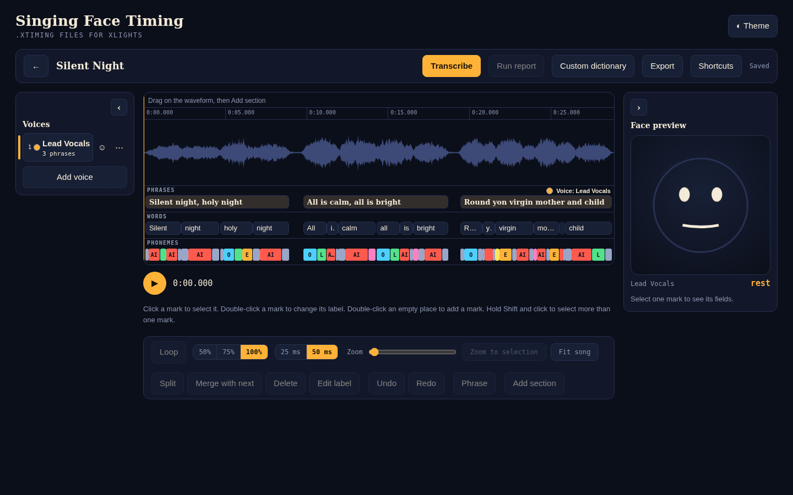
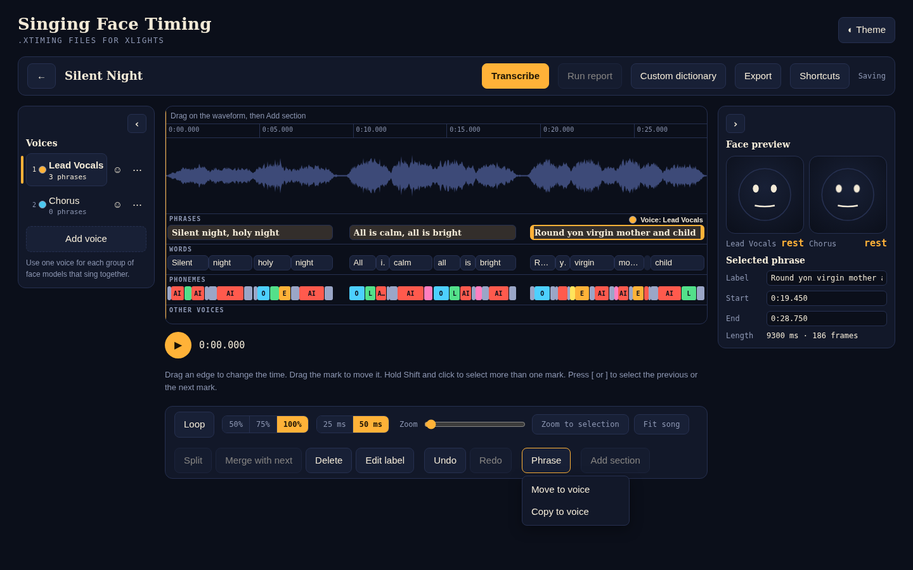
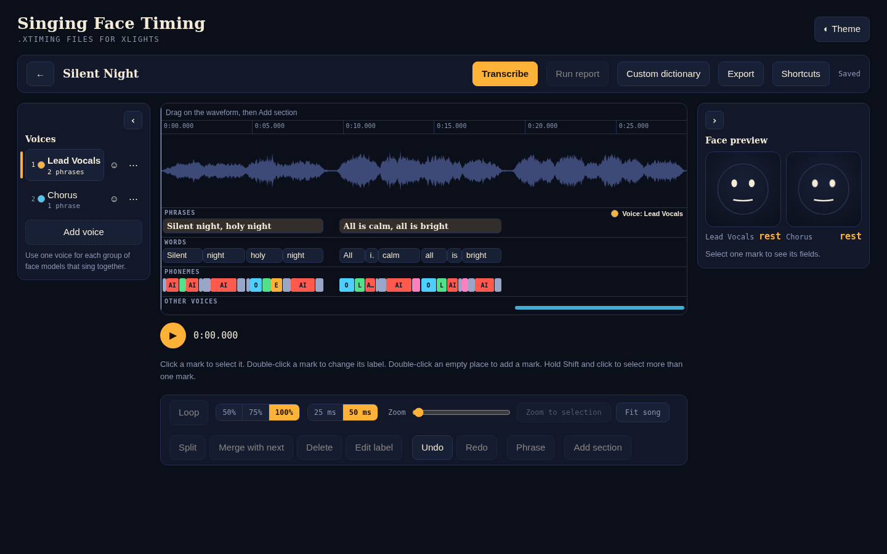
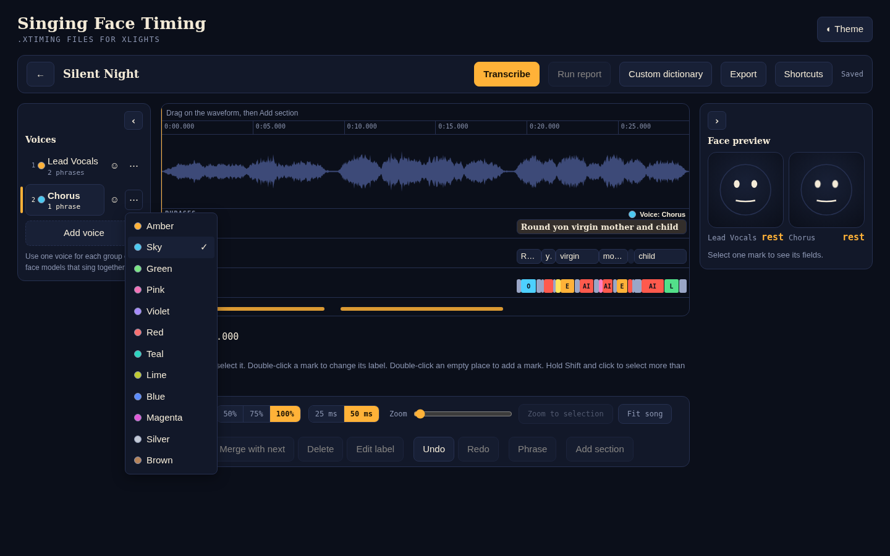
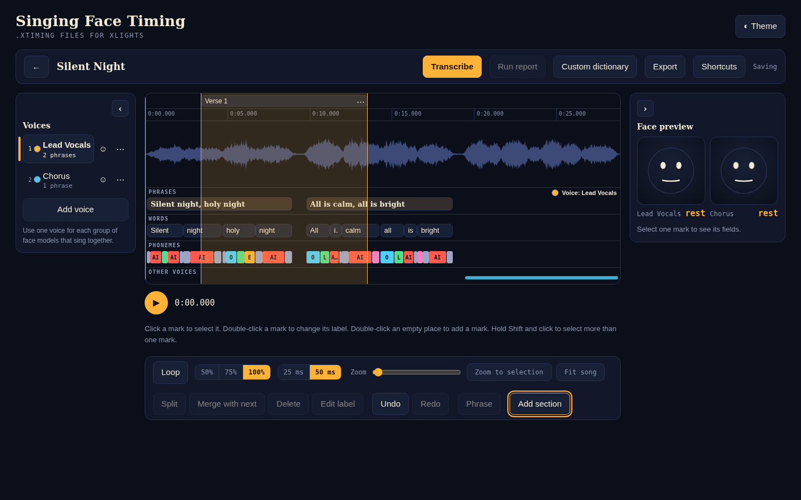

# Voices and sections

A voice is one singer or one vocal part. One voice becomes one timing track in xLights. A section is a named time range of the song, for example "Chorus".

Use one voice for each group of face models that sing together.

## Example: one lead face model and three chorus face models

The lead face model sings alone. The three chorus face models sing the same words together. You need two voices: one for the lead and one for the chorus. The export gives two timing tracks. In xLights, the three chorus face models use the same timing track.

1. Open the song. It has the voice "Lead Vocals" with all phrases.

   

2. Select "Add voice". The rail adds "Voice 2".
3. Rename "Voice 2" to "Chorus". See "Rename a voice" below.
4. On the phrase layer, click a phrase that the chorus sings. Hold `Shift` and click to select more phrases.
5. Select "Phrase" in the toolbar.
6. Select "Move to voice" and select "Chorus". Select "Copy to voice" if the lead also sings the phrase.
7. Click "Lead Vocals" in the rail. Check the phrases. Click "Chorus" in the rail. Check the phrases.

If "Chorus" has phrases in the same time range, the app asks "<voice name> has <n> phrases in this range. Replace them?" Select "Continue" to replace them, or "Cancel".

The row "Other voices" under the phoneme layer shows a bar for each phrase of the other voices, in the colour of each voice. Use it to see what the other voices sing.

For the steps in xLights, see [06 Export to xLights](06-export-to-xlights.md).

## The voice rail

Each row of the voice rail shows:

- the number of the row, 1 to 12,
- the colour chip,
- the name and the count of phrases,
- a mute button for the face preview,
- the menu "Actions for <voice name>".

The row of the shown voice has a bar at its left edge and a bold name. Click a row to show that voice on the three layers. The click clears the mark selection. "Add voice" does not change the shown voice. The rail shows the hint "Use one voice for each group of face models that sing together." with two voices or more.

A song has 1 to 12 voices. At 12 voices, "Add voice" is off and states "A song has 12 voices at most."

## Rename a voice

1. Select "Actions for <voice name>" on the row.
2. Select "Rename".
3. Type the name in the field "Voice name".
4. Press `Enter`.

A voice name has 1 to 60 characters and is unique in the song. It cannot contain `<`, `>`, `&` or `"`. A wrong name shows "A voice name has 1 to 60 characters.", "A voice name cannot contain <, >, & or "." or "A voice with this name exists." If xLights changes the name on import, the field shows "xLights shows this name as “<name after the import>”." The app saves the name.

## Change the colour

1. Select "Actions for <voice name>".
2. Select "Colour".
3. Select a colour.

The 12 colours are Amber, Sky, Green, Pink, Violet, Red, Teal, Lime, Blue, Magenta, Silver and Brown. A new voice gets the first colour that no voice uses.

## Change the order

1. Select "Actions for <voice name>".
2. Select "Move up" or "Move down".

The order of the rail is the order of the export.

## Mute a voice for the face preview

1. Select "Mute face preview of <voice name>" on the row.

The button changes its sign from ☺ to ⊘. The face preview then hides the face of that voice. The mute changes only the preview. The export keeps the voice.

## Delete a voice

1. Select "Actions for <voice name>".
2. Select "Delete".
3. Read the question "The app deletes “<voice name>” and its marks."
4. Select "Delete".

A song keeps at least one voice. The row of the last voice has no delete action. One undo brings the voice back.

## Sections

A section has a name and a time range. Sections are shared by all voices. A section is 1 second long or more. Sections do not overlap.

### Add a section

1. Drag on the waveform to select a time range.
2. Select "Add section".
3. Type a name. The name has 40 characters at most.
4. Press `Enter`.

Press `Escape` to cancel. If you leave the field, the app adds the section with the name in the field. A new section takes the name "Section N" if you type none.

If the range overlaps a section, the app makes the new section shorter. The status line then says "The section starts at <time>, after "<name>"." or "The section ends at <time>, before "<name>"." With no free range of 1 second, the status line says "No room for a section here. Select a free range of 1 second or more."

You can also make sections from `[Name]` tags in the lyrics. See [02 Transcribe](02-transcribe.md).

### Change a section

Select "Actions for <section name>" on the section.

| Action | Result |
|---|---|
| "Rename" | Type a new name. |
| "Move section to voice" | Select a voice. The app moves each phrase of the shown voice in the section to that voice. |
| "Delete" | The section goes. The marks stay. No question appears. |

To change the time range, drag an edge of the section. The edge snaps to the frame size and stops at the next section. A click on a section selects its time range and shows its start.

## Notes and limits

- A voice with no marks stays in the song. The export warns about it.
- A phrase belongs to the section that holds its middle.
- Each export option can make one timing track for each voice and section. See [06 Export to xLights](06-export-to-xlights.md).
- Each change of a voice or a section is one undo step.
