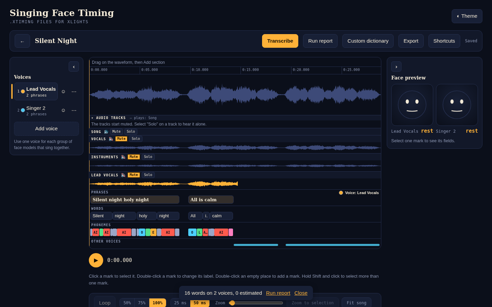
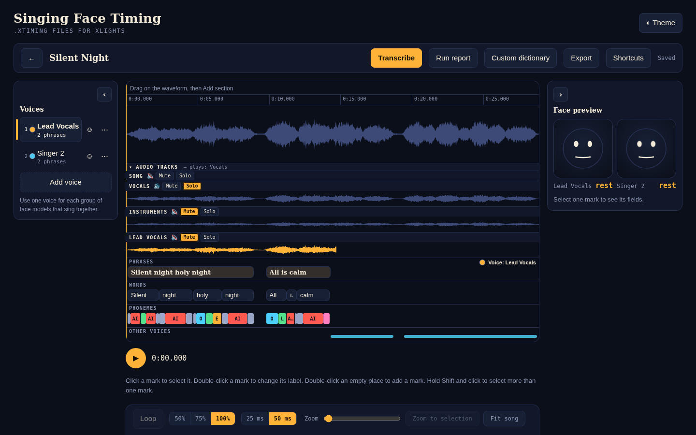
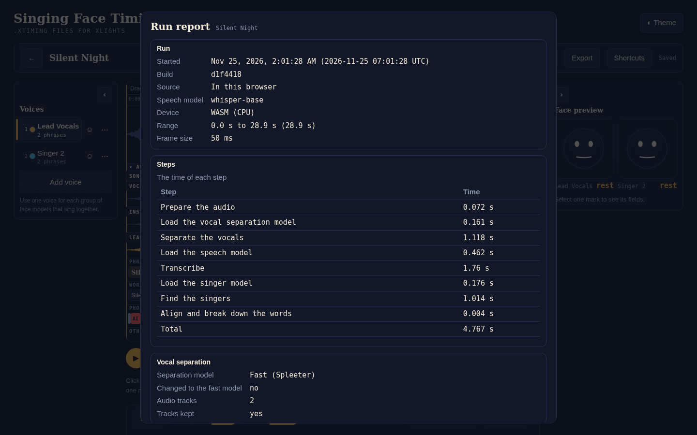
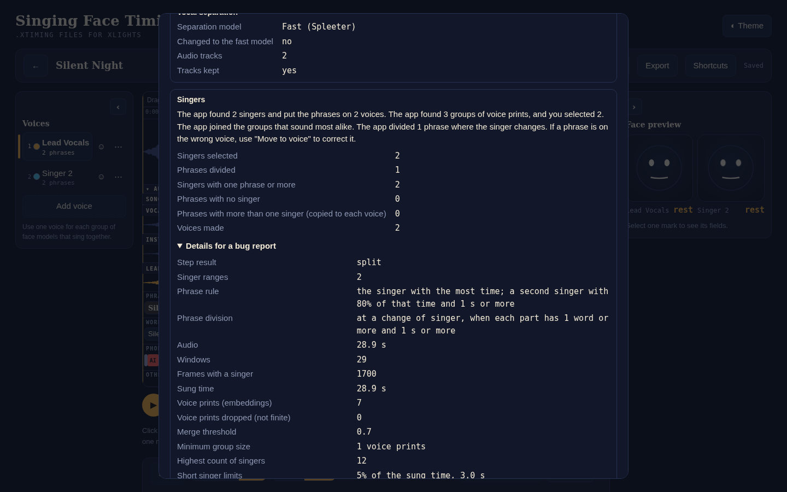

# Audio tracks and run report

After a run with "Separate the vocals first" and "Keep the separated tracks", the editor lets you listen to each audio track. The run report states what the last run did.

## Audio tracks

1. Run "Transcribe" with "Separate the vocals first" on and "Keep the separated tracks" on. See [02 Transcribe](02-transcribe.md).
2. Look at the group "Audio tracks" under the waveform.

A song with no kept audio tracks has no group.

### The rows

| Row | What it is |
|---|---|
| "Song" | The song audio. Its waveform is at the top of the stage. |
| "Vocals" | The vocals that the separation found. |
| "Instruments" | The instruments that the separation found. |
| One row for each singer voice | The vocals, limited to the times of that singer. It is not a separate recording. |

A singer row has the name of its voice. After you rename the voice, the row shows the new name. The singer rows follow the order of the voices.

Each row has, from left to right, the name, the sound sign, "Mute" and "Solo". The row name of a singer row has the tooltip "This row is the vocals track, limited to the times of this singer."

### Mute and Solo

- "Mute" stops the sound of one row.
- "Solo" plays only that row. Select "Solo" on more rows to play them together.

At the start, "Song" sounds and each other row is muted. So the same sound does not play twice. The group shows "The tracks start muted. Select "Solo" on a track to hear it alone." until you change a mute or a solo.

1. Select "Solo" on "Vocals".
2. Select "Play".
3. Select "Solo" again to end the solo.

"Solo" on a muted row removes its mute and solos it. "Mute" on a soloed row ends the solo and mutes the row. A mute or a solo is not an undo step.

### The sound sign

The sound sign shows a speaker that plays or a speaker that is silent. Its text is "plays" or "silent". The tooltip gives the reason:

- "Plays."
- "Silent, because "Mute" is on."
- "Silent, because "Solo" is on for <row names>."
- "Silent, because the browser did not start the sound."

The heading shows the rows that sound, for example "Audio tracks — plays: Vocals". With no sounding row, it shows "plays: nothing".

If the browser refuses the sound of a row, the group shows "The browser did not start the sound of <row name>. Select "Mute" and then "Solo" on the row again."

### Fold the group

1. Select the heading "Audio tracks".

The rows hide and show. The heading keeps the text of the rows that sound. The group shows four rows at most. With more rows, the group scrolls.

### Rules for the sound

- Each track plays, pauses, seeks, loops and changes speed with the song audio.
- The pitch does not change at 50% and 75%.
- A track of a range run covers the range only.
- With "Song" muted, the play cursor, the loop and the face preview still work.

## Run report

The run report states what the last transcribe run of this song did. It holds no lyrics.

### Open the report

1. Select "Run report" in the top bar. Or select "Run report" in the toast after a run.

Before the first run, the button is off and the top bar shows "No transcribe run for this song yet."

### Read the report

| Section | What it states |
|---|---|
| Run | The start time, the build, the source, the speech model, the device, the range and the frame size. |
| Steps | The time of each step and the total. |
| Vocal separation | The separation model and whether the run changed to the fast model. |
| Singers | A summary in plain words, then the counts. |
| Voices | The voices that hold phrases of the run. "Made by the run" is "yes" for a voice that the singer step added. A voice that you deleted shows "(deleted)". |
| Marks | The counts of phrases, words, estimated words and unknown words. Also the lyrics lines and the words that the run left out. |
| Notes | Each warning and each failure. |

Start with the summary under "Singers". It gives the result, the most probable reason and the next action. For example, "The app found 2 singers and put the phrases on 2 voices." and then the next action.

### Copy the report for a bug report

1. Select "Copy report". The status line shows "The report is on the clipboard."
2. Paste the text in your bug report.

If the browser refuses, the status line shows "Press Ctrl+C to copy." Select "Download report" to get a text file. The part "Details for a bug report" folds. It holds the numbers of the singer step and a sentence for each term.

## When the singers are wrong

1. Open "Run report". Read the summary under "Singers".
2. If the song has more singers than the app found, run "Transcribe" again. Select the count in "Singers".
3. If a phrase is on the wrong voice, select the phrase. Select "Phrase". Select "Move to voice" and select the right voice.
4. If a phrase needs both voices, select "Copy to voice".

A new run with "Put each singer on its own voice" replaces the marks in the range of each voice of the last run. The replace question names those voices. See [02 Transcribe](02-transcribe.md).

## Notes and limits

- "Put each singer on its own voice" is experimental. See [02 Transcribe](02-transcribe.md) for its limits.
- A singer row shows the vocals of one singer. The app cuts it from the separated vocals. It is not a recording of that singer alone.
- The kept tracks use browser storage. About 2.4 MB for a song of 29 seconds. They count in the storage meter.
- The zip file of the export window holds the vocals, the instruments and the report. See [06 Export to xLights](06-export-to-xlights.md).
- If the app cannot read the run data, the group shows "The app could not read the run report and the separated tracks of this song. Reload the page."
