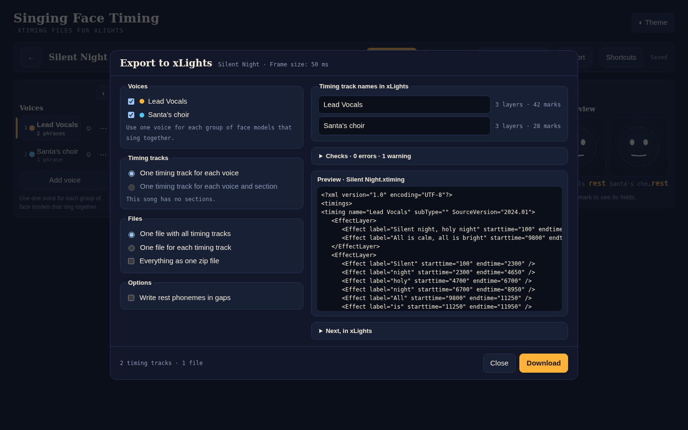
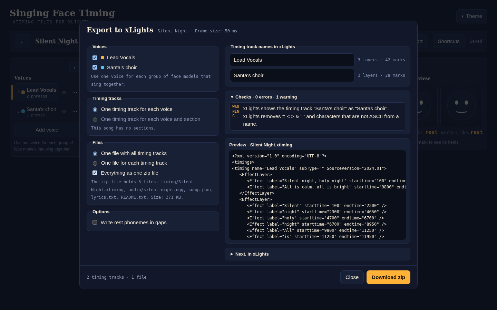
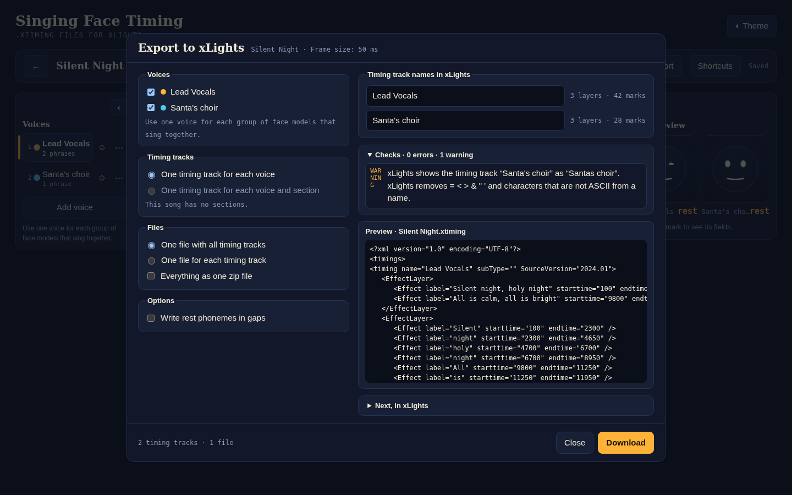
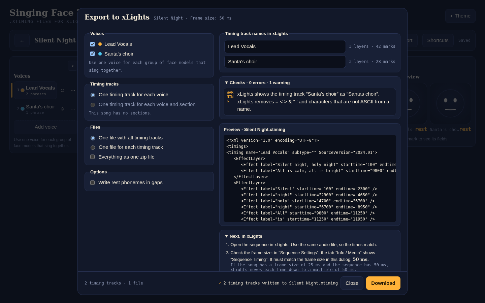

# Export to xLights

The "Export to xLights" window writes the `.xtiming` files. You import them in xLights and use them in a Faces effect.

## Export the files

1. In the editor, select "Export".

   

2. In the group "Voices", check each voice that you want. The window checks each voice that has marks. A voice with no marks starts unchecked. It starts checked at a later export, after it gets marks, unless you cleared it.
3. In the group "Timing tracks", select a grouping.
4. In the group "Files", select a packaging.
5. If you want a `rest` mouth shape in each gap, check "Write rest phonemes in gaps".
6. Check the names under "Timing track names in xLights".
7. Open "Checks". Read each message.
8. Select "Download". With the zip file selected, the button reads "Download zip".
9. Read the line next to the buttons. For example, "1 timing track written to Silent Night.xtiming".

The title of the window shows the song name and the frame size, for example "Silent Night · Frame size: 50 ms".

### Timing tracks

| Choice | Result |
|---|---|
| "One timing track for each voice" | One timing track for each voice. The name is the voice name. |
| "One timing track for each voice and section" | The name is `<voice name> - <section name>`. A phrase outside every section goes to `<voice name> - Unsectioned`. |

If the song has no sections, the second choice is off and the window shows "This song has no sections."

### Files

| Choice | Result |
|---|---|
| "One file with all timing tracks" | One file: `<song name>.xtiming`. |
| "One file for each timing track" | One file for each timing track: `<song name> - <timing track name>.xtiming`. |
| "Everything as one zip file" | One file: `<song name>.zip`. |

With "One file for each timing track", the window shows "The browser can block several downloads. If files are missing, allow downloads for this site, or select One file."

The app replaces each of `\ / : * ? " < > |` in a file name with `_`.

### The zip file

With "Everything as one zip file", a note lists the files and the size. For example, "The zip file holds 5 files: timing/Silent Night.xtiming, audio/silent-night.ogg, song.json, lyrics.txt, README.txt. Size: 371 KB."

The zip file holds:

| Entry | When |
|---|---|
| `timing/<file name>.xtiming` | Always. |
| `timing/<song name> - all.xtiming` | With "One file for each timing track". |
| `audio/<audio file name>` | Always. The audio file with its original bytes. |
| `song.json` | Always. The song data. |
| `lyrics.txt` | A voice has a phrase. |
| `custom-dictionary.txt` | The custom dictionary has an entry. |
| `tracks/vocals.wav`, `tracks/instruments.wav` | The last run kept the audio tracks. |
| `report.txt` | The song has a run report. |
| `README.txt` | Always. One line for each entry, and the steps for xLights. |

The zip file is a way to keep your work. The audio file in the zip file is the same file that you added.

### Names that xLights changes

xLights removes these characters from a timing track name on import: `= < > & " '` and each character that is not ASCII. xLights keeps the spaces. If a timing track with the same name exists, xLights adds `_1`, then `_2`. The window shows the name after the import in the group "Timing track names in xLights" and in "Checks".

For example, the voice name "Santa's choir" becomes "Santas choir" in xLights.

## Checks

The heading shows the count, for example "Checks · 0 errors · 1 warning". An error disables "Download" and "Download zip". The line next to the buttons then reads "Correct the errors in "Checks" first." A warning does not disable them.

### Errors

| Message | What to do |
|---|---|
| "No marks to export. Select a voice with marks." | Check a voice that has marks. |
| "Two timing tracks have the name “<timing track name>”." | Change one name. |
| "A timing track of “<voice name>” has no name." | Type a name. |
| "xLights cannot use the timing track name “<timing track name>”. Use letters from A to Z, digits or spaces." | Type a name with letters, digits or spaces. |
| "“<label>” at <time> is not a phoneme label." | Change the label to one of the ten phoneme labels in the editor. |
| "“<label>” at <time> ends at or before its start." | Change the times of the mark in the editor. |

### Warnings

| Message | What it means |
|---|---|
| "“<voice name>” has no marks. Clear its check box, or add marks." | The file holds a timing track with three empty layers. |
| "“<voice name>” has marks, and it is not in this export. Select its check box to add it." | A voice with marks is not checked. The file leaves it out. |
| "xLights shows the timing track “<timing track name>” as “<name after the import>”. xLights removes = < > & " ' and characters that are not ASCII from a name." | The name in xLights differs from the name here. |
| "xLights gives these timing tracks almost the same name: “<name after the import>” and “<name after the import>_1”. Change a voice name or a section name." | Two names are the same after the import. |
| "“<label>” at <time> has no phoneme." | The word gives no mouth shape. Break down the word again. |
| "“<label>” at <time> is an unknown word. Its phonemes are a guess." | Add the word to the custom dictionary. See [07 Custom dictionary](07-custom-dictionary.md). |
| "“<label>” at <time> has an estimated time." | The time of the word is a guess. Check it. |
| "“<label>” at <time> is shorter than one frame. The export makes it one frame long." | The mark is shorter than the frame size. |
| "“<label>” at <time> ends after the end of the song." | Move the mark inside the song. |

The export snaps each time to the frame size. The marks in the song do not change.

## The files that you get

Each `.xtiming` file has one `<timing>` element for each timing track. Each timing track has exactly three `<EffectLayer>` elements: the phrases, the words and the phonemes. The Faces effect of xLights reads the third layer. A voice with no phoneme still gets three layers.

With "Write rest phonemes in gaps" on, the app writes a `rest` phoneme in each gap of the phoneme layer. With it off, a gap is a closed mouth in xLights.

## Steps in xLights

After a download, the window shows "Next, in xLights" with these steps. The control names are the names in xLights 2026.21.

1. Open the sequence in xLights. Use the same audio file, so the times match.
2. Check the frame size. In "Sequence Settings", the tab "Info / Media" shows "Sequence Timing". It must match the frame size of the window. If the song has 25 ms and the sequence has 50 ms, xLights moves each time down to a multiple of 50 ms.
3. Right-click a timing row heading and select "Import Timing Track".
4. Select the `.xtiming` file. If the file has several timing tracks, xLights adds one timing track for each.
5. Drop a Faces effect on the row of the face model, from the start to the end of the song. The effect moves the mouth only during its own time.
6. In the effect settings, under "Mouth Movements", select "Timing Track". Select the timing track for that face model. The list shows only the timing tracks with three layers.
7. Repeat steps 5 and 6 for each face model.

### Steps for a lead face model and chorus face models

The window shows these steps under "Use the timing tracks with several face models".

1. Check that each face model has a face definition with a mouth for each phoneme label: `AI`, `E`, `etc`, `FV`, `L`, `MBP`, `O`, `rest`, `U`, `WQ`. A singing tree or a singing pumpkin from a vendor comes with a face definition. xLights shows no mouth for a phoneme label that the face definition does not have.
2. Drop one Faces effect on the face model that sings the lead.
3. Under "Mouth Movements", select "Timing Track". Select the timing track of the lead voice.
4. Drop one Faces effect on each face model that sings the chorus. Put the effect on each face model, not on a model group. On a model group, xLights shows only a face definition of the type "Matrix".
5. In each of these effects, select the same timing track: the timing track of the chorus voice.

## Notes and limits

- The xLights facts come from xLights 2026.21. A "Single Nodes" or "Matrix" face definition and xLights on Windows or macOS are not confirmed.
- The sequencer grid of xLights 2026.21 can show a label with a character that is not ASCII, for example `café`, as `caf??`. The file keeps the bytes.
- The app does not edit xLights sequences, layouts or face definitions. You place the Faces effects in xLights.
- A window that opens with "No marks to export. Transcribe the song first." means that no voice has marks.
