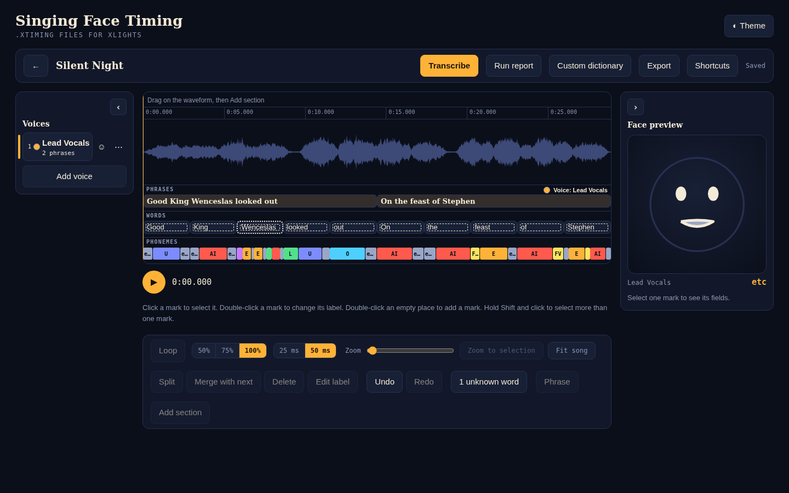
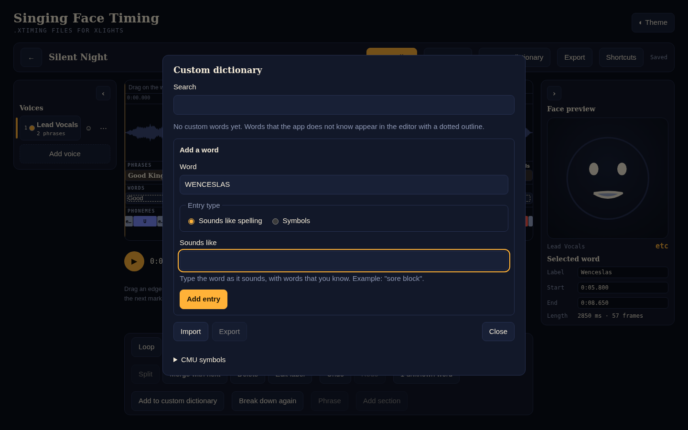
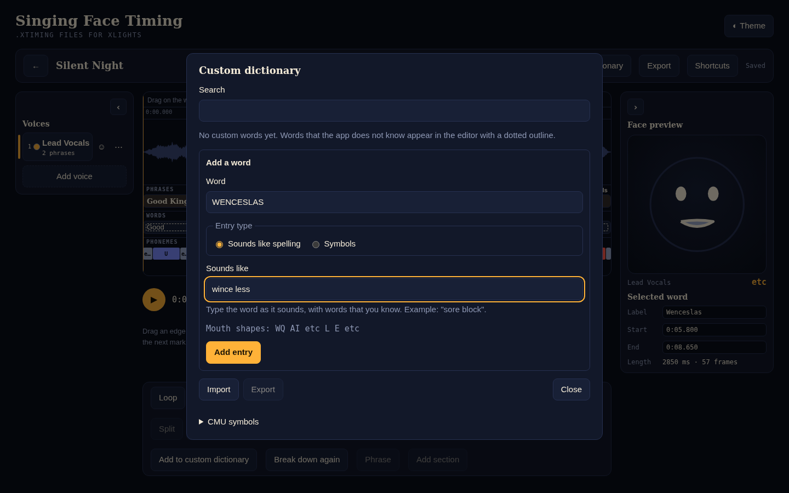
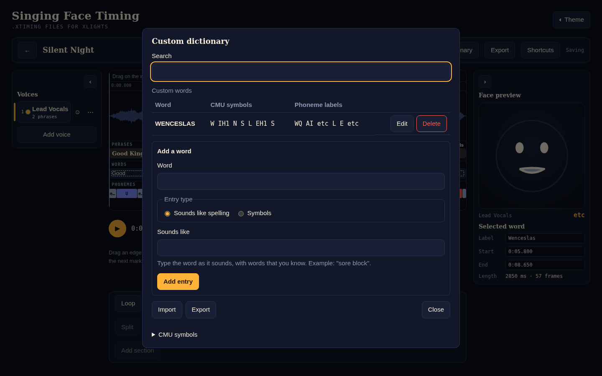
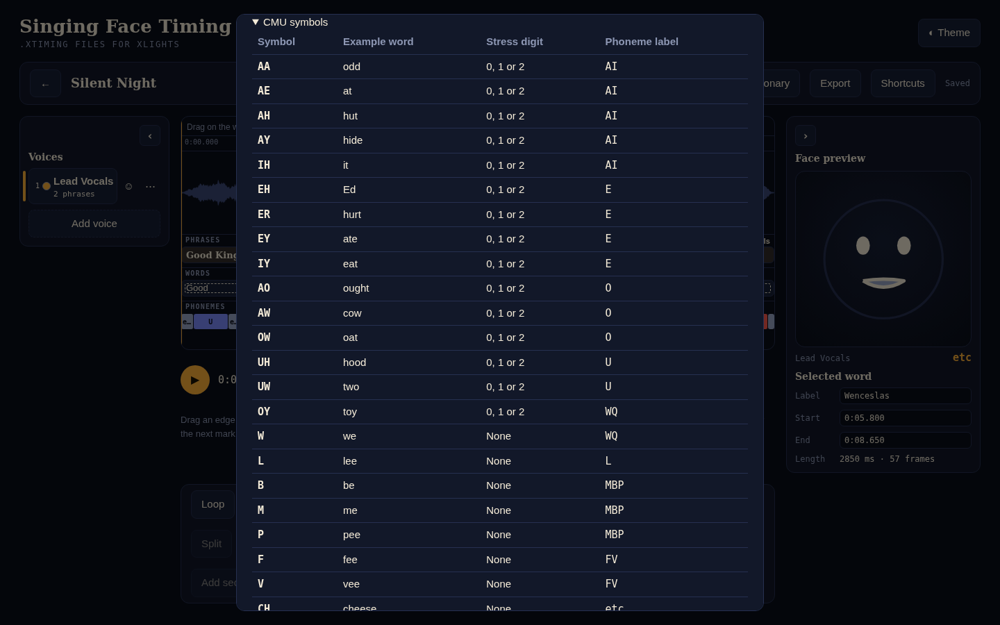

# Custom dictionary

The dictionary gives the CMU symbols of a word. The custom dictionary holds the words that you add or change. It takes priority over the dictionary.

## Unknown words

A word that no dictionary has is an unknown word. The app guesses its phonemes from its letters.

1. Look at the word layer. An unknown word has a dotted outline.
2. Look at the toolbar. The counter shows "1 unknown word" or "<n> unknown words". The counter is absent at zero.
3. Select the counter. The editor selects the next unknown word and scrolls to it.

## Add a word

1. Select an unknown word.
2. Select "Add to custom dictionary" in the toolbar.
3. Check the field "Word". It holds the selected word.
4. Select an entry type, "Sounds like spelling" or "Symbols".
5. Type the entry. See the two ways below.
6. Read "Mouth shapes: <phoneme labels>" under the field.
7. Select "Add entry".

The app then breaks down each unedited word with that spelling in the open song. This is one undo step. The undo restores the old phonemes. The custom entry stays.

You can also select "Custom dictionary" in the top bar, with no selected word, and select "Add a word".

### Sounds like spelling

This is the default for a new entry.

1. Type the word as it sounds, with words that you know, in the field "Sounds like". For example, `sore block`.
2. The window shows the mouth shapes. For `wince less` it shows "Mouth shapes: WQ AI etc L E etc".

If a part is not in a dictionary, the window shows "The app does not know <PART>. Use shorter known words."

### Symbols

1. Select "Symbols".
2. Type the CMU symbols in the field "CMU symbols". Put one space between the symbols. For example, `R UW1 D AA0 L F`.
3. Select "Show the list of symbols" if you need the symbols.

The app changes lower case to upper case. A wrong symbol shows "<symbol> is not a CMU symbol."

An entry that you edit starts on "Symbols".

## The list of symbols

The table "CMU symbols" has the columns "Symbol", "Example word", "Stress digit" and "Phoneme label". The app ignores the stress digit.

| Phoneme label | CMU symbols |
|---|---|
| `AI` | AA, AE, AH, AY, IH |
| `E` | EH, ER, EY, IY |
| `O` | AO, AW, OW |
| `U` | UH, UW |
| `WQ` | OY, W |
| `L` | L |
| `MBP` | B, M, P |
| `FV` | F, V |
| `etc` | CH, D, DH, G, HH, JH, K, N, NG, R, S, SH, T, TH, Y, Z, ZH |

## Edit and delete a word

1. Select "Custom dictionary".
2. Type in "Search" to find the word. If no word matches, the window shows "No custom word matches the search."
3. Select "Edit" or "Delete" on the row.
4. For an edit, change the entry and select "Save entry". Select "Cancel" to keep the old entry.

## Import and export the dictionary

1. Select "Export" to download the custom dictionary as a file.
2. Select "Import" to read a file.

The file has one entry on each line: the word, two spaces, then the CMU symbols with one space between them. A line that starts with `;;;` is a comment.

The window reports the result under "Import". For example, "3 entries imported." or "3 entries imported. 2 lines skipped." Under it, one line for each bad line, for example "Line 3: no symbols." and "Line 4: “ZZ” is not a symbol." After 10 lines, the report adds "<n> more lines skipped." An imported entry replaces an entry with the same word.

## Notes and limits

- A word has 1 to 40 characters and no spaces. The app stores the word in upper case.
- The custom dictionary belongs to this browser, not to one song. The zip file of the export window holds it.
- The API key is never in the custom dictionary file.
- The dictionary has English words only.
- A word of digits only is unknown.
- If the dictionary does not load, the editor shows "The dictionary did not load. Check the connection and retry." Select "Retry".
