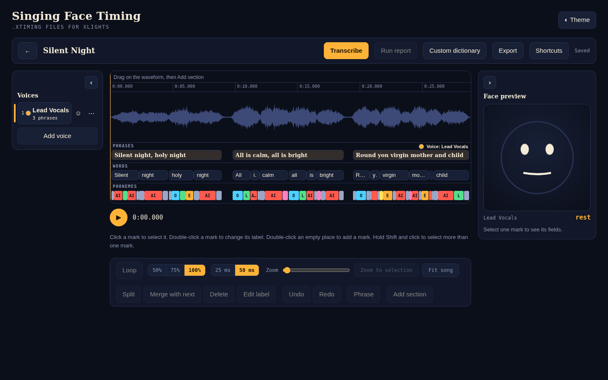

# Singing Face Timing manual

Singing Face Timing finds each sung word of a song and the time of each word. It then gives you an `.xtiming` file that the Faces effect of xLights uses to move the mouth of a face model.

## What you need

- A modern desktop browser. The app needs a window that is 1024 px wide or more.
- An audio file of a song: MP3, WAV, OGG, FLAC, M4A or AAC.
- xLights, for the last step.

## Privacy

The audio stays in your browser. Audio leaves your computer only when you select a remote endpoint in the "Transcribe" window. The app shows the host of the remote endpoint first. The app has no server that receives audio.

## Pages

| Page | What it covers |
|---|---|
| [01 Song library](01-song-library.md) | Add, rename and delete a song. Storage and theme. |
| [02 Transcribe](02-transcribe.md) | Find the words, with lyrics, a range, vocal separation and singers. |
| [03 Edit marks](03-edit-marks.md) | The editor, the mouse, the buttons, the keys and the face preview. |
| [04 Voices and sections](04-voices-and-sections.md) | One voice for each group of face models. Sections. |
| [05 Audio tracks and run report](05-audio-tracks-and-run-report.md) | The separated audio tracks and the report of a run. |
| [06 Export to xLights](06-export-to-xlights.md) | The files, the checks and the steps in xLights. |
| [07 Custom dictionary](07-custom-dictionary.md) | Teach the app a word that it does not know. |
| [08 Troubleshooting](08-troubleshooting.md) | The messages of the app and what to do. |

## Quick start

This is the shortest path from a song to a singing face model. [01 Song library](01-song-library.md) explains each step.

1. Add a song. On the first page, select "Add a song" and select an audio file. To try the app first, select "Try the demo song".
2. In the editor, select "Transcribe". Select "Start". See [02 Transcribe](02-transcribe.md).
3. Wait for the window to close. The editor shows the marks on three layers.
4. Check the marks. Play the song and watch the face preview. Correct each word that is wrong. See [03 Edit marks](03-edit-marks.md).
5. Select "Export". Select "Download". See [06 Export to xLights](06-export-to-xlights.md).
6. In xLights, right-click a timing row heading and select "Import Timing Track".
7. Select the `.xtiming` file.
8. Drop a Faces effect on the face model. Under "Mouth Movements", select "Timing Track" and select the timing track.

## Words that this manual uses

| Word | Meaning |
|---|---|
| song | One audio file with its voices, sections and marks. The app keeps it in your browser. |
| voice | One singer or one vocal part. One voice becomes one timing track. |
| mark | One labelled time interval on a layer. |
| phrase, word, phoneme | The three layers of a voice. |
| timing track | The xLights element that holds the three layers. |
| face model | The xLights model that shows a singing face. |
| audio track | One audio signal of a song: the song audio, the vocals or the instruments. |
| run report | The record of the last transcribe run. |

Some features are marked "experimental". They can give a wrong result. Check the result before you export.
