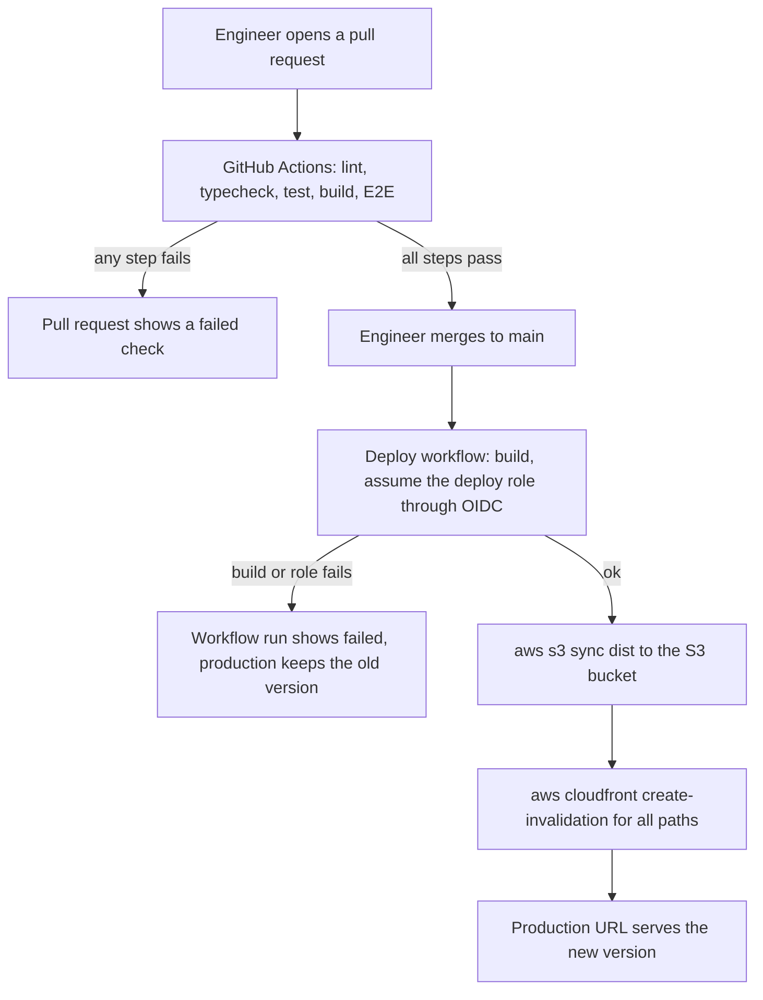

## Purpose

The foundation gives every later epic a repository that installs, tests, builds,
starts and deploys with documented commands. It contains no feature for the person
beyond an app shell.

## User stories

- As an engineer, I want one command for each of install, test, lint, typecheck,
  build and start, so that I can verify a change.
- As an engineer, I want CI to run those commands on each pull request, so that a
  defect does not reach `main`.
- As the person, I want the app at a public URL, so that I do not install anything.

## Functional requirements

- FR-foundation-1 — The repository contains a Vite 8 project with React 19 and
  TypeScript 7 in strict mode.
- FR-foundation-2 — `npm ci` installs all dependencies from `package-lock.json`.
- FR-foundation-3 — `npm run dev` starts the app at `http://localhost:5173`.
- FR-foundation-4 — `npm run build` writes the production files to `dist/`.
- FR-foundation-5 — `npm test` runs the Vitest unit and component tests once.
- FR-foundation-6 — `npm run test:e2e` runs the Playwright tests against the built
  app.
- FR-foundation-7 — `npm run lint` runs ESLint with the complexity rules in
  [Behaviour rules](#behaviour-rules).
- FR-foundation-8 — `npm run typecheck` runs the TypeScript compiler with no output
  files.
- FR-foundation-9 — `npm run format` runs Prettier on all source files.
- FR-foundation-10 — A GitHub Actions workflow runs lint, typecheck, unit tests,
  build and E2E tests on each pull request to `main`.
- FR-foundation-11 — A GitHub Actions workflow deploys each commit on `main` to the
  S3 bucket and invalidates the CloudFront distribution.
- FR-foundation-12 — The CloudFormation template `infra/hosting.yml` declares the
  S3 bucket, the origin access control, the CloudFront distribution, the response
  headers policy and the deploy role.
- FR-foundation-13 — The app shell shows the app name, a theme switch and an empty
  song library.
- FR-foundation-14 — The repository contains the demo audio clip and its expected
  marks in `public/demo/`.
- FR-foundation-15 — The response headers policy sets the security headers in
  [Interfaces](#interfaces) on every response.
- FR-foundation-17 — The S3 bucket blocks all public access.
- FR-foundation-18 — The deploy workflow gets AWS credentials through GitHub OIDC.
- FR-foundation-16 — The repository contains a `LICENSE` file with the MIT licence.

## User flows



1. The engineer opens a pull request to `main`.
2. GitHub Actions runs the five checks.
3. If a check fails, the pull request shows the failed check and the merge stops.
4. The engineer merges the pull request.
5. The deploy workflow builds the commit.
6. The deploy workflow copies `dist/` to the S3 bucket.
7. The deploy workflow invalidates the CloudFront distribution.
8. The engineer reads the result from the workflow run in GitHub Actions.

### Create the hosting, one time

**Warning.** These steps create AWS resources that cost money. The engineer gets
the user's confirmation before step 2.

1. The user names the AWS account and the region.
2. The engineer deploys `infra/hosting.yml` as a CloudFormation stack.
3. The engineer copies the three stack outputs into GitHub Actions repository
   variables.
4. The engineer records the production URL in `docs/external.md`.

## Screens & states

**App shell.** Regions: a header with the app name and the theme switch, and a main
area. States:

- empty: the main area shows "No songs yet" and a disabled "Add a song" button.
- error: if the browser has no IndexedDB, the main area shows "This browser cannot
  store songs. Use a current Chrome, Edge or Firefox."

## Behaviour rules

- The ESLint configuration fails a function with cyclomatic complexity above 10.
- The ESLint configuration fails a block nested deeper than 4 levels.
- The ESLint configuration fails unused variables and unreachable code.
- The source layout is:
  - `src/app/` — shell, routes, theme.
  - `src/features/<feature-id>/` — one folder for each feature set.
  - `src/lib/` — pure modules: `xtiming/`, `dictionary/`, `time/`.
  - `src/store/` — the song store and the history stack.
  - `src/workers/` — Web Workers.
  - `tests/e2e/`, `tests/fixtures/`.
- Unit tests sit beside the source file as `<name>.test.ts`.
- The Node.js version is the current LTS release, pinned in `.nvmrc`.

## Data touched

None. The shell opens the IndexedDB database with version 1 and no object stores.

## Interfaces

**CloudFormation template, `infra/hosting.yml`.** Resources:

- `AWS::S3::Bucket` — private, all public access blocked.
- `AWS::CloudFront::OriginAccessControl` — configured through its
  `OriginAccessControlConfig` property.
- `AWS::S3::BucketPolicy` — allows read from the CloudFront distribution only.
- `AWS::CloudFront::ResponseHeadersPolicy` — `SecurityHeadersConfig` has the
  properties `ContentSecurityPolicy`, `ContentTypeOptions` and `ReferrerPolicy`.
  `ContentSecurityPolicy` takes a `ContentSecurityPolicy` string and an `Override`
  boolean.
- `AWS::CloudFront::Distribution` — default root object `index.html`, HTTPS only.
- `AWS::IAM::Role` — the deploy role. Its trust policy uses the action
  `sts:AssumeRoleWithWebIdentity` with the conditions
  `token.actions.githubusercontent.com:aud` equal to `sts.amazonaws.com` and
  `token.actions.githubusercontent.com:sub` equal to
  `repo:<owner>/<repo>:ref:refs/heads/main`.

Stack outputs: the bucket name, the distribution id, the distribution domain name
and the deploy role ARN. The template takes the GitHub repository as a parameter.
If the AWS account has no GitHub OIDC provider, the template creates one.

Verified against:
https://docs.aws.amazon.com/AWSCloudFormation/latest/TemplateReference/aws-resource-cloudfront-originaccesscontrol.md,
https://docs.aws.amazon.com/AWSCloudFormation/latest/TemplateReference/aws-properties-cloudfront-responseheaderspolicy-securityheadersconfig.md,
https://docs.aws.amazon.com/AWSCloudFormation/latest/TemplateReference/aws-properties-cloudfront-responseheaderspolicy-contentsecuritypolicy.md,
https://docs.aws.amazon.com/IAM/latest/UserGuide/id_roles_create_for-idp_oidc.html
and https://repost.aws/knowledge-center/iam-idp-access-error (retrieved
2026-11-24). The properties of the bucket policy, the distribution and the fields
inside `OriginAccessControlConfig` are not verified in this spec. The engineer
reads the CloudFormation reference for each before the template is written.

**Deploy commands.** Verified against `aws s3 sync help` and
`aws cloudfront create-invalidation help` (aws-cli/2.37.9):

```
aws s3 sync dist/ s3://$SITE_BUCKET --delete
aws cloudfront create-invalidation --distribution-id $CLOUDFRONT_DISTRIBUTION_ID --paths "/*"
```

The deploy role needs permission to list, put and delete objects in the bucket and
to create an invalidation on the distribution. The engineer confirms the exact IAM
action names from the IAM reference before the role is written.

Files with a content hash in the name get a long cache time with the
`--cache-control` option of `aws s3 sync`. `index.html` gets no cache.

Headers that the response headers policy sets on every response:

| Header | Value |
|---|---|
| `Content-Security-Policy` | `default-src 'self'; script-src 'self' 'wasm-unsafe-eval'; connect-src 'self' https://huggingface.co https://*.huggingface.co https://*.hf.co; img-src 'self' data: blob:; media-src 'self' blob:; worker-src 'self' blob:; style-src 'self' 'unsafe-inline'` |
| `X-Content-Type-Options` | `nosniff` |
| `Referrer-Policy` | `no-referrer` |

Epic 2 changes the `connect-src` list if the speech model files come from other
hosts.

**Deploy status.** The deploy runs in GitHub Actions, so the workflow run is the
deploy status. The repository needs no separate status script.

**Routes.** The app uses hash routes, so the distribution needs no rewrite rule and
no custom error response.

## Edge cases & failures

- If a repository variable is missing, the deploy workflow fails at its first step
  with a message that names the variable.
- If `aws s3 sync` fails, the workflow does not create an invalidation. Production
  keeps the old version.
- If the invalidation fails, the workflow run fails. The engineer runs the
  workflow again.
- A request to the S3 bucket URL, not through CloudFront, gets an access-denied
  response.
- If the E2E tests cannot start a browser in CI, the workflow fails. It does not
  skip the tests.

## Acceptance criteria

- A fresh clone runs `npm ci`, `npm run lint`, `npm run typecheck`, `npm test`,
  `npm run build` and `npm run test:e2e` with exit code 0. (FR-foundation-1 to 9)
- A pull request with a failing unit test shows a failed check. (FR-foundation-10)
- A commit on `main` appears at the production URL after its workflow run
  succeeds. (FR-foundation-11)
- A stack from `infra/hosting.yml` in a clean AWS account reaches the state
  `CREATE_COMPLETE`. (FR-foundation-12)
- The production URL shows the app name, the theme switch and "No songs yet".
  (FR-foundation-13)
- The theme switch changes the page between the light theme and the dark theme.
  (FR-foundation-13)
- `public/demo/` contains one audio file shorter than 30 seconds and one JSON file
  of marks. (FR-foundation-14)
- A response from the production URL carries the three headers in the table.
  (FR-foundation-15)
- The repository root contains `LICENSE`. (FR-foundation-16)
- A direct request to an object URL of the S3 bucket returns HTTP 403.
  (FR-foundation-17)
- The repository and its settings contain no AWS access key. (FR-foundation-18)

## Out of scope

- A custom domain.
- A staging environment.
- Pull-request preview deploys.

## Open questions

- Which AWS account and region hold the hosting stack? The user answers in Epic 0.
