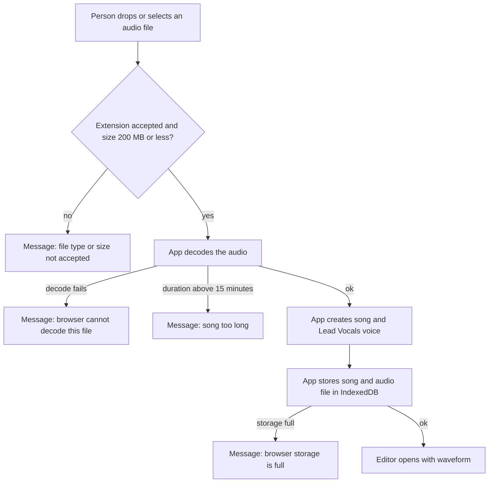
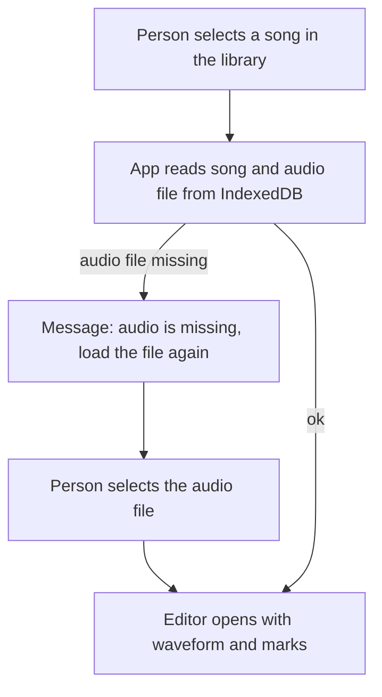

## Purpose

The person gives the app an audio file. The app makes a song from it, shows the
waveform, plays the audio and keeps the song in the browser for later visits.

## User stories

- As the person, I want to drop an audio file on the page, so that I start a song
  with one action.
- As the person, I want my songs to be there when I come back, so that I do not
  repeat work.
- As the person, I want to try the app with a demo song, so that I can judge it
  before I load my own file.

## Functional requirements

- FR-audio-1 — The song library lists every saved song with its name, its duration
  and the date of the last change.
- FR-audio-2 — The song library accepts an audio file through a file dialog.
- FR-audio-3 — The song library accepts an audio file through drag and drop.
- FR-audio-4 — The app accepts files with the extensions `.mp3`, `.wav`, `.ogg`,
  `.flac`, `.m4a` and `.aac`.
- FR-audio-5 — The app rejects a file larger than 200 MB.
- FR-audio-6 — The app rejects a file with a duration above 15 minutes.
- FR-audio-7 — The app decodes the audio file in the browser.
- FR-audio-8 — The app creates a song with the file name, without the extension, as
  the song name.
- FR-audio-9 — The app creates one voice named "Lead Vocals" in each new song.
- FR-audio-10 — The app stores the song and the original audio file in IndexedDB.
- FR-audio-11 — The app opens the editor for the new song after the decode ends.
- FR-audio-12 — The editor shows the waveform of the full song.
- FR-audio-13 — The editor plays and pauses the audio.
- FR-audio-14 — The editor shows the current play time as `m:ss.mmm`.
- FR-audio-15 — The person renames a song in the song library.
- FR-audio-16 — The person deletes a song in the song library after a confirm
  dialog.
- FR-audio-17 — The "Try the demo song" button creates a song from the demo clip
  with its marks.
- FR-audio-18 — The app requests persistent storage from the browser when the
  person creates the first song.
- FR-audio-19 — The app saves the open song 1 second after the last change.
- FR-audio-20 — The song library shows the storage that the app uses and the
  storage that the browser allows.
- FR-audio-21 — The song library states the purpose of the app above the drop
  zone.
- FR-audio-22 — The song library credits the speech model, the vocal separation
  models, the singer models and the dictionary, with their licences.
- FR-audio-23 — The app starts a save of the open song 2 seconds after the first
  change that is not saved, also while changes continue.
- FR-audio-24 — While a change is not saved, the browser asks the person to
  confirm a reload or a close of the page.
- FR-audio-25 — The app starts a save of the open song when the page becomes
  hidden or unloads.
- FR-audio-26 — The link back to the song library opens the library after the
  save of the open song ends. If the save does not end in 3 seconds, the editor
  stays open and shows "The app could not save the song. Try again."
- FR-audio-27 — If a different tab saves the open song, the editor shows a notice
  until the person closes it.
- FR-audio-28 — A save that does not end in 10 seconds counts as failed. The next
  change starts a new save.

## User flows

### Create a song



1. The person drops an audio file on the song library, or selects "Add a song".
2. The app checks the extension and the size.
3. The app decodes the audio and reads the duration.
4. The app creates the song and one voice.
5. The app stores the song and the audio file.
6. The app opens the editor.

### Open a saved song



1. The person selects a song.
2. The app reads the song and its audio file.
3. If the audio file is missing, the app asks for the file again and keeps the
   marks.
4. The app opens the editor.

## Screens & states

**Song library** — mockup: [mockups/01-song-library.html](../mockups/01-song-library.html).
Regions: header, purpose text, drop zone, song list, storage meter, "How it works"
strip.

- Purpose text, above the drop zone in each state: "Make the face models of your
  xLights show sing. Add a song, and the app finds each word and its mouth shapes,
  then gives you a timing file for the Faces effect."
- empty: the drop zone fills the main area. The "Try the demo song" button shows.
- loading: the drop zone shows "Decoding <file name>" with a progress bar.
- populated: the drop zone is a compact band above the song list. The band keeps
  "Try the demo song" and the file limits. The song name has the style of a link.
  A long song name ends with an ellipsis, and its tooltip shows the full name.
- rename: under the name field, the hint "A song name has 1 to 80 characters."
  shows for an empty name and for a name of 80 characters.
- delete confirm: "Delete “<song name>”?", then "The app deletes its audio file,
  voices, sections and marks. You cannot undo this."
- credits, in the "How it works" strip. Each link opens in a new tab.
  - "The transcribe step uses the Whisper speech model of OpenAI (MIT), in the ONNX
    files of onnx-community."
  - "The vocal separation option uses the 2-stem model of Spleeter by Deezer and
    the htdemucs model of Demucs by Meta. The code of each project has the MIT
    licence. The licence notes state the facts about the weights."
  - The CMU Pronouncing Dictionary and the singer models, as before.
  - "The singer split option uses the BS-RoFormer male and female vocals model by
    aufr33, from the model list of python-audio-separator, and the Mel-Band
    RoFormer karaoke model by becruily. The authors state no licence. This project
    converted each model from PyTorch to ONNX with float16 weights. The STFT is
    outside the model. The project did not train the models. The model notice
    gives the source and the SHA-256 of each file." The link "model notice" opens
    `models/NOTICE.txt` (issue #194).
- error: a message band above the drop zone shows the failure text.
- drag-over: the drop zone has a bright border and the text "Drop to add".

**Editor, waveform region.** States for this feature only:

- loading: a skeleton waveform with "Drawing waveform".
- populated: the waveform, a play button, the play time, the song name.
- error: "The audio for this song is missing. Load the file again." with a file
  button.

## Behaviour rules

- The song list sorts by the date of the last change, newest first.
- A song name is 1 to 80 characters. The app trims spaces at both ends.
- Two songs can have the same name.
- The app decides the file type from the extension first. The app accepts a file
  with an accepted extension only if the browser reports one of these MIME types:
  - a type that starts with `audio/`
  - `video/ogg`
  - `application/ogg`
  - an empty type

  The app rejects a file with a different MIME type.
- The app keeps stereo audio for play. The waveform shows one mixed channel.
- The space bar toggles play when no text field has focus.
- The app does not start play automatically.
- Deleting a song deletes its audio file, voices, sections and marks.
- The demo song is a normal song. The person can edit and delete it.
- 200 MB means 200 × 1024 × 1024 bytes.
- A save writes the full song. It deletes each stored voice, section and mark that
  the open song does not have, also a record that a different tab added. So the
  tab that saves last keeps its version, and the stored marks keep the mark rules.
- A save reads the stored keys of the song before it deletes. A save that starts
  when the page becomes hidden or unloads skips the read only when the tab knows
  the stored keys of the song. Then the save can complete after the page unloads.
- After a save of a song in a different tab, the tab no longer knows the stored
  keys of that song. A browser with no `BroadcastChannel` shows no notice.
- If a save of a song fails and the person then opens a different song, the
  change that is not saved goes away, and the editor keeps the message of the
  failure.

## Data touched

- Writes `SONG`, `AUDIO_FILE` and `VOICE`.
- Creates the IndexedDB object stores `songs`, `audioFiles`, `voices`, `sections`,
  `marks`, `customEntries` and `settings` in database version 2.
- Reads `APP_SETTINGS.defaultFrameMs` for the `frameMs` of a new song.

## Interfaces

**BroadcastChannel.** `new BroadcastChannel(name)` connects the browsing
contexts of one origin. `postMessage(message)` sends the message to each other
channel object with the same name, not to the sender. The `message` event gives
the message in `data`. `close()` stops the messages. Baseline since March 2022.
The app uses the name `singing-face-timing` and sends `{ songId }`.
Verified against: https://developer.mozilla.org/en-US/docs/Web/API/BroadcastChannel
(last modified 2024-06-03, retrieved 2026-11-25).

**IDBTransaction.commit().** It commits an active transaction and does not wait
for the events of its requests. Older browsers, for example Safari before 15, do
not have it, so the app calls it only when it exists.
Verified against: https://developer.mozilla.org/en-US/docs/Web/API/IDBTransaction/commit
(last modified 2024-07-19, retrieved 2026-11-25).

**Web Audio.** `BaseAudioContext.decodeAudioData(arrayBuffer)` returns a Promise
that fulfils with an `AudioBuffer`. The decoded audio has the sample rate of the
`AudioContext`. The page does not list the supported formats, so the app treats a
rejected Promise as "this browser cannot decode this file".
Verified against:
https://developer.mozilla.org/en-US/docs/Web/API/BaseAudioContext/decodeAudioData
(retrieved 2026-11-24).

**wavesurfer.js 8.1.1.** The app decodes the stored audio file one time with
`decodeAudioData` and mixes the channels into one channel of peaks.
`WaveSurfer.create({ container, height, waveColor, progressColor, cursorColor })`
creates the waveform without audio. `loadBlob(blob, peaks, duration)` then loads the
stored bytes. With the peaks and the duration, wavesurfer.js does not decode the
blob, and play uses all channels of the file. The app uses `play()`, `pause()`,
`isPlaying()`, `setOptions()` and `destroy()`. The app listens to the events
`timeupdate` (time in seconds), `play`, `pause` and `finish`. The docs state that
large clips can fail to decode because of memory limits. The limits in FR-audio-5
and FR-audio-6 reduce that risk. The names for zoom and scroll are not verified in
this spec. The engineer reads the wavesurfer.js API reference before use.
Verified against: https://wavesurfer.xyz/docs/ (retrieved 2026-11-24) and
`node_modules/wavesurfer.js/dist/wavesurfer.d.ts` (8.1.1).

**Module contract, `src/features/audio-import/`:**

```ts
type ImportFailure =
  | { kind: 'type' } | { kind: 'size'; bytes: number }
  | { kind: 'decode' } | { kind: 'duration'; ms: number }
  | { kind: 'storage' }

// `message` is the text that the person sees.
class ImportError extends Error { readonly failure: ImportFailure }

// Returns the duration in seconds. Rejects if the browser cannot decode the bytes.
type DecodeAudio = (bytes: ArrayBuffer) => Promise<number>

// Returns the duration in milliseconds. Rejects with ImportError.
checkAudioFile(file: File, decode?: DecodeAudio): Promise<number>

// Rejects with ImportError.
createSongFromFile(file: File, decode?: DecodeAudio): Promise<Song>

type NewSong = {
  name: string
  durationMs: number
  audio: { data: Blob; fileName: string; mimeType: string }
  voices?: Omit<Voice, 'songId'>[]
  marks?: Mark[]
}

// Rejects with StorageFullError.
storeNewSong(newSong: NewSong): Promise<Song>

// `message` is the text that the person sees.
class DemoSongError extends Error {}

// Rejects with DemoSongError or StorageFullError.
createDemoSong(): Promise<Song>
```

## Edge cases & failures

| Case | What the person sees |
|---|---|
| Extension not accepted | "This file type is not supported. Use MP3, WAV, OGG, FLAC, M4A or AAC." |
| File above 200 MB | "This file is larger than 200 MB." |
| Browser cannot decode | "This browser cannot decode this file. Convert it to MP3 or WAV and try again." |
| Duration above 15 minutes | "This song is longer than 15 minutes." |
| Storage full | "Browser storage is full. Delete a song and try again." |
| The demo song files do not load | "The demo song did not load. Check the connection and retry." |
| The app cannot read the audio from browser storage | "The app could not read the audio from browser storage. Reload the page." |
| Persistent storage refused | A note beside the storage meter: "The browser can remove songs when disk space is low. Export your work." |
| Several files dropped | The app takes the first audio file and shows "Only one file was added." The editor shows the note again as a toast after it opens. |
| Reload during decode | The song does not exist. The library shows no partial song. |
| Reload or close while a change is not saved | The browser asks the person to confirm. The browser shows its own text. |
| The page unloads before a save ends | The browser can stop the save. The song keeps the last save that ended. |
| A different tab saves the open song | "This song is open in a different tab. The tab that saves last keeps its version. Close one of the tabs." The notice has a "Close" button. |
| A save does not end in its time limit | "The app could not save the song. Try again." |

## Acceptance criteria

- The library shows name, duration and change date for each saved song. (FR-audio-1)
- A file from the dialog and a dropped file each create one song. (FR-audio-2, 3)
- A `.txt` file shows the file-type message and creates no song. (FR-audio-4)
- A 201 MB file shows the size message and creates no song. (FR-audio-5)
- A 16-minute file shows the duration message and creates no song. (FR-audio-6)
- A new song from `carol.mp3` has the name `carol` and one voice named
  "Lead Vocals". (FR-audio-8, 9)
- After a reload, the library lists the song and the editor plays its audio.
  (FR-audio-10)
- The editor opens without a click after the decode ends. (FR-audio-11)
- The waveform spans the full width at the default zoom. (FR-audio-12)
- The space bar starts play, and a second press pauses play. (FR-audio-13)
- The play time shows `0:01.500` at 1.5 seconds. (FR-audio-14)
- A renamed song shows the new name after a reload. (FR-audio-15)
- A deleted song is absent after a reload, and the storage meter goes down.
  (FR-audio-16)
- The demo button creates a song that has words and phonemes. (FR-audio-17)
- The first song triggers one persistent-storage request. (FR-audio-18)
- An edit followed by a reload 2 seconds later keeps the edit. (FR-audio-19)
- The storage meter shows used and allowed space in MB. (FR-audio-20)
- The first page states the purpose of the app above the drop zone. (FR-audio-21)
- With one song or more, the demo song and the limits are visible, and the song
  name has the style of a link. (FR-audio-17)
- A song name of 80 characters with no space stays inside its row at 1440 px and
  at 1024 px. (FR-audio-1)
- The rename field shows the hint for an empty name and for a name at the limit.
  (FR-audio-15)
- The delete dialog states that the delete is permanent. (FR-audio-16)
- Two dropped files show the note after the editor opens. (FR-audio-3)
- The credits name the speech model and the vocal separation models. (FR-audio-22)
- With a change each 200 ms for 10 seconds, the app saves the song 4 times or
  more. (FR-audio-23)
- 10 edits with 100 ms between them, then a reload 300 ms after the last edit:
  the edits are there after the reload, or the browser asked first. (FR-audio-23,
  24, 25)
- A reload with nothing to save shows no question. (FR-audio-24)
- The song library lists the saved song name after the back link. (FR-audio-26)
- With a save that does not end, the back link shows the save message after 3
  seconds, and the editor stays open. (FR-audio-26)
- Two tabs hold the same song. Tab B replaces a word and saves. Tab A moves a
  different word and saves. The stored marks are the marks of tab A. (FR-audio-27)
- Tab A shows the notice after tab B saves the song that is open in tab A.
  (FR-audio-27)
- After a save that does not end in 10 seconds, the next change saves the song.
  (FR-audio-28)

## Out of scope

- Recording from a microphone.
- Loading audio from a URL.
- Replacing the audio file of a song that still has its audio.
- Export and import of a whole song as a backup file.

## Open questions

None.
