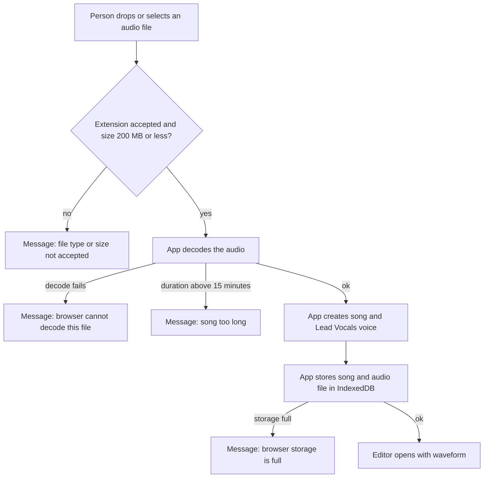
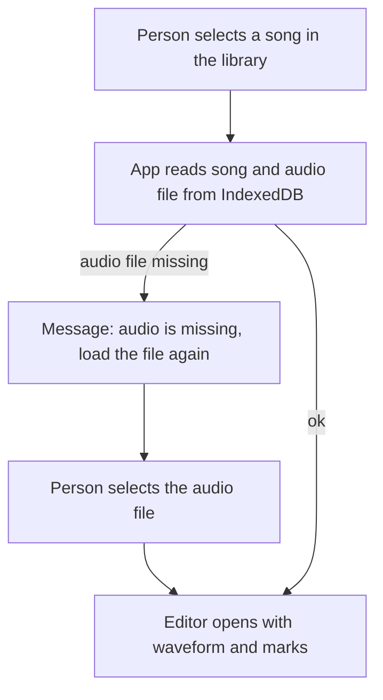

## Purpose

The person gives the app an audio file. The app makes a song from it, shows the
waveform, plays the audio and keeps the song in the browser for later visits.

## User stories

- As the person, I want to drop an audio file on the page, so that I start a song
  with one action.
- As the person, I want my songs to be there when I come back, so that I do not
  repeat work.
- As the person, I want to try the app with a demo song, so that I can judge it
  before I load my own file.

## Functional requirements

- FR-audio-1 — The song library lists every saved song with its name, its duration
  and the date of the last change.
- FR-audio-2 — The song library accepts an audio file through a file dialog.
- FR-audio-3 — The song library accepts an audio file through drag and drop.
- FR-audio-4 — The app accepts files with the extensions `.mp3`, `.wav`, `.ogg`,
  `.flac`, `.m4a` and `.aac`.
- FR-audio-5 — The app rejects a file larger than 200 MB.
- FR-audio-6 — The app rejects a file with a duration above 15 minutes.
- FR-audio-7 — The app decodes the audio file in the browser.
- FR-audio-8 — The app creates a song with the file name, without the extension, as
  the song name.
- FR-audio-9 — The app creates one voice named "Lead Vocals" in each new song.
- FR-audio-10 — The app stores the song and the original audio file in IndexedDB.
- FR-audio-11 — The app opens the editor for the new song after the decode ends.
- FR-audio-12 — The editor shows the waveform of the full song.
- FR-audio-13 — The editor plays and pauses the audio.
- FR-audio-14 — The editor shows the current play time as `m:ss.mmm`.
- FR-audio-15 — The person renames a song in the song library.
- FR-audio-16 — The person deletes a song in the song library after a confirm
  dialog.
- FR-audio-17 — The "Try the demo song" button creates a song from the demo clip
  with its marks.
- FR-audio-18 — The app requests persistent storage from the browser when the
  person creates the first song.
- FR-audio-19 — The app saves the open song 1 second after the last change.
- FR-audio-20 — The song library shows the storage that the app uses and the
  storage that the browser allows.

## User flows

### Create a song



1. The person drops an audio file on the song library, or selects "Add a song".
2. The app checks the extension and the size.
3. The app decodes the audio and reads the duration.
4. The app creates the song and one voice.
5. The app stores the song and the audio file.
6. The app opens the editor.

### Open a saved song



1. The person selects a song.
2. The app reads the song and its audio file.
3. If the audio file is missing, the app asks for the file again and keeps the
   marks.
4. The app opens the editor.

## Screens & states

**Song library** — mockup: [mockups/01-song-library.html](../mockups/01-song-library.html).
Regions: header, drop zone, song list, storage meter, "How it works" strip.

- empty: the drop zone fills the main area. The "Try the demo song" button shows.
- loading: the drop zone shows "Decoding <file name>" with a progress bar.
- populated: the drop zone is a compact band above the song list.
- error: a message band above the drop zone shows the failure text.
- drag-over: the drop zone has a bright border and the text "Drop to add".

**Editor, waveform region.** States for this feature only:

- loading: a skeleton waveform with "Drawing waveform".
- populated: the waveform, a play button, the play time, the song name.
- error: "The audio for this song is missing. Load the file again." with a file
  button.

## Behaviour rules

- The song list sorts by the date of the last change, newest first.
- A song name is 1 to 80 characters. The app trims spaces at both ends.
- Two songs can have the same name.
- The app decides the file type from the extension first. If the browser reports a
  MIME type that does not start with `audio/`, the app rejects the file.
- The app keeps stereo audio for play. The waveform shows one mixed channel.
- The space bar toggles play when no text field has focus.
- The app does not start play automatically.
- Deleting a song deletes its audio file, voices, sections and marks.
- The demo song is a normal song. The person can edit and delete it.

## Data touched

- Writes `SONG`, `AUDIO_FILE` and `VOICE`.
- Creates the IndexedDB object stores `songs`, `audioFiles`, `voices`, `sections`,
  `marks`, `customEntries` and `settings` in database version 2.
- Reads `APP_SETTINGS.defaultFrameMs` for the `frameMs` of a new song.

## Interfaces

**Web Audio.** `BaseAudioContext.decodeAudioData(arrayBuffer)` returns a Promise
that fulfils with an `AudioBuffer`. The decoded audio has the sample rate of the
`AudioContext`. The page does not list the supported formats, so the app treats a
rejected Promise as "this browser cannot decode this file".
Verified against:
https://developer.mozilla.org/en-US/docs/Web/API/BaseAudioContext/decodeAudioData
(retrieved 2026-11-24).

**wavesurfer.js 8.1.1.** `WaveSurfer.create({ container, waveColor, progressColor,
url })` creates the waveform. The docs state that large clips can fail to decode
because of memory limits. The limits in FR-audio-5 and FR-audio-6 reduce that risk.
The engineer reads the wavesurfer.js API reference for the zoom, scroll and time
events before use. Those names are not verified in this spec.
Verified against: https://wavesurfer.xyz/docs/ (retrieved 2026-11-24).

**Module contract, `src/features/audio-import/`:**

```ts
createSongFromFile(file: File): Promise<Song>   // rejects with ImportError
type ImportError =
  | { kind: 'type' } | { kind: 'size'; bytes: number }
  | { kind: 'decode' } | { kind: 'duration'; ms: number }
  | { kind: 'storage' }
```

## Edge cases & failures

| Case | What the person sees |
|---|---|
| Extension not accepted | "This file type is not supported. Use MP3, WAV, OGG, FLAC, M4A or AAC." |
| File above 200 MB | "This file is larger than 200 MB." |
| Browser cannot decode | "This browser cannot decode this file. Convert it to MP3 or WAV and try again." |
| Duration above 15 minutes | "This song is longer than 15 minutes." |
| Storage full | "Browser storage is full. Delete a song and try again." |
| Persistent storage refused | A note beside the storage meter: "The browser can remove songs when disk space is low. Export your work." |
| Several files dropped | The app takes the first audio file and shows "Only one file was added." |
| Reload during decode | The song does not exist. The library shows no partial song. |

## Acceptance criteria

- The library shows name, duration and change date for each saved song. (FR-audio-1)
- A file from the dialog and a dropped file each create one song. (FR-audio-2, 3)
- A `.txt` file shows the file-type message and creates no song. (FR-audio-4)
- A 201 MB file shows the size message and creates no song. (FR-audio-5)
- A 16-minute file shows the duration message and creates no song. (FR-audio-6)
- A new song from `carol.mp3` has the name `carol` and one voice named
  "Lead Vocals". (FR-audio-8, 9)
- After a reload, the library lists the song and the editor plays its audio.
  (FR-audio-10)
- The editor opens without a click after the decode ends. (FR-audio-11)
- The waveform spans the full width at the default zoom. (FR-audio-12)
- The space bar starts play, and a second press pauses play. (FR-audio-13)
- The play time shows `0:01.500` at 1.5 seconds. (FR-audio-14)
- A renamed song shows the new name after a reload. (FR-audio-15)
- A deleted song is absent after a reload, and the storage meter goes down.
  (FR-audio-16)
- The demo button creates a song that has words and phonemes. (FR-audio-17)
- The first song triggers one persistent-storage request. (FR-audio-18)
- An edit followed by a reload 2 seconds later keeps the edit. (FR-audio-19)
- The storage meter shows used and allowed space in MB. (FR-audio-20)

## Out of scope

- Recording from a microphone.
- Loading audio from a URL.
- Replacing the audio file of a song that still has its audio.
- Export and import of a whole song as a backup file.

## Open questions

None.
