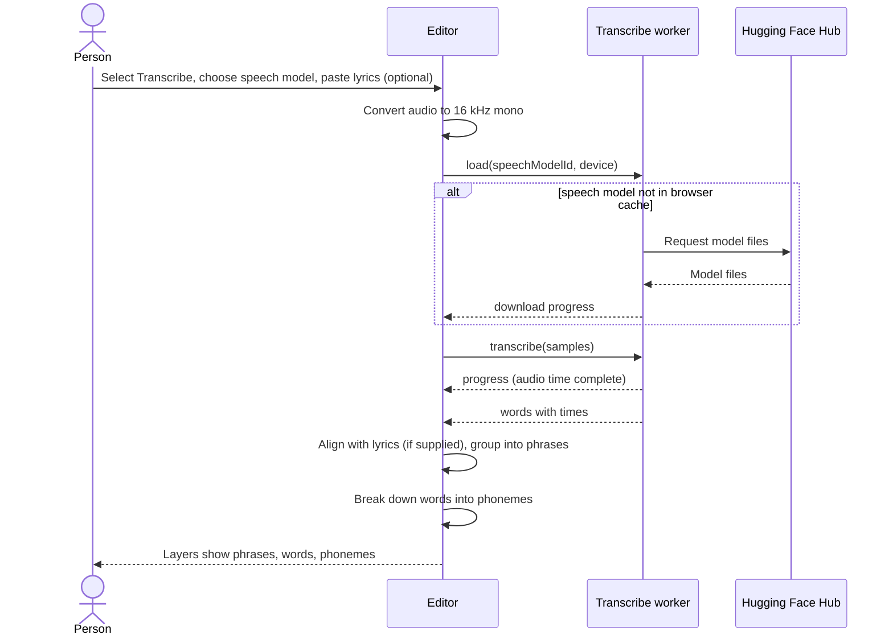
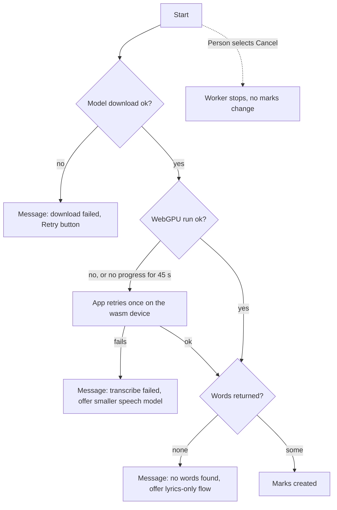
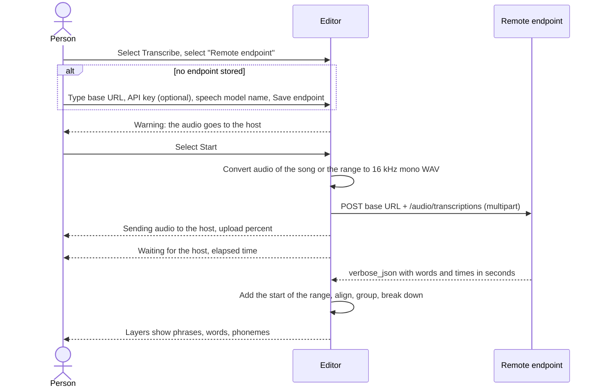

## Purpose

The app runs a speech model in the browser and finds each sung word with its start
time and its end time. The app groups the words into phrases. If the person has the
lyrics, the app uses them to correct the words.

The person can select a remote endpoint in place of the speech model in the
browser. A remote endpoint is a server that is compatible with the OpenAI
transcription API, for example a self-hosted server of the person. The audio then
leaves the browser, and the app shows the host before each run.

## User stories

- As the person, I want the app to find the words and their times, so that I do not
  place each word by ear.
- As the person, I want to paste the correct lyrics, so that wrong words from the
  speech model do not reach my show.
- As the person, I want to see progress, so that I know the app is working.
- As the person, I want to transcribe one section again, so that I can fix a bad
  part without losing the good parts.
- As the person, I want to send the audio to my own Whisper server, so that a run
  is fast on a computer with no fast graphics card.

## Functional requirements

- FR-transcribe-1 — The editor has a "Transcribe" action for the selected voice.
- FR-transcribe-2 — The transcribe dialog offers three speech models: tiny, base
  and small.
- FR-transcribe-3 — The transcribe dialog shows the download size of each speech
  model.
- FR-transcribe-4 — The transcribe dialog has an optional lyrics text field.
- FR-transcribe-5 — The app runs the speech model in a Web Worker.
- FR-transcribe-6 — The app selects the device from the measured speed of earlier
  runs. With no measured speed, the first run uses the `wasm` device. When the
  browser supports WebGPU, the next run uses the `webgpu` device one time. After
  that, the app uses the faster device. After a `webgpu` run that fails or is too
  slow, the app does not select `webgpu` for 7 days.
- FR-transcribe-7 — The app uses the `wasm` device when the browser does not
  support WebGPU. The `wasm` device uses 2 threads when the page is cross-origin
  isolated.
- FR-transcribe-8 — The app shows download progress for the speech model as a
  percentage.
- FR-transcribe-9 — The app shows transcribe progress as the audio time that is
  complete.
- FR-transcribe-10 — The person cancels a transcribe run with one button.
- FR-transcribe-11 — The app converts the audio to one channel at 16 kHz before it
  sends the audio to the worker.
- FR-transcribe-12 — The app creates one word on the word layer for each word that
  the speech model returns.
- FR-transcribe-13 — The app groups words into phrases with the rules in
  [Behaviour rules](#behaviour-rules).
- FR-transcribe-14 — If the person supplies lyrics, the app aligns the transcribed
  words with the lyrics.
- FR-transcribe-15 — If the person supplies lyrics, each line of the lyrics becomes
  one phrase.
- FR-transcribe-16 — The app marks each word whose time is an estimate as
  "estimated".
- FR-transcribe-17 — The app breaks down every new word into phonemes after the
  transcribe run ends.
- FR-transcribe-18 — The app asks for confirmation before a transcribe run replaces
  marks that exist.
- FR-transcribe-19 — The person transcribes a time selection only.
- FR-transcribe-20 — The browser keeps the speech model files, so a second run
  starts without a download.
- FR-transcribe-21 — The person creates phrases from lyrics without a speech model.
- FR-transcribe-22 — One transcribe run is one undo step.
- FR-transcribe-23 — The transcribe dialog offers the choice "Where to transcribe":
  "In this browser" or "Remote endpoint".
- FR-transcribe-24 — "In this browser" is the default choice.
- FR-transcribe-25 — The app remembers the last "Where to transcribe" choice.
- FR-transcribe-26 — The person types the base URL, an optional API key and the
  speech model name of the remote endpoint.
- FR-transcribe-27 — The API key field hides its text.
- FR-transcribe-28 — "Test connection" sends one second of silence to the remote
  endpoint and shows the result.
- FR-transcribe-29 — The dialog shows the warning with the host before each remote
  run.
- FR-transcribe-30 — A remote run sends one WAV file to
  `<base URL>/audio/transcriptions`.
- FR-transcribe-31 — A range run with a remote endpoint sends only the audio of the
  range.
- FR-transcribe-32 — The app sends the API key only in the `Authorization` header
  of a request to the base URL.
- FR-transcribe-33 — The app converts the words of a remote endpoint to the same
  word list as a run in the browser.
- FR-transcribe-34 — "Cancel" stops the request of a remote run.
- FR-transcribe-35 — The dialog disables "Start" when the browser blocks the call to
  the remote endpoint as mixed content.
- FR-transcribe-36 — The transcribe dialog has the check box "Separate the vocals
  first". It is off by default.
- FR-transcribe-37 — The app remembers the last choice of "Separate the vocals
  first".
- FR-transcribe-38 — The dialog hides "Separate the vocals first" for "Lyrics only".
- FR-transcribe-39 — With the option on, the vocal separation runs before the speech
  model or the remote endpoint reads the audio.
- FR-transcribe-40 — The vocal separation runs in a Web Worker in the browser. It
  sends no audio out of the browser.
- FR-transcribe-41 — With the option off, the app loads no file of the vocal
  separation.
- FR-transcribe-42 — A range run separates only the audio of the range.
- FR-transcribe-43 — A remote run with the option on sends the vocals as its WAV
  file.
- FR-transcribe-44 — The dialog shows the download progress of the vocal separation
  model and the progress of the vocal separation.
- FR-transcribe-45 — "Cancel" stops the vocal separation.
- FR-transcribe-46 — After a failed vocal separation, the person continues the run
  with no separation, or cancels it.
- FR-transcribe-47 — The transcribe dialog has the check box "Put each singer on its
  own voice (experimental)". It is off by default.
- FR-transcribe-48 — The app remembers the last choice of "Put each singer on its own
  voice".
- FR-transcribe-49 — The dialog disables "Put each singer on its own voice" while
  "Separate the vocals first" is off.
- FR-transcribe-50 — The dialog hides "Put each singer on its own voice" for "Lyrics
  only".
- FR-transcribe-51 — With the option on, the singer step runs after the run writes
  its marks. It reads the separated vocals of the run at 16 kHz.
- FR-transcribe-52 — The singer step runs in a Web Worker in the browser. It sends no
  audio out of the browser.
- FR-transcribe-53 — With the option off, the app loads no file of the singer step.
- FR-transcribe-54 — The dialog shows the download progress of the singer model and
  the progress of the singer step.
- FR-transcribe-55 — "Cancel" during the singer step stops the step and keeps the
  marks of the run.
- FR-transcribe-56 — After a failed singer step, the marks of the run stay on the
  voice of the run, and the toast states the failure.

## User flows

### Transcribe a song



1. The person selects "Transcribe".
2. The person selects a speech model.
3. The person pastes lyrics, or leaves the field empty.
4. The person selects "Start".
5. If one mark or more overlaps the target range, the app asks for confirmation.
6. The app downloads the speech model if the browser does not have it.
7. The app transcribes the audio and shows progress.
8. The app aligns, groups and breaks down the words.
9. The app closes the dialog and shows the layers.

### Failure branches



### Transcribe with a remote endpoint



1. The person selects "Transcribe".
2. The person selects "Remote endpoint".
3. If no endpoint is stored, the person types the base URL, the API key and the
   speech model name, and selects "Save endpoint".
4. The person reads the warning with the host.
5. The person selects "Start".
6. If one mark or more overlaps the target range, the app asks for confirmation.
7. The app converts the audio of the song or the range to a WAV file.
8. The app sends the file to the remote endpoint and shows the upload, then the
   wait.
9. The app aligns, groups and breaks down the words, as for a run in the browser.
10. The app closes the dialog and shows the layers.

### Transcribe with vocal separation

1. The person selects "Separate the vocals first" in the transcribe dialog.
2. The person selects "Start".
3. The app decodes the audio of the song or the range as two channels at 44.1 kHz.
4. The separate worker downloads the vocal separation model if the browser does not
   have it.
5. The separate worker removes the instruments and returns the vocals as one
   channel.
6. The app converts the vocals to 16 kHz.
7. The speech model or the remote endpoint reads the vocals, as for a run with no
   separation.
8. If the vocal separation fails, the dialog shows the message with "Continue with
   no separation" and "Cancel". "Continue with no separation" goes on with the audio
   of the song.

### Put each singer on its own voice

1. The person selects "Separate the vocals first".
2. The person selects "Put each singer on its own voice (experimental)".
3. The person selects "Start".
4. The run separates the vocals, finds the words and writes the marks, as for a run
   with vocal separation.
5. The singers worker downloads the singer model if the browser does not have it.
6. The singers worker finds the time ranges of each singer in the separated vocals.
7. The app gives each phrase of the run to its singers, and puts each singer on its
   own voice. See the singer rules in
   [05-voices-sections.md](05-voices-sections.md#behaviour-rules).
8. The app closes the dialog. The toast names the count of voices, for example "214
   words on 3 voices, 9 estimated".

### Create phrases from lyrics without a speech model

1. The person selects "Lyrics only" in the transcribe dialog.
2. The person pastes the lyrics.
3. The app makes one phrase for each line.
4. The app spreads the phrases evenly across the target range.
5. The app spreads the words of each phrase evenly across the phrase.
6. The app marks every word as "estimated".

## Screens & states

**Transcribe dialog.** Regions: "Where to transcribe" choice, speech model selector
or endpoint panel, device note, lyrics field,
range selector (full song or the time selection), progress area, buttons.

- idle: selectors enabled, "Start" enabled.
- preparing: "Preparing audio, 0:02 elapsed" with a bar that has no end. The app
  decodes the audio and converts it to 16 kHz mono. "Cancel" enabled.
- loading: "Loading speech model, 0:05 elapsed" with a bar that has no end. The
  worker loads a speech model from the browser cache. "Cancel" enabled.
- downloading: "Downloading speech model, 42%" with a bar. "Cancel" enabled.
- started: "Transcribing, 0:12 elapsed" with a bar that has no end, until the first
  progress of the run. "Cancel" enabled.
- transcribing: "Transcribing, 1:12 of 3:40" with a bar. "Cancel" enabled. The
  audio time changes at the end of each sung segment, a few seconds apart, and not
  only at the end of each 30-second chunk.
- finishing: "Aligning lyrics and breaking down words".
- confirm: "The run replaces the marks of this voice." with "Continue" and "Cancel".
- error: the message, with "Retry" and "Close".
- done: the dialog closes. A toast shows "214 words, 9 estimated".

The device note reads "Uses your graphics card (WebGPU)" or "WebGPU is not
available. Transcription is slower on this browser."

- The elapsed time counts from the "Start" click and changes each second. The
  progress text of the preparing, loading and started states shows it.
- The live region announces the name of each state one time, for example
  "Transcribing". It does not announce the elapsed time or the audio time.
- During a speech model run, the device line replaces the device note. It reads
  "Graphics card (WebGPU)" or "CPU".
- After the first chunk, the device line adds the speed: the seconds of audio for
  each second of the run, rounded. For example "CPU, about 2 times faster than the
  song", "CPU, about 3 times slower than the song" or "CPU, about as fast as the
  song".
- If the app moves a slow WebGPU run to the CPU, the dialog shows "The graphics
  card was too slow. The run continues on the CPU." one time.

If the person selects "Lyrics only" and the lyrics field has no word, the app
disables "Start". The hint reads "Paste the lyrics to use Lyrics only."

**Separate the vocals first.** The check box comes after "Lyrics only". "Lyrics
only" hides it, because a lyrics-only run reads no audio. The note under the check
box reads "The app removes the instruments before it finds the words. This step
downloads a model of 79 MB one time and adds time to the run. The audio stays in this
browser." For a remote run, the third sentence reads "The app separates the vocals
in this browser, and then sends the vocals to <host>."

The states of the vocal separation come after preparing and before the states of
the speech model or the remote endpoint:

- separation loading: "Loading vocal separation model, 0:03 elapsed" with a bar
  that has no end. "Cancel" enabled.
- separation downloading: "Downloading vocal separation model, 42%" with a bar.
  "Cancel" enabled.
- separating: "Separating vocals, 1:12 of 3:40, 0:45 elapsed" with a bar. Before
  the first progress, "Separating vocals, 0:12 elapsed" with a bar that has no end.
  "Cancel" enabled. The elapsed time shows the time that the step adds to the run.
- separation failed: the message of the failure, with "Continue with no
  separation" and "Cancel".

**Put each singer on its own voice.** The label of the check box is "Put each singer
on its own voice (experimental)". The check box comes after "Separate the vocals
first". "Lyrics only" hides it. While "Separate the vocals first" is off, the check
box is disabled, and the hint under it reads "Select "Separate the vocals first" to
use this option." The note under the check box reads "The app estimates which singer
sings each phrase, and makes one voice for each singer. Check the result. Use "Move
to voice" to correct a phrase. The app can find too many singers."

The states of the singer step come after finishing, because the step starts after
the run writes its marks:

- singers loading: "Loading singer model, 0:03 elapsed" with a bar that has no end.
  "Cancel" enabled.
- singers downloading: "Downloading singer model, 42%" with a bar. "Cancel" enabled.
- finding singers: "Finding the singers, 1:12 of 3:40" with a bar. Before the first
  progress, "Finding the singers, 0:12 elapsed" with a bar that has no end. "Cancel"
  enabled.
- done: the dialog closes. With two voices or more, the toast reads "214 words on 3
  voices, 9 estimated". Otherwise, the toast adds the message of the outcome to
  "214 words, 9 estimated". See [Edge cases & failures](#edge-cases--failures).

**Where to transcribe.** The choice "Where to transcribe" comes first in the
dialog, with "In this browser" and "Remote endpoint". "Lyrics only" disables the
choice, because a lyrics-only run sends no audio.

With "Remote endpoint" selected:

- The endpoint panel replaces the speech model selector and the device note.
- With a stored endpoint, the panel reads "Endpoint <host>, speech model <name>"
  with the button "Change".
- With no stored endpoint, or after "Change", the panel shows the fields "Base URL",
  "API key (optional)" and "Speech model name", and the buttons "Save endpoint" and
  "Test connection". "Start" is disabled while the fields show.
- The help text under "Base URL" reads "For example https://api.openai.com/v1 or
  http://localhost:8000/v1. The app sends the audio to the base URL and
  /audio/transcriptions. The server must allow this page in its CORS settings. A
  page from an https address can call an http address only on this computer
  (localhost)."
- The API key field has the type `password` and no autocomplete.
- The warning "The app sends the audio of this song to <host>. The audio leaves
  this computer." shows before "Start" and stays during the run.
- If the page is `https` and the base URL is `http` on a host other than
  `localhost` or `127.0.0.1`, the dialog shows "This page is secure (https), and
  the browser blocks a call to an http address. Use an https address for the
  endpoint." and disables "Start".

The states of a remote run:

- preparing: as for a run in the browser.
- sending: "Sending audio to <host>, 42%" with a bar. Before the first upload
  progress, "Sending audio to <host>, 0:02 elapsed" with a bar that has no end.
- waiting: "Waiting for <host>, 0:12 elapsed" with a bar that has no end. The
  upload is complete, and the server transcribes the audio.
- finishing, confirm, error and done: as for a run in the browser.
- The device line does not show during a remote run.

"Test connection" shows "Testing the connection to <host>." and then "The
connection works. <host> returned word times." or the message of the failure.
Each base URL that the app refuses shows a message:

| Base URL | Message |
|---|---|
| Empty | "Type the base URL of the endpoint." |
| Not an `http` or `https` URL, or with `?` or `#` | "The base URL is not valid. Type an address that starts with https:// or http://, with no ? and no #." |
| With a user name or a password | "Remove the user name and the password from the base URL. Type the API key in the API key field." |
| Speech model name empty | "Type the name of the speech model, for example whisper-1." |

## Behaviour rules

- The default speech model is base. The app remembers the last selection.
- Without lyrics, a new phrase starts when one of these is true:
  - the gap from the end of the previous word is 700 ms or more,
  - the previous word ends with `.`, `?` or `!`,
  - the phrase has 12 words.
- A phrase starts at the start of its first word and ends at the end of its last
  word.
- The app removes these characters from word labels: `. , ! ? ; : " ( ) [ ]`. The
  app keeps apostrophes and hyphens inside a word.
- Word labels keep the letter case from the lyrics, or from the speech model when
  there are no lyrics.
- The app discards a word that the speech model returns with no end time.
- A word is at least one frame size long. The app extends a shorter word to one
  frame size, and moves the next word if needed.
- Words on one layer do not overlap. If the speech model returns an overlap, the
  earlier word ends where the later word starts.
- **Align rules.** The app compares the transcribed words with the lyrics words as
  two sequences, without case and without punctuation.
  - A lyrics word that matches a transcribed word takes its time.
  - A lyrics word between two matched words with no match gets an even share of the
    time between them, and is "estimated".
  - A transcribed word with no lyrics match is discarded.
  - If fewer than 30% of the lyrics words match, the app shows a warning before it
    creates marks.
- A range run replaces the marks that overlap the range:
  - A word that overlaps the range is removed with its phonemes.
  - A phrase that crosses an edge of the range gets shorter and keeps its words
    that are outside the range.
  - A phrase that contains the range becomes two phrases, one on each side.
  - A phrase with no word left is removed.
  - A phrase that changes takes the text of its kept words as its label.
  - Marks outside the range do not change. The replace is one undo step.
- The worker handles one run at a time. The "Transcribe" action is disabled during
  a run.
- The app transcribes in 30-second chunks with a 5-second stride.
- The language is English. The task is transcribe.
- **Remote endpoint rules.**
  - The app removes the spaces and the trailing slashes of the base URL. It keeps
    the path as typed and adds `/audio/transcriptions`.
  - The request is `multipart/form-data` with the fields `file` (`audio.wav`,
    `audio/wav`), `model`, `language=en`, `response_format=verbose_json` and
    `timestamp_granularities[]=word`.
  - The file is 16-bit PCM WAV with one channel at 16 kHz, about 1.9 MB for each
    minute.
  - If the file is larger than 25 000 000 bytes, the app sends nothing and shows
    the message for a file above the limit. The limit is about 13 minutes of audio.
  - If the API key is empty, the request has no `Authorization` header. A
    self-hosted server can work with no key.
  - The app adds the start of the range to each word time. The app discards a word
    with no start time, no end time or no text.
  - A lyrics-only run never sends a request, whatever the choice.
  - An error message never holds the API key or the text of the response.

## Data touched

- Reads `AUDIO_FILE`. Reads and writes `APP_SETTINGS.speechModelId`.
- Reads and writes `APP_SETTINGS.transcribeSource` and
  `APP_SETTINGS.remoteEndpoint` (`baseUrl`, `apiKey`, `model`). The API key stays in
  IndexedDB and goes only to the base URL.
- Reads and writes `APP_SETTINGS.separateVocals`, the last choice of "Separate the
  vocals first".
- Reads and writes `APP_SETTINGS.singerVoices`, the last choice of "Put each singer
  on its own voice".
- Reads and writes `APP_SETTINGS.deviceSpeeds`: for each speech model, the measured
  speed of each device and the time of the last `webgpu` failure. The app selects
  the device from these values.
- Writes `MARK` on the phrase, word and phoneme layers of the selected voice.
- Adds the field `estimated: bool` to `MARK`. The field is false after the person
  moves the mark.
- The speech model files are in the browser Cache Storage, managed by the library.

## Interfaces

**`@huggingface/transformers` 4.3.2.** Verified against:
https://huggingface.co/docs/transformers.js/api/pipelines,
https://huggingface.co/docs/transformers.js/en/guides/webgpu,
https://huggingface.co/docs/transformers.js/en/guides/dtypes (retrieved 2026-11-24).

- Create: `pipeline('automatic-speech-recognition', modelId, { device, dtype })`.
- `device: 'webgpu'` selects WebGPU. The default in a browser is WASM.
- `dtype` values include `fp32`, `fp16`, `q8`, `q4`. The docs state that Whisper is
  sensitive to the quantisation of the encoder.
- Call: `transcriber(audio, { return_timestamps: 'word', chunk_length_s: 30,
  stride_length_s: 5, language, task })`.
- Audio input types: `string | URL | Float32Array | Float64Array`.
- Result: `{ text, chunks: [{ text, timestamp: [start, end] }] }`, times in seconds.

Confirmed on 2026-11-24 for version 4.3.2. Pull request #71 cites each source.

- **Model repositories.** The app uses `onnx-community/whisper-tiny_timestamped`,
  `onnx-community/whisper-base_timestamped` and
  `onnx-community/whisper-small_timestamped`. Each repository has `alignment_heads`
  in `generation_config.json`, and the library needs them for
  `return_timestamps: 'word'`. Source:
  https://huggingface.co/onnx-community/whisper-base_timestamped/resolve/main/generation_config.json
  (the same path for tiny and small).
- **dtype.** `{ encoder_model: 'fp32', decoder_model_merged: 'q8' }`. The app also
  sets the key `model: 'fp32'`, because the cache check of the library reads that
  key. Source: https://huggingface.co/docs/transformers.js/en/guides/dtypes
- **Download sizes.** tiny 66 MB, base 139 MB, small 512 MB, for that dtype
  (1 MB = 1 000 000 bytes). Source:
  `https://huggingface.co/api/models/onnx-community/whisper-*_timestamped/tree/main/onnx`
- **Download progress.** The `pipeline` option is `progress_callback`. The event
  `{ status: 'progress_total', name, progress, loaded, total, files }` gives the
  bytes of all files. Source:
  https://huggingface.co/docs/transformers.js/api/pipelines and
  `node_modules/@huggingface/transformers/types/utils/core.d.ts` (`ProgressInfo`).
- **Input sample rate.** A `Float32Array` input must be at 16 kHz. The
  `preprocessor_config.json` of each repository sets `"sampling_rate": 16000`, and
  the library does not resample a `Float32Array`. Source:
  https://huggingface.co/onnx-community/whisper-base_timestamped/resolve/main/preprocessor_config.json
- **Stop a run.** The library has no stop operation for a pipeline call. The client
  terminates the worker. Source:
  `node_modules/@huggingface/transformers/types/pipelines/automatic-speech-recognition.d.ts`
- **Progress inside a chunk.** The pipeline call accepts the generate option
  `streamer`. The typed pipeline options accept a `TextStreamer`. `generate` calls
  `streamer.put(tokens)` for the prompt and for each new token, and
  `streamer.end()` at the end of each generate pass. With word times, Whisper
  writes timestamp tokens. A timestamp token id minus `timestamp_begin` of the
  tokenizer, times 0.02 s, gives a time inside the 30-second window of the pass.
  Whisper can read one chunk in more than one pass, and the next pass starts at the
  end of the last complete segment. The worker extends `TextStreamer` with its own
  `put` and `end`, so it decodes no text. Sources:
  https://huggingface.co/docs/transformers.js/api/generation/streamers and, in
  `node_modules/@huggingface/transformers/src/`, `generation/streamers.js`,
  `models/whisper/modeling_whisper.js` (`_generate_with_seek`) and
  `pipelines/automatic-speech-recognition.js` (`_call_whisper`).
- **Audio decode.** The app decodes each audio file in an `OfflineAudioContext`
  with one channel, a length of one frame, and the sample rate of the result. An
  `OfflineAudioContext` plays no sound, so the autoplay policy of the browser does
  not apply to it. `decodeAudioData` resamples the audio to the sample rate of the
  context. Sources:
  https://developer.mozilla.org/en-US/docs/Web/API/OfflineAudioContext/OfflineAudioContext,
  https://developer.mozilla.org/en-US/docs/Web/API/BaseAudioContext/decodeAudioData,
  https://developer.mozilla.org/en-US/docs/Web/Media/Guides/Autoplay and
  https://webaudio.github.io/web-audio-api/ (retrieved 2026-11-24).

**OpenAI transcription API.** Verified against:
https://developers.openai.com/api/reference/resources/audio/subresources/transcriptions/methods/create
and https://developers.openai.com/api/docs/guides/speech-to-text (retrieved
2026-11-24).

- Operation: `POST /audio/transcriptions` with `multipart/form-data`.
- Fields: `file` and `model` are required. `language` (ISO-639-1), `prompt`,
  `response_format` (default `json`) and `timestamp_granularities[]` (default
  `segment`) are optional.
- `timestamp_granularities[]` needs `response_format=verbose_json`. The guide states
  that it "is only supported for `whisper-1`". `gpt-4o-transcribe` and
  `gpt-4o-mini-transcribe` support `json` only, so they return no word times.
- `verbose_json` has `words`, a list of `{ word, start, end }` with times in
  seconds.
- Formats: flac, mp3, mp4, mpeg, mpga, m4a, ogg, wav, webm. "Files can be up to
  25 MB."

**Self-hosted server: speaches (faster-whisper-server).** Verified against:
https://speaches.ai/configuration/, https://speaches.ai/usage/speech-to-text/ and
the source files `src/speaches/routers/stt.py`, `src/speaches/executors/whisper.py`
and `src/speaches/main.py` of `speaches-ai/speaches` on the `master` branch
(retrieved 2026-11-24).

- The server reads the form field `timestamp_granularities[]` and accepts
  `response_format=verbose_json`. `"word"` in the list turns on word times, and
  the response has `words` with `word`, `start` and `end`.
- CORS is off by default. The variable `ALLOW_ORIGINS` (for example
  `'["https://<app domain>"]'`) turns it on for all methods and headers.
- The setting `api_key` is unset by default. When it is set, each request needs the
  key.

**Browser rules.** Verified against MDN (retrieved 2026-11-24):
https://developer.mozilla.org/en-US/docs/Web/Security/Mixed_content,
https://developer.mozilla.org/en-US/docs/Web/HTTP/Guides/CORS/Errors,
https://developer.mozilla.org/en-US/docs/Web/API/XMLHttpRequest/upload,
https://developer.mozilla.org/en-US/docs/Web/API/Window/fetch and
https://developer.mozilla.org/en-US/docs/Web/HTTP/Reference/Headers/Content-Security-Policy/connect-src.
Also https://developer.chrome.com/blog/local-network-access (retrieved 2026-11-24).

- A page from an `https` address cannot call an `http` address. A loopback address
  such as `http://localhost` or `http://127.0.0.1` is not mixed content.
- The details of a CORS failure "are not available to JavaScript code". The page
  sees the same error as for no connection.
- `XMLHttpRequest.upload` gives `progress` and `load` events. The handlers must
  exist before `send()`, and they make a cross-origin request send a CORS preflight.
  `fetch` gives no upload progress, so the app uses `XMLHttpRequest`.
- `connect-src` controls `fetch` and `XMLHttpRequest`.
- From Chrome 142, a public page that calls a local network address or `localhost`
  asks the person for the permission first.

**Worker message contract, `src/workers/transcribe.worker.ts`:**

The types are in `src/features/transcription/protocol.ts`.

```ts
type Device = 'webgpu' | 'wasm'
type ErrorKind = 'download' | 'device' | 'memory' | 'unknown'
// to worker (ToWorkerMessage)
{ type: 'load'; speechModelId: string; device: Device }
{ type: 'transcribe'; runId: string; samples: Float32Array; offsetMs: number }
// from worker (FromWorkerMessage)
{ type: 'download'; loadedBytes: number; totalBytes: number }
{ type: 'ready' }
{ type: 'progress'; runId: string; doneMs: number } // at each timestamp token that moves forward, and at each chunk end
{ type: 'result'; runId: string; words: TimedWord[] }
{ type: 'error'; runId?: string; kind: ErrorKind; detail: string }
```

`TimedWord` is `{ text: string; startMs: number; endMs: number }`. The client stops a
run by terminating the worker, and the next run loads the speech model again from
the browser cache.

**Vocal separation, `src/workers/separate.worker.ts`.** The types are in
`src/features/vocal-separation/protocol.ts`. The client
`separateVocals(audio, { onDownload, onProgress, signal })` starts one worker for
each run and terminates it at the end or at "Cancel".

```ts
interface StereoAudio { left: Float32Array; right: Float32Array; sampleRate: 44100 }
// to worker (SeparateRequest)
{ type: 'separate'; runId: number; audio: StereoAudio }
// from worker (SeparateMessage)
{ type: 'download'; runId: number; loadedBytes: number; totalBytes: number }
{ type: 'progress'; runId: number; doneMs: number; totalMs: number }
{ type: 'result'; runId: number; vocals: Float32Array } // one channel, 44.1 kHz, the length of the input
{ type: 'error'; runId: number; kind: 'download' | 'memory' | 'model' | 'unknown'; detail: string }
```

The app converts the vocals to 16 kHz in an `OfflineAudioContext` at 16 000 Hz: a
buffer source plays a buffer at 44 100 Hz, and `startRendering()` returns the
resampled `AudioBuffer`. A buffer can have a sample rate that is not the rate of the
context, and the browser resamples it. Sources:
https://developer.mozilla.org/en-US/docs/Web/API/OfflineAudioContext/startRendering,
https://developer.mozilla.org/en-US/docs/Web/API/BaseAudioContext/createBuffer and
https://developer.mozilla.org/en-US/docs/Web/API/AudioBuffer/copyToChannel
(retrieved 2026-11-24).

**Singer step, `src/workers/singers.worker.ts`.** The types are in
`src/features/singer-voices/protocol.ts`. The client
`findSingers(vocals, { onDownload, onProgress, signal })` starts one worker for each
run and terminates it at the end or at "Cancel". The worker calls the engine of
`createSingerFinder()` in `src/features/singer-voices/engine/index.ts`. When
`__SINGERS_FIXTURE__` is true, the client starts `singersFixture.worker.ts`, which
downloads no model.

```ts
interface SingerSegment { startMs: number; endMs: number; singer: number } // singer 0, 1, 2 … in order of first appearance
// to worker (SingersRequest)
{ type: 'find-singers'; runId: number; vocals: Float32Array } // one channel, 16 kHz
// from worker (SingersMessage)
{ type: 'download'; runId: number; loadedBytes: number; totalBytes: number }
{ type: 'progress'; runId: number; doneMs: number; totalMs: number }
{ type: 'result'; runId: number; segments: SingerSegment[] }
{ type: 'error'; runId: number; kind: 'download' | 'memory' | 'model' | 'unknown'; detail: string }
```

The times of a segment start at the start of the vocals. A range run adds the start
of the range.

The engine uses two ONNX models from the Hugging Face Hub, through
`@huggingface/transformers`: `onnx-community/pyannote-segmentation-3.0` (MIT) and
`onnx-community/wespeaker-voxceleb-resnet34-LM` (CC BY 4.0), 32 522 457 bytes
together. The accuracy on singing is not measured. See
`docs/adr/0009-singer-voices-from-diarization.md` and
`docs/licences/singer-models.md`.

**Pure functions, `src/features/transcription/`:**

```ts
alignLyrics(transcribed: TimedWord[], lyrics: string): AlignResult
groupIntoPhrases(words: TimedWord[]): AlignedPhrase[]
spreadLyrics(lyrics: string, startMs: number, endMs: number): AlignedPhrase[]
```

`AlignResult` is `{ phrases: AlignedPhrase[]; matchRatio: number }`. `matchRatio` is
from 0 to 1.

## Edge cases & failures

| Case | What the person sees |
|---|---|
| Network fails during the download | "The speech model did not download. Check the connection and retry." |
| WebGPU run fails | No message. The app retries on `wasm` and updates the device note. |
| WebGPU run sends no progress for 45 seconds | "The graphics card was too slow. The run continues on the CPU." The app stops the worker, runs the same audio again on `wasm`, and the device line shows "CPU". A `wasm` run has no time limit. |
| Out of memory | "This browser ran out of memory. Select a smaller speech model." |
| The run fails on both devices | "The transcription failed. Select a smaller speech model and retry." |
| No words returned | "No words were found. Paste the lyrics and use Lyrics only." |
| Match below 30% | "Only 22% of the lyrics matched the audio. Check that the lyrics belong to this song." with "Continue" and "Cancel". |
| Person closes the tab during a run | No marks change. The next visit shows the old marks. |
| Instrumental range selected | "No words were found" for that range. Other marks stay. |
| Lyrics contain a line with no words | The app ignores the line. |
| Lyrics contain `[Chorus]` style tags | The app ignores a line that is only text in square brackets. |
| Remote endpoint: no connection, or the CORS settings block the page | "The app could not connect to <host>. The server is not available, or its CORS settings block this page. Check that the server runs and sends the header Access-Control-Allow-Origin: <origin of the app>" |
| Remote endpoint: HTTP 401 or 403 | "<host> refused the API key (HTTP 401). Check the API key of the remote endpoint." |
| Remote endpoint: HTTP 404 | "<host> has no transcription service at this address (HTTP 404). Check the base URL. It usually ends with /v1." |
| Remote endpoint: HTTP 413, or a WAV file above 25 000 000 bytes | "The audio is too large for the remote endpoint. Select a shorter part of the song in the editor, and transcribe the time selection." |
| Remote endpoint: HTTP 429 | "<host> received too many requests (HTTP 429). Wait one minute, then select Retry." |
| Remote endpoint: HTTP 500 or more | "<host> reported an error (HTTP 500). Check the server, then select Retry." |
| Remote endpoint: another HTTP status that is not a success | "<host> refused the request (HTTP 400). Check the speech model name of the remote endpoint." |
| Remote endpoint: the response is not JSON | "<host> did not return JSON. Check the base URL. It usually ends with /v1." |
| Remote endpoint: the response has no `words` list | "<host> returned no word times. Use a server and a speech model that return the words field of verbose_json." |
| Remote endpoint: the response has an empty `words` list | "No words were found. Paste the lyrics and use Lyrics only." |
| Remote endpoint: the person selects "Cancel" | The app stops the request. No mark changes. The dialog goes back to idle with no message. |
| Vocal separation: the model does not download | "The app could not download the vocal separation model. Check the connection. Then try again, or continue with no separation." with "Continue with no separation" and "Cancel". |
| Vocal separation: out of memory | "This browser does not have enough memory to separate the vocals of this song. Select a shorter time range, or continue with no separation." with "Continue with no separation" and "Cancel". |
| Vocal separation: the model fails, or another failure | "The vocal separation did not work. Continue with no separation, or cancel." with "Continue with no separation" and "Cancel". |
| Vocal separation: the person selects "Cancel" during the step | The app stops the worker. No mark changes. The dialog goes back to idle with no message. |
| Vocal separation: the person selects "Continue with no separation" | The run goes on with the audio of the song, as with the option off. |
| Singer step: one singer found | No new voice. The toast adds "The app found one singer. All phrases stay on <voice name>." |
| Singer step: the model does not download | The marks stay. The toast adds "The app could not download the singer model. Check the connection. All phrases stay on <voice name>." |
| Singer step: out of memory | The marks stay. The toast adds "This browser does not have enough memory to find the singers of this song. All phrases stay on <voice name>." |
| Singer step: the model fails, or another failure | The marks stay. The toast adds "The app could not find the singers. All phrases stay on <voice name>." |
| Singer step: the person selects "Cancel" during the step | The app stops the worker. The marks of the run stay. The dialog closes, and the toast adds "The app stopped the search for the singers. All phrases stay on <voice name>." |
| Singer step: the vocal separation failed and the person selected "Continue with no separation" | The step does not run. The toast adds "The app finds the singers only in separated vocals. All phrases stay on <voice name>." |
| Singer step: more singers than free voices | The song keeps 12 voices or fewer. See the singer rules in [05-voices-sections.md](05-voices-sections.md#behaviour-rules). |
| Remote endpoint: the browser asks for the permission to reach the local network | The run waits for the answer of the person. If the person refuses, the dialog shows the message for no connection. |

## Acceptance criteria

- The editor shows "Transcribe" when a voice is selected. (FR-transcribe-1)
- The dialog lists tiny, base and small, each with a size in MB.
  (FR-transcribe-2, 3)
- The UI responds to a click within 100 ms during a run. (FR-transcribe-5)
- With WebGPU off, the device note shows the slower-browser text and the run
  completes. (FR-transcribe-6, 7)
- The progress text changes at least once for each 30 seconds of audio.
  (FR-transcribe-8, 9)
- "Cancel" stops the run within 2 seconds and no mark changes. (FR-transcribe-10)
- The worker receives a `Float32Array` whose length is duration in seconds times
  16 000, within 1%. (FR-transcribe-11)
- Each word that the speech model returns with a start time and an end time
  becomes one word on the word layer. (FR-transcribe-12)
- `groupIntoPhrases` returns a new phrase after a 700 ms gap. (FR-transcribe-13)
- `alignLyrics` returns the lyrics spelling for each matched word.
  (FR-transcribe-14)
- With 4 lines of lyrics, the phrase layer has 4 phrases. (FR-transcribe-15)
- A lyrics word with no match shows the "estimated" style. (FR-transcribe-16)
- Every word has one or more phonemes after the run. (FR-transcribe-17)
- A run over existing marks shows a confirm dialog first. (FR-transcribe-18)
- A range run leaves marks outside the range unchanged. (FR-transcribe-19)
- A second run with the same speech model shows no download state.
  (FR-transcribe-20)
- "Lyrics only" creates phrases and words with no network request.
  (FR-transcribe-21)
- One undo after a run restores the earlier marks. (FR-transcribe-22)
- With "In this browser" selected, a run sends no request with audio, lyrics or
  marks. An E2E test checks the requests of a run. (FR-transcribe-23, 24)
- The dialog opens with the last "Where to transcribe" choice. (FR-transcribe-25)
- The API key field has the type `password`. (FR-transcribe-26, 27)
- "Test connection" shows "The connection works" for an endpoint that returns a
  `words` list. (FR-transcribe-28)
- The warning with the host shows before each remote run. (FR-transcribe-29)
- A remote run against a fake endpoint creates the same marks as a run in the
  browser with the same words. (FR-transcribe-30, 33)
- A range run sends a WAV file with the samples of the range only, and the word
  times are song times. (FR-transcribe-31)
- The API key is in the `Authorization` header of the request to the base URL, and
  in no export, log or error message. (FR-transcribe-32)
- "Cancel" during a remote run aborts the request, and no mark changes.
  (FR-transcribe-34)
- On an `https` page, an `http` base URL on the local network disables "Start".
  (FR-transcribe-35)
- The dialog opens with "Separate the vocals first" off when the person has made no
  choice. (FR-transcribe-36)
- The dialog opens with the last choice of "Separate the vocals first".
  (FR-transcribe-37)
- With "Lyrics only" selected, the dialog shows no "Separate the vocals first".
  (FR-transcribe-38)
- With the option on, the progress text shows "Separating vocals" before
  "Transcribing". (FR-transcribe-39, 44)
- With the option on, no request carries audio for the vocal separation.
  (FR-transcribe-40)
- With the option off, the browser requests no file of the separate worker. An E2E
  test checks the requests of a run. (FR-transcribe-41)
- A range run sends the audio of the range only to the separate worker.
  (FR-transcribe-42)
- A remote run with the option on sends one WAV file, after the vocal separation.
  (FR-transcribe-43)
- "Cancel" during the vocal separation stops the worker, and no mark changes.
  (FR-transcribe-45)
- After a failed vocal separation, "Continue with no separation" creates the marks
  from the audio of the song. (FR-transcribe-46)
- The dialog opens with "Put each singer on its own voice" off when the person has
  made no choice. (FR-transcribe-47)
- The dialog opens with the last choice of "Put each singer on its own voice".
  (FR-transcribe-48)
- With "Separate the vocals first" off, "Put each singer on its own voice" is
  disabled and shows the hint. (FR-transcribe-49)
- With "Lyrics only" selected, the dialog shows no "Put each singer on its own
  voice". (FR-transcribe-50)
- With both options on, the progress text shows "Finding the singers" after
  "Transcribing". (FR-transcribe-51, 54)
- With both options on, the browser requests the singers worker file and sends no
  request with audio outside the app. (FR-transcribe-52)
- With the option off, the browser requests no file of the singers worker. An E2E
  test checks the requests of a run. (FR-transcribe-53)
- "Cancel" during the singer step keeps the marks of the run on the voice of the
  run. (FR-transcribe-55)
- After a failed singer step, the marks stay on the voice of the run, and the toast
  names the voice. (FR-transcribe-56)

## Out of scope

- Separation of stems other than the vocals.
- Vocal separation on a server.
- Detecting which singer sings each word. The singer step gives singers to phrases.
- Two clean audio signals for singers who sing at the same time.
- The names of the singers.
- Languages other than English.
- Speech models larger than small.
- A server or a proxy that belongs to the app.
- A remote endpoint that is not compatible with the OpenAI transcription API.
- A streaming response from a remote endpoint.

## Open questions

None.
