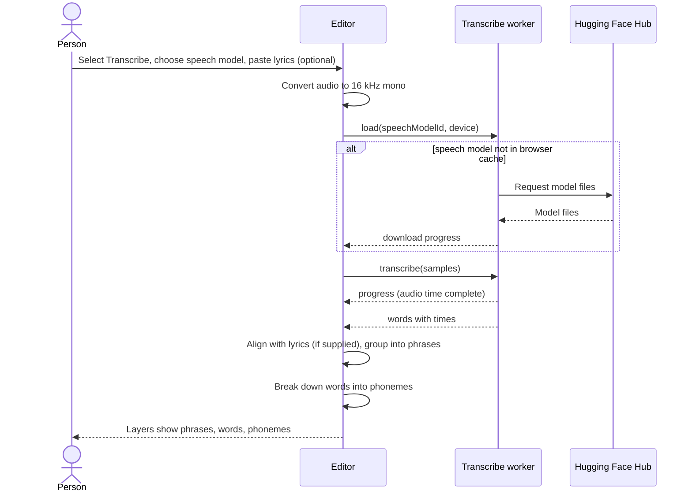
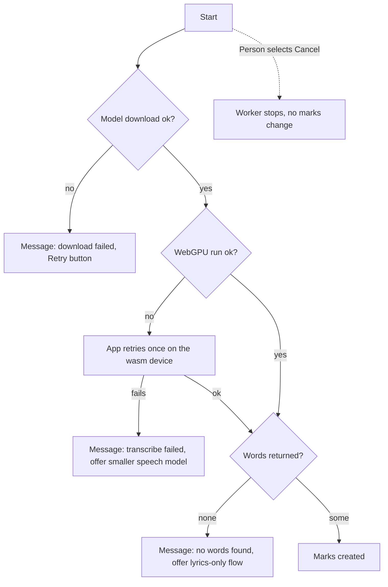

## Purpose

The app runs a speech model in the browser and finds each sung word with its start
time and its end time. The app groups the words into phrases. If the person has the
lyrics, the app uses them to correct the words.

## User stories

- As the person, I want the app to find the words and their times, so that I do not
  place each word by ear.
- As the person, I want to paste the correct lyrics, so that wrong words from the
  speech model do not reach my show.
- As the person, I want to see progress, so that I know the app is working.
- As the person, I want to transcribe one section again, so that I can fix a bad
  part without losing the good parts.

## Functional requirements

- FR-transcribe-1 — The editor has a "Transcribe" action for the selected voice.
- FR-transcribe-2 — The transcribe dialog offers three speech models: tiny, base
  and small.
- FR-transcribe-3 — The transcribe dialog shows the download size of each speech
  model.
- FR-transcribe-4 — The transcribe dialog has an optional lyrics text field.
- FR-transcribe-5 — The app runs the speech model in a Web Worker.
- FR-transcribe-6 — The app uses the `webgpu` device when the browser supports
  WebGPU.
- FR-transcribe-7 — The app uses the `wasm` device when the browser does not
  support WebGPU.
- FR-transcribe-8 — The app shows download progress for the speech model as a
  percentage.
- FR-transcribe-9 — The app shows transcribe progress as the audio time that is
  complete.
- FR-transcribe-10 — The person cancels a transcribe run with one button.
- FR-transcribe-11 — The app converts the audio to one channel at 16 kHz before it
  sends the audio to the worker.
- FR-transcribe-12 — The app creates one word on the word layer for each word that
  the speech model returns.
- FR-transcribe-13 — The app groups words into phrases with the rules in
  [Behaviour rules](#behaviour-rules).
- FR-transcribe-14 — If the person supplies lyrics, the app aligns the transcribed
  words with the lyrics.
- FR-transcribe-15 — If the person supplies lyrics, each line of the lyrics becomes
  one phrase.
- FR-transcribe-16 — The app marks each word whose time is an estimate as
  "estimated".
- FR-transcribe-17 — The app breaks down every new word into phonemes after the
  transcribe run ends.
- FR-transcribe-18 — The app asks for confirmation before a transcribe run replaces
  marks that exist.
- FR-transcribe-19 — The person transcribes a time selection only.
- FR-transcribe-20 — The browser keeps the speech model files, so a second run
  starts without a download.
- FR-transcribe-21 — The person creates phrases from lyrics without a speech model.
- FR-transcribe-22 — One transcribe run is one undo step.

## User flows

### Transcribe a song



1. The person selects "Transcribe".
2. The person selects a speech model.
3. The person pastes lyrics, or leaves the field empty.
4. The person selects "Start".
5. If marks exist in the target range, the app asks for confirmation.
6. The app downloads the speech model if the browser does not have it.
7. The app transcribes the audio and shows progress.
8. The app aligns, groups and breaks down the words.
9. The app closes the dialog and shows the layers.

### Failure branches



### Create phrases from lyrics without a speech model

1. The person selects "Lyrics only" in the transcribe dialog.
2. The person pastes the lyrics.
3. The app makes one phrase for each line.
4. The app spreads the phrases evenly across the target range.
5. The app spreads the words of each phrase evenly across the phrase.
6. The app marks every word as "estimated".

## Screens & states

**Transcribe dialog.** Regions: speech model selector, device note, lyrics field,
range selector (full song or the time selection), progress area, buttons.

- idle: selectors enabled, "Start" enabled.
- downloading: "Downloading speech model, 42%" with a bar. "Cancel" enabled.
- transcribing: "Transcribing, 1:12 of 3:40" with a bar. "Cancel" enabled.
- finishing: "Aligning lyrics and breaking down words".
- error: the message, with "Retry" and "Close".
- done: the dialog closes. A toast shows "214 words, 9 estimated".

The device note reads "Uses your graphics card (WebGPU)" or "WebGPU is not
available. Transcription is slower on this browser."

## Behaviour rules

- The default speech model is base. The app remembers the last selection.
- Without lyrics, a new phrase starts when one of these is true:
  - the gap from the end of the previous word is 700 ms or more,
  - the previous word ends with `.`, `?` or `!`,
  - the phrase has 12 words.
- A phrase starts at the start of its first word and ends at the end of its last
  word.
- The app removes these characters from word labels: `. , ! ? ; : " ( ) [ ]`. The
  app keeps apostrophes and hyphens inside a word.
- Word labels keep the letter case from the lyrics, or from the speech model when
  there are no lyrics.
- The app discards a word that the speech model returns with no end time.
- A word is at least one frame size long. The app extends a shorter word to one
  frame size, and moves the next word if needed.
- Words on one layer do not overlap. If the speech model returns an overlap, the
  earlier word ends where the later word starts.
- **Align rules.** The app compares the transcribed words with the lyrics words as
  two sequences, without case and without punctuation.
  - A lyrics word that matches a transcribed word takes its time.
  - A lyrics word between two matched words with no match gets an even share of the
    time between them, and is "estimated".
  - A transcribed word with no lyrics match is discarded.
  - If fewer than 30% of the lyrics words match, the app shows a warning before it
    creates marks.
- A range run replaces only the marks that lie fully inside the range.
- The worker handles one run at a time. The "Transcribe" action is disabled during
  a run.
- The app transcribes in 30-second chunks with a 5-second stride.
- The language is English. The task is transcribe.

## Data touched

- Reads `AUDIO_FILE`. Reads and writes `APP_SETTINGS.speechModelId` and `device`.
- Writes `MARK` on the phrase, word and phoneme layers of the selected voice.
- Adds the field `estimated: bool` to `MARK`. The field is false after the person
  moves the mark.
- The speech model files are in the browser Cache Storage, managed by the library.

## Interfaces

**`@huggingface/transformers` 4.3.2.** Verified against:
https://huggingface.co/docs/transformers.js/api/pipelines,
https://huggingface.co/docs/transformers.js/en/guides/webgpu,
https://huggingface.co/docs/transformers.js/en/guides/dtypes (retrieved 2026-11-24).

- Create: `pipeline('automatic-speech-recognition', modelId, { device, dtype })`.
- `device: 'webgpu'` selects WebGPU. The default in a browser is WASM.
- `dtype` values include `fp32`, `fp16`, `q8`, `q4`. The docs state that Whisper is
  sensitive to the quantisation of the encoder.
- Call: `transcriber(audio, { return_timestamps: 'word', chunk_length_s: 30,
  stride_length_s: 5, language, task })`.
- Audio input types: `string | URL | Float32Array | Float64Array`.
- Result: `{ text, chunks: [{ text, timestamp: [start, end] }] }`, times in seconds.

Not confirmed, to be settled first in Epic 2 (see spec.md, Risks 2, 3, 4):

- which model repositories return word times; candidates are
  `onnx-community/whisper-tiny_timestamped`, `onnx-community/whisper-base_timestamped`
  and `onnx-community/whisper-small_timestamped`,
- the option name and event shape for download progress,
- the sample rate that a `Float32Array` input must have,
- how to stop a run; the fallback is to terminate the worker.

**Worker message contract, `src/workers/transcribe.worker.ts`:**

```ts
// to worker
{ type: 'load'; speechModelId: string; device: 'webgpu' | 'wasm' }
{ type: 'transcribe'; runId: string; samples: Float32Array; offsetMs: number }
{ type: 'cancel'; runId: string }
// from worker
{ type: 'download'; loadedBytes: number; totalBytes: number }
{ type: 'ready' }
{ type: 'progress'; runId: string; doneMs: number }
{ type: 'result'; runId: string; words: { text: string; startMs: number; endMs: number }[] }
{ type: 'error'; runId?: string; kind: 'download' | 'device' | 'memory' | 'unknown'; detail: string }
```

**Pure functions, `src/features/transcription/`:**

```ts
alignLyrics(transcribed: TimedWord[], lyrics: string): AlignedPhrase[]
groupIntoPhrases(words: TimedWord[]): AlignedPhrase[]
spreadLyrics(lyrics: string, startMs: number, endMs: number): AlignedPhrase[]
```

## Edge cases & failures

| Case | What the person sees |
|---|---|
| Network fails during the download | "The speech model did not download. Check the connection and retry." |
| WebGPU run fails | No message. The app retries on `wasm` and updates the device note. |
| Out of memory | "This browser ran out of memory. Select a smaller speech model." |
| No words returned | "No words were found. Paste the lyrics and use Lyrics only." |
| Match below 30% | "Only 22% of the lyrics matched the audio. Check that the lyrics belong to this song." with "Continue" and "Cancel". |
| Person closes the tab during a run | No marks change. The next visit shows the old marks. |
| Instrumental range selected | "No words were found" for that range. Other marks stay. |
| Lyrics contain a line with no words | The app ignores the line. |
| Lyrics contain `[Chorus]` style tags | The app ignores a line that is only text in square brackets. |

## Acceptance criteria

- The editor shows "Transcribe" when a voice is selected. (FR-transcribe-1)
- The dialog lists tiny, base and small, each with a size in MB.
  (FR-transcribe-2, 3)
- The UI responds to a click within 100 ms during a run. (FR-transcribe-5)
- With WebGPU off, the device note shows the slower-browser text and the run
  completes. (FR-transcribe-6, 7)
- The progress text changes at least once for each 30 seconds of audio.
  (FR-transcribe-8, 9)
- "Cancel" stops the run within 2 seconds and no mark changes. (FR-transcribe-10)
- The worker receives a `Float32Array` whose length is duration in seconds times
  16 000, within 1%. (FR-transcribe-11)
- The demo song yields the fixture words within 150 ms of the fixture times with
  the base speech model. This is a recorded manual check. (FR-transcribe-12)
- `groupIntoPhrases` returns a new phrase after a 700 ms gap. (FR-transcribe-13)
- `alignLyrics` returns the lyrics spelling for each matched word.
  (FR-transcribe-14)
- With 4 lines of lyrics, the phrase layer has 4 phrases. (FR-transcribe-15)
- A lyrics word with no match shows the "estimated" style. (FR-transcribe-16)
- Every word has one or more phonemes after the run. (FR-transcribe-17)
- A run over existing marks shows a confirm dialog first. (FR-transcribe-18)
- A range run leaves marks outside the range unchanged. (FR-transcribe-19)
- A second run with the same speech model shows no download state.
  (FR-transcribe-20)
- "Lyrics only" creates phrases and words with no network request.
  (FR-transcribe-21)
- One undo after a run restores the earlier marks. (FR-transcribe-22)

## Out of scope

- Separating vocals from instruments.
- Detecting which singer sings a word.
- Languages other than English.
- Speech models larger than small.
- A cloud speech service.

## Open questions

None for the user. The four items under [Interfaces](#interfaces) are engineering
checks.
