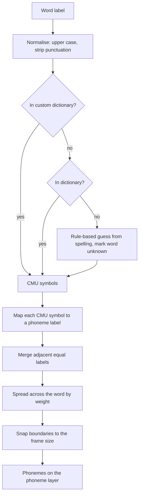
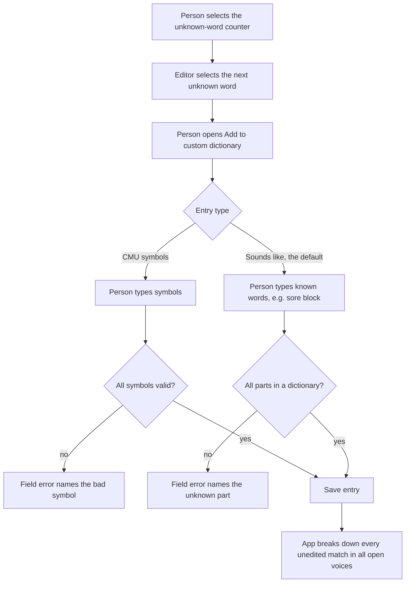

## Purpose

The app converts each word into the phonemes that the xLights Faces effect reads.
The person adds words that the dictionary does not have, and changes words that the
dictionary gets wrong for a song.

## User stories

- As the person, I want every word to get mouth shapes automatically, so that the
  face sings without manual work.
- As the person, I want to see which words the app does not know, so that I can fix
  them.
- As the person, I want to teach the app a name or a slang word once, so that every
  later song uses it.

## Functional requirements

- FR-phoneme-1 — The app loads the dictionary on the first break down of a visit, or when the editor opens a song that has a word.
- FR-phoneme-2 — The app looks up a word in the custom dictionary first.
- FR-phoneme-3 — The app looks up a word in the dictionary when the custom
  dictionary does not have it.
- FR-phoneme-4 — The app maps each CMU symbol to one phoneme label with the table
  in [Behaviour rules](#behaviour-rules).
- FR-phoneme-5 — The app merges adjacent phonemes of one word that have the same
  phoneme label.
- FR-phoneme-6 — The app spreads the phonemes of a word across the word with the
  weights in [Behaviour rules](#behaviour-rules).
- FR-phoneme-7 — The app snaps each phoneme boundary to the frame size of the song.
- FR-phoneme-8 — The app gives a word that no dictionary has a rule-based guess.
- FR-phoneme-9 — The app marks a word that no dictionary has as "unknown".
- FR-phoneme-10 — The editor shows the count of unknown words in the selected
  voice.
- FR-phoneme-11 — The person moves to the next unknown word with one action.
- FR-phoneme-12 — The person adds a custom entry with a word and its CMU symbols.
- FR-phoneme-13 — The person adds a custom entry with a word and a "sounds like"
  spelling.
- FR-phoneme-14 — The person edits a custom entry.
- FR-phoneme-15 — The person deletes a custom entry.
- FR-phoneme-16 — The app breaks down again every unedited word that matches a
  changed custom entry.
- FR-phoneme-17 — The person exports the custom dictionary as a text file.
- FR-phoneme-18 — The person imports a custom dictionary from a text file.
- FR-phoneme-19 — The person breaks down selected words again.
- FR-phoneme-20 — The app keeps hand-edited phonemes when their word moves or
  changes length.
- FR-phoneme-21 — The entry form of a new entry starts on the entry type "Sounds
  like spelling".
- FR-phoneme-22 — The entry form shows the mouth shapes of the typed entry before
  the save.
- FR-phoneme-23 — The link "Show the list of symbols" opens the reference table of
  CMU symbols in view.
- FR-phoneme-24 — The import report states the cause of each of the first 10
  skipped lines.

## User flows

### Break down a word



1. The app normalises the word label.
2. The app looks up the custom dictionary, then the dictionary.
3. If no entry exists, the app guesses from the spelling and marks the word.
4. The app maps, merges, spreads and snaps.
5. The app writes the phonemes as children of the word.

### Fix an unknown word



1. The person selects the unknown-word counter.
2. The editor selects the next unknown word and scrolls to it.
3. The person opens "Add to custom dictionary".
4. The person types a "sounds like" spelling, or CMU symbols.
5. The form shows the mouth shapes of the entry.
6. The app validates the entry.
7. The app saves the entry and breaks down the matching words.

## Screens & states

**Custom dictionary dialog.** Regions: search field, entry list, entry form,
import and export buttons, a reference table of CMU symbols with example words.

- empty: "No custom words yet. Words that the app does not know appear in the
  editor with a dotted outline."
- populated: a table with word, CMU symbols, resulting phoneme labels, and edit and
  delete buttons.
- error: field errors under the form.

Messages and labels. The dialog, the entry form, the counter and the layer show
these strings:

- Dialog title: "Custom dictionary". Search field: "Search".
- Search with no result: "No custom word matches the search."
- Entry list: the caption "Custom words", and the column headings "Word", "CMU
  symbols" and "Phoneme labels". Each row has the buttons "Edit" and "Delete".
- Dialog buttons: "Import", "Export" and "Close".
- Import report, no bad line: "1 entry imported." or "3 entries imported."
- Import report, bad lines: "3 entries imported. 2 lines skipped." Under it, one
  line for each of the first 10 bad lines: "Line <number>: <cause>", for example
  "Line 3: no symbols." and "Line 4: “ZZ” is not a symbol."
- Import report, more than 10 bad lines: after the 10 causes, "4 more lines
  skipped."
- Causes of a bad import line, in the order of the check:
  - The line has a word and no symbols: "no symbols."
  - Other spaces: "use two spaces after the word and one space between the
    symbols."
  - The word has no letter: "the word has no letter."
  - The word has more than 40 characters: "the word has more than 40 characters."
  - A bad symbol: "“<item>” is not a symbol."
- The import report shows under the "Import" button.
- Entry form titles: "Add a word" and "Edit RUDOLPH". Submit buttons: "Add entry"
  and "Save entry". An edit also has "Cancel".
- Entry form fields: "Word", "CMU symbols" and "Sounds like".
- Entry type: the group "Entry type" with the choices "Sounds like spelling" and
  "Symbols". A new entry starts on "Sounds like spelling". An edit starts on
  "Symbols".
- Hint of "CMU symbols": "Put one space between the symbols, for example R UW1 D
  AA0 L F. The app changes lower case to upper case. The symbols come from the CMU
  Pronouncing Dictionary."
- Under the hint of "CMU symbols": the link "Show the list of symbols". It opens
  the reference table, scrolls it into view and moves the focus to its title.
- Hint of "Sounds like": "Type the word as it sounds, with words that you know.
  Example: "sore block"."
- Mouth shape preview, under the field, when the typed entry gives CMU symbols:
  "Mouth shapes: <phoneme labels>", for example "Mouth shapes: etc O etc MBP L AI
  etc" for "sore block". The preview uses the mapping table and the merge rule.
- Focus: if the form opens with a word from the song, the focus starts in the field
  of the entry type: "Sounds like" for a new entry, "CMU symbols" for an edit.
- Empty word: "Type a word."
- Word with a space, or with more than 40 characters: "A word has 1 to 40
  characters and no spaces."
- Word with no letter and no digit: "Type a word with a letter or a digit."
- Word with digits only: "Type a word with a letter."
- Empty CMU symbols: "Type the CMU symbols."
- Empty "sounds like" spelling: "Type a \"sounds like\" spelling."
- Beside the message for a dictionary that does not load: the button "Retry".
- Reference table: the title "CMU symbols", and the column headings "Symbol",
  "Example word", "Stress digit" and "Phoneme label". The stress digit column shows
  "0, 1 or 2" or "None".
- Counter: "1 unknown word" or "N unknown words", for example "3 unknown words".
- Hidden text after the counter selects a word: "Selected Zxqv."
- Hidden text of an unknown word on the layer: "(unknown word)".
- Editor toolbar, with one unknown word selected: "Add to custom dictionary".

**Editor, phoneme layer.** A word that is unknown has a dotted outline. The counter
"3 unknown words" shows in the editor toolbar and is absent at zero.

## Behaviour rules

**Mapping table.** CMU symbols carry a stress digit (`0`, `1`, `2`) on vowels. The
app ignores the digit.

| Phoneme label | CMU symbols |
|---|---|
| `AI` | AA, AE, AH, AY, IH |
| `E` | EH, ER, EY, IY |
| `O` | AO, AW, OW |
| `U` | UH, UW |
| `WQ` | OY, W |
| `L` | L |
| `MBP` | B, M, P |
| `FV` | F, V |
| `etc` | CH, D, DH, G, HH, JH, K, N, NG, R, S, SH, T, TH, Y, Z, ZH |

Verified against: `resources/dictionaries/phoneme_mapping` in
https://github.com/xLightsSequencer/xLights (commit `99a289bf`). The project stores
this table as its own TypeScript data.

**Weights.** A sung vowel is longer than a consonant. Each phoneme gets a share of
the word in proportion to its weight:

- `AI`, `E`, `O`, `U`: weight 3.
- `WQ`, `L`: weight 2.
- `MBP`, `FV`, `etc`: weight 1.

**Other rules.**

- Each phoneme is at least one frame size long. If a word is too short for all its
  phonemes, the app drops phonemes with weight 1 first, from the end of the word.
- A word always keeps one phoneme or more.
- The phonemes of a word fill the word with no gap.
- The app writes no `rest` phoneme. A gap between words is a closed mouth in
  xLights.
- When the dictionary has several entries for a word, the app uses the first.
- Normalise: upper case, remove characters other than letters, digits and
  apostrophes. `singin'` looks up `SINGIN'`, then `SINGING`.
- A word of digits only, for example `12`, is unknown.
- **Rule-based guess.** Each vowel letter group maps to a vowel label (`A`, `I` to
  `AI`; `E` to `E`; `O` to `O`; `U` to `U`). Each consonant letter maps by the same
  families as the table (`B`, `M`, `P` to `MBP`; `F`, `V` to `FV`; `L` to `L`; `W`,
  `Q` to `WQ`; others to `etc`).
- A custom entry word is 1 to 40 characters with no spaces.
- "Sounds like" parts are separated by spaces. The app joins the CMU symbols of the
  parts.
- A phoneme that the person edits by hand sets `edited` on its word. A later
  automatic break down skips that word.
- When an edited word moves, its phonemes move by the same amount. When an edited
  word changes length, its phonemes scale in proportion and snap.
- The app normalises the word of a custom entry before it stores the entry.
- A change of a custom entry is not an undo step, because custom entries belong to
  the browser. The break down that follows it is one undo step of the open song. An
  undo restores the earlier phonemes, and the custom entry stays.
- A song that is not open keeps its phonemes until its next break down.
- Custom dictionary file format: one entry for each line, the word, two spaces,
  then the CMU symbols separated by one space. Lines that start with `;;;` are
  comments.

## Data touched

- Reads `MARK` (word layer). Writes `MARK` (phoneme layer).
- Reads and writes `CUSTOM_ENTRY`.
- Adds the field `unknown: bool` to `MARK` for words.
- The dictionary is a static file, `public/dict/cmudict.json`, built from
  `cmudict.dict` by `scripts/build-dictionary.mjs`.

## Interfaces

**CMU Pronouncing Dictionary.** Source: https://github.com/cmusphinx/cmudict, file
`cmudict.dict`. The README states that use for any research or commercial purpose
is unrestricted and asks for acknowledgement.
Verified against: https://github.com/cmusphinx/cmudict (retrieved 2026-11-24).

These facts are confirmed from the file and its `LICENSE` file. `docs/external.md`
records them.

- Source: commit `74790861f652b15e4ac49015a90074ad62a27690` (2025-10-24). The copy
  is in `vendor/cmudict/`.
- Entry format: each line is a word, one space, then its CMU symbols separated by
  one space. A variant entry has a number after the word, for example `hello(2)`.
  A `#` starts a comment to the end of the line.
- Entry count: `public/dict/cmudict.json` holds 126052 words. The app keeps the
  first entry of each word.
- Licence: a BSD-2-Clause style licence, copyright Carnegie Mellon University. The
  app serves the notice as `public/dict/cmudict-LICENSE.txt`.

**Module contract, `src/lib/dictionary/`:**

```ts
const PHONEME_LABELS = ['AI', 'E', 'etc', 'FV', 'L', 'MBP', 'O', 'rest', 'U', 'WQ'] as const
type PhonemeLabel = (typeof PHONEME_LABELS)[number]

// key: the word in upper case. value: its CMU symbols separated by one space.
type Dictionary = Readonly<Record<string, string>>

interface LookupResult {
  readonly symbols: string[]
  readonly source: 'custom' | 'cmu' | 'guess'
}
interface SpreadPhoneme {
  readonly label: PhonemeLabel
  readonly startMs: number
  readonly endMs: number
}

lookup(word: string, customEntries: Dictionary, dictionary: Dictionary): LookupResult
toPhonemeLabels(symbols: readonly string[]): PhonemeLabel[]    // mapped and merged
spread(
  labels: readonly PhonemeLabel[],
  startMs: number,
  endMs: number,
  frameMs: number,
): SpreadPhoneme[]
validateSymbols(text: string): { ok: true } | { ok: false; bad: string }
```

`loadDictionary` is in `src/features/phoneme-breakdown/`, because it uses the
network:

```ts
loadDictionary(): Promise<Dictionary>    // later calls get the same promise
```

## Edge cases & failures

| Case | Result |
|---|---|
| Dictionary file fails to load | "The dictionary did not load. Check the connection and retry." Words stay without phonemes. |
| Word is one frame long with 4 phonemes | One phoneme: the highest weight, earliest on a tie. |
| Custom entry with symbol `XX` | Field error: "XX is not a CMU symbol." |
| "Sounds like" part not in any dictionary | Field error: "The app does not know ROODOLF. Use shorter known words." |
| Import file has a bad line | The app imports the good lines and reports "2 lines skipped" with the line number and the cause of each. |
| Import has a word that exists | The imported entry replaces the old entry. |
| Label with only punctuation, for example `-` | The word gets one `etc` phoneme and is unknown. |
| The app cannot read or write the custom dictionary | "The app could not read or write the custom dictionary. Reload the page." |
| The break down fails for a reason other than the dictionary file | "The app could not break down the words. Select Retry." The words stay without phonemes. |
| An import line has a word with no letter, or with digits only | The app skips the line and reports "Line <number>: the word has no letter." |
| The dictionary does not load while the person types a "sounds like" spelling | The form shows no mouth shape preview. The submit shows the load message. |
| Two import lines give the same word | The later line wins. The file counts as one entry. |

## Acceptance criteria

- The dictionary request happens once for each visit, at the first break down or
  when the editor opens a song that has a word. A song with no marks causes no
  request.
  (FR-phoneme-1)
- With a custom entry for `HELLO`, `lookup('hello').source` is `custom`.
  (FR-phoneme-2, 3)
- `toPhonemeLabels(['HH','AH0','L','OW1'])` returns `['etc','AI','L','O']`.
  (FR-phoneme-4)
- `toPhonemeLabels(['S','T','AA1','R'])` returns `['etc','AI','etc']`.
  (FR-phoneme-5)
- `spread(['etc','AI','L','O'], 0, 900, 50)` returns boundaries at 0, 100, 400,
  600, 900. (FR-phoneme-6, 7)
- Every boundary that `spread` returns is a multiple of the frame size.
  (FR-phoneme-7)
- The word `Zxqv` gets phonemes and a dotted outline. (FR-phoneme-8, 9)
- A voice with 3 unknown words shows "3 unknown words". (FR-phoneme-10)
- The counter action selects the first unknown word after the play position.
  (FR-phoneme-11)
- A new entry `RUDOLPH  R UW1 D AA0 L F` saves and removes the dotted outline from
  each `Rudolph`. (FR-phoneme-12, 16)
- A "sounds like" entry `ROO DOLF`, where both parts are known, saves.
  (FR-phoneme-13)
- The form opens on "Sounds like spelling" with its text. (FR-phoneme-21)
- The form shows the mouth shapes of the entry before the save. (FR-phoneme-22)
- The link "Show the list of symbols" shows the reference table inside the
  viewport. (FR-phoneme-23)
- The import report states a cause for each of the first 10 skipped lines.
  (FR-phoneme-24)
- An edited entry changes the phonemes of matching unedited words. (FR-phoneme-14,
  16)
- A deleted entry returns matching unedited words to the dictionary result.
  (FR-phoneme-15)
- Export then import in a clean browser gives the same entries. (FR-phoneme-17, 18)
- "Break down again" on a selected word replaces its phonemes. (FR-phoneme-19)
- A word with hand-edited phonemes keeps them after a custom dictionary change.
  (FR-phoneme-20)

## Out of scope

- The xLights `-shimmer` label suffix and other label suffixes.
- Dictionaries for other languages.
- Phoneme times from the audio signal (forced alignment at phoneme level).
- A shared, online custom dictionary.

## Open questions

None.
