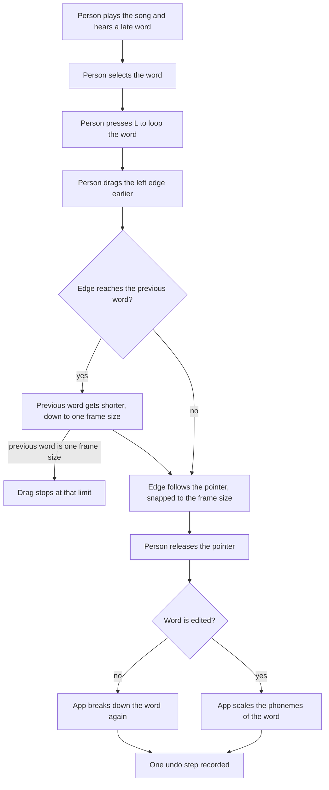
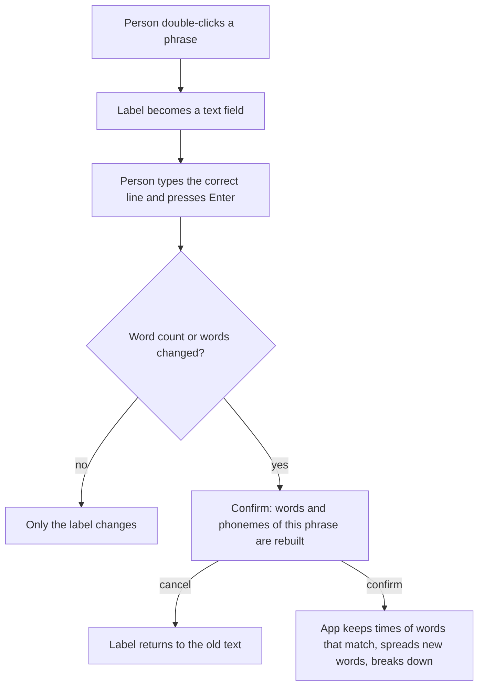

## Purpose

The editor is where the person checks and corrects the marks. It shows the
waveform and the three layers of the selected voice on one time scale. It shows a
face that sings during play, so the person sees the result before xLights does.

## User stories

- As the person, I want to drag the edge of a word to the right place, so that a
  wrong time takes one action to fix.
- As the person, I want to hear one word or one phrase in a loop, so that I can
  judge its time.
- As the person, I want a face that moves its mouth during play, so that I can see
  errors that I cannot hear.
- As the person, I want undo, so that an error in an edit costs nothing.
- As the person, I want to hear the vocals alone, so that I can judge the time of
  a word under loud instruments.

## Functional requirements

- FR-editor-1 — The editor shows the waveform, a time ruler and the three layers of
  the selected voice on one time scale.
- FR-editor-2 — The person zooms the time scale from 10 to 1 000 pixels for each
  second.
- FR-editor-3 — The person scrolls the time scale.
- FR-editor-4 — The editor shows a play cursor on the waveform and on all layers.
- FR-editor-5 — The editor follows the play cursor during play.
- FR-editor-6 — The person selects a mark with a click.
- FR-editor-7 — The person selects several marks on one layer.
- FR-editor-8 — The person drags an edge of a mark to change its start or its end.
- FR-editor-9 — The person drags the body of a mark to move it.
- FR-editor-10 — The editor snaps each dragged time to the frame size.
- FR-editor-11 — The editor keeps marks on one layer from overlapping.
- FR-editor-12 — A dragged edge that touches the adjacent mark moves the shared
  boundary of both marks.
- FR-editor-13 — The editor keeps each child mark inside its parent.
- FR-editor-14 — The app breaks down a word again after its times change, unless
  the word is edited.
- FR-editor-15 — The person edits the label of a phrase or a word in place.
- FR-editor-16 — The person changes the phoneme label of a phoneme from a list of
  the ten phoneme labels.
- FR-editor-17 — The person splits a mark at the play cursor.
- FR-editor-18 — The person merges a mark with the next mark on the same layer.
- FR-editor-19 — The person deletes the selected marks.
- FR-editor-20 — The person adds a mark in an empty range of a layer.
- FR-editor-21 — The person plays the selected mark in a loop.
- FR-editor-22 — The person sets the play speed to 50%, 75% or 100%.
- FR-editor-23 — The face preview shows the mouth shape of the phoneme at the play
  cursor.
- FR-editor-24 — The face preview shows the closed mouth when no phoneme is at the
  play cursor.
- FR-editor-25 — The person undoes and redoes each change, to a depth of 100.
- FR-editor-26 — The editor shows a word that is "estimated" or "unknown" with a
  distinct style.
- FR-editor-27 — The inspector shows the label, the start, the end and the length
  of the selected mark.
- FR-editor-28 — The person types a start time or an end time in the inspector.
- FR-editor-29 — The editor has a shortcut list that opens with the `?` key.
- FR-editor-30 — Editing a phrase label breaks down the phrase into words again
  after a confirm dialog.
- FR-editor-31 — The editor shows one track row for each kept audio track of the
  song, under the waveform, on the time scale of the stage.
- FR-editor-32 — The editor shows one track row for each singer voice of the last
  run.
- FR-editor-33 — The person mutes each track row and the "Song" row.
- FR-editor-34 — The person soloes each track row and the "Song" row.
- FR-editor-35 — Each track that sounds plays in time with the play cursor.
- FR-editor-36 — The person folds the group of track rows.
- FR-editor-37 — The editor keeps the mute, the solo and the fold for each song.
- FR-editor-38 — The toolbar has a button for each edit action: split, merge,
  delete and edit the label.
- FR-editor-39 — A toolbar button that cannot act states the reason in its
  tooltip.
- FR-editor-40 — A button in the top bar opens the shortcut list.
- FR-editor-41 — A help line under the layers tells how to edit marks, and it
  changes with the selection.
- FR-editor-42 — The tooltip of a mark shows its label, its start and its end.
- FR-editor-43 — The status line states the reason when a key, a button or a drag
  does nothing.
- FR-editor-44 — The person types a time as `m:ss.mmm` or as plain seconds.
- FR-editor-45 — The status line states the rule that changed a typed time.
- FR-editor-46 — The phoneme list opens with no scroll of the stage.
- FR-editor-47 — Each layer is one Tab stop.
- FR-editor-48 — The person selects each mark of a layer with the keyboard.
- FR-editor-49 — The first Tab stop of the editor skips to the transport.
- FR-editor-50 — `Space` plays or pauses from a button of the toolbar.
- FR-editor-51 — Each track row and the "Song" row show whether the row sounds now.
- FR-editor-52 — The heading of the group "Audio tracks" names the rows that sound.
- FR-editor-53 — The editor tells the person when it cannot read the run data of
  the song.
- FR-editor-54 — A heading above the phrase layer names the shown voice.
- FR-editor-55 — A phrase label change gives each new word 3 frame sizes or more
  when the phrase has room.
- FR-editor-56 — A mark that a double-click adds is 10 frame sizes long, or the
  length of the empty range when it is shorter.
- FR-editor-57 — A mark never draws over the next mark of its layer.
- FR-editor-58 — A selected mark of any width has two edge handles that the person
  can drag.
- FR-editor-59 — A phrase or a word shorter than 3 frame sizes has the "short"
  style.
- FR-editor-60 — A zoom with the slider or a key keeps the selected mark, the play
  cursor or the centre of the stage in place.
- FR-editor-61 — "Zoom to selection" shows the selected marks or the time
  selection.
- FR-editor-62 — "Fit song" shows the full song.
- FR-editor-63 — The person folds the voice rail and the inspector.

## User flows

### Correct the time of a word



1. The person selects the word.
2. The person presses `L` to play the word in a loop.
3. The person drags the left edge of the word.
4. The editor snaps the edge and moves the adjacent word boundary if they touch.
5. The person releases the pointer.
6. The app updates the phonemes of the word and of the adjacent word.
7. The app records one undo step.

### Change the words of a phrase



1. The person double-clicks the phrase.
2. The person types the new text and presses `Enter`.
3. If the words changed, the app asks for confirmation.
4. The app aligns the new words with the old words of the phrase.
5. The app gives each new word a time. See "Words of a changed phrase" in
   [Behaviour rules](#behaviour-rules).
6. The app breaks down each new or changed word, and each unedited word that changed
   length.
7. The app records one undo step.

## Screens & states

**Editor** — mockup: [mockups/02-editor.html](../mockups/02-editor.html).

Regions:

- **Top bar.** Back to the song library, song name, "Transcribe", "Run report",
  "Custom dictionary", "Export", "Shortcuts", save state ("Saved" or "Saving").
  "Shortcuts" has the tooltip "Show the keyboard shortcuts (?)" and opens the
  shortcut list.
- **Voice rail** (left). The voices of the song. Defined in
  [05-voices-sections.md](05-voices-sections.md). A fold button "Voices" on its
  right edge folds it.
- **Stage** (centre). From top to bottom: the section band, the time ruler, the
  waveform, the group "Audio tracks" with the track rows, the phrase layer, the
  word layer, the phoneme layer. A song with no kept audio tracks has no group.
- **Transport** (below the stage). Play, loop, speed, play time, zoom slider,
  "Zoom to selection", "Fit song", frame size selector, the group "Mark", undo, redo, unknown-word counter.
- **Help line** (under the stage). One line of help for the selection. See
  [Behaviour rules](#behaviour-rules).
- **Status line** (under the help line). A polite live region with the reason
  that the last action did nothing.
- **Inspector** (right). The face preview at the top. Under it, the fields of the
  selected mark. A fold button "Inspector" on its left edge folds it.

States:

- empty: the layers show "No marks yet. Select Transcribe to find the words." with
  a "Transcribe" button. When a different voice of the song has phrases, the text
  is "This voice has no marks. Select phrases of a different voice, then select
  "Phrase" and "Move to voice". Or select "Transcribe"."
- each state with a voice: the heading "Voice: <voice name>", with the colour
  chip of the voice, is above the phrase layer. It changes with the shown voice.
  See [05-voices-sections.md](05-voices-sections.md#behaviour-rules).
- loading: skeleton layers while the song opens.
- populated: all regions as described.
- error: the waveform error state from [01-audio-import.md](01-audio-import.md).
  The layers stay usable without audio.
- narrow window (below 1024 px): a full-page note, "The editor needs a window that
  is 1024 px wide or more.", and a link "Back to the song library".

Mark styles on the layers: phrases are wide bars with the full text. Words are
bars with the word. Phonemes are short blocks with the phoneme label and one colour
for each phoneme label. A label that does not fit is cut with an ellipsis. The
tooltip of a mark shows the full label on the first line and "<start> to <end>"
on the second line, for example "0:01.200 to 0:01.650". An "unknown" word has a dotted border. An
"estimated" word has a dashed inner frame, and a screen reader gets the text
"(estimated time)".

The drawn width of a mark (FR-editor-57 to 59):

- A mark draws from its start to its end on the time scale, and no wider. So it
  never covers the next mark of its layer, at any zoom.
- A mark narrower than 16 px shows no label and no border. The tooltip and a screen
  reader give the label.
- A selected mark of 28 px or more has its edge handles inside the mark. A narrower
  selected mark has its handles under the bar, outside the mark, 10 px wide each.
  They do not cover the bar of the adjacent mark. A narrow selected mark shows an
  amber fill in place of the outline.
- A phrase or a word shorter than 3 frame sizes has the "short" style: a lower bar
  with stripes. A screen reader gets the text "(short mark)". A phoneme is often one
  frame size long, so a phoneme has no "short" style.

Controls on the layers:

- Label field: named "Phrase label" or "Word label". `Enter` saves, `Escape`
  cancels.
- Phoneme list: named "Phoneme label". It has the ten phoneme labels.
- Confirm dialog for a phrase label that changes the words: "The app rebuilds the
  words and phonemes of this phrase." with "Continue" and "Cancel".
- "Break down again" in the transport, for the selected words. It is disabled
  when every selected word is edited. Tooltip: "An edited word keeps its
  phonemes."
- `Shift`+click selects the marks from the anchor to the clicked mark on one
  layer. A plain click sets the anchor.

Track rows (FR-editor-31 to 37, 51 to 53):

- A song with kept audio tracks shows the group "Audio tracks" under the waveform.
  The group has the rows "Song", "Vocals" and "Instruments". Each row except "Song"
  draws the waveform of its audio track on the time scale of the stage. A row is
  lower than the waveform.
- If the singer step of the last run put the singers on voices, the group also has
  one row for each of those voices. The row finds its voice by the voice id in
  the run data, so the row name is the present voice name. The row shows the vocals
  only in the time ranges of that singer, in the colour of the voice. The rows
  follow the voice order.
  The row name has the tooltip "This row is the vocals track, limited to the times
  of this singer."
- The row "Song" is the song audio. It has no waveform of its own, because the
  waveform of the song is at the top of the stage. Its name has the tooltip "This
  row is the song audio. Its waveform is at the top of the stage."
- Each row has a line above its waveform with, from left to right, the row name,
  the sound sign, "Mute" and "Solo". The line starts at the left edge of the stage,
  as the names of the layers. No part of the line covers the waveform. The
  waveform has the width of the stage and lines up with the time ruler at each
  zoom and scroll.
- The sound sign shows a speaker that plays or a speaker that is silent. For
  assistive technology, it has the text "plays" or "silent". Its tooltip:
  - "Plays." for a row that sounds.
  - "Silent, because "Mute" is on." for a muted row.
  - "Silent, because "Solo" is on for <row names>." for a row that a solo of other
    rows makes silent.
  - "Silent, because the browser did not start the sound." for a row whose play
    the browser refused.
- "Mute" and "Solo" are toggle buttons with the names "Mute <row name>" and "Solo
  <row name>". "Mute" has the tooltip "Mute: do not play this track." "Solo" has
  the tooltip "Solo: play only this track." A pressed button shows a fill, a bold
  label and a frame. A row never shows "Mute" and "Solo" pressed together.
- The heading of the group has the fold button "Audio tracks" and the rows that
  sound, for example "Audio tracks — plays: Vocals". With no row that sounds, the
  text is "plays: nothing". The text shows also when the group is folded.
- While the person has not changed a mute or a solo of the song, the group shows
  "The tracks start muted. Select "Solo" on a track to hear it alone." under the
  heading.
- While a mute or a solo makes the "Song" row silent, the play button has the
  tooltip "The song audio is muted. See "Audio tracks"."
- The fold button "Audio tracks" hides and shows the rows. It has `aria-expanded`.
- The group shows at most 4 rows. With more rows, the group scrolls inside itself,
  so the phrase, word and phoneme layers stay on the screen. The row names, "Mute"
  and "Solo" scroll with their rows. The waveforms stay on the time scale of the
  stage.
- If the browser refuses the sound of a row, the group shows "The browser did not
  start the sound of <row name>. Select "Mute" and then "Solo" on the row again."
- A song with no kept audio tracks shows no group and no "Song" controls.
- If the app cannot read the run data of the song, the place of the group shows
  "The app could not read the run report and the separated tracks of this song.
  Reload the page." The disabled "Run report" action has the same text as its
  tooltip.

## Behaviour rules

- **Track rows.**
  - With no choice of the person, "Song" sounds and each other row is muted. So the
    same sound does not play twice.
  - If one row or more is soloed, only the soloed rows sound. Else each row that is
    not muted sounds.
  - "Solo" on a muted row removes its mute and soloes it, with one click.
  - "Mute" on a soloed row ends its solo and mutes it, with one click. So the row
    is silent after the click.
  - "Solo" on a soloed row ends the solo. The row keeps its mute state.
  - The sound sign, the heading text and the tooltip of the play button use one
    rule: the mute and solo rule above, and the rows whose play the browser
    refused.
  - With "Song" muted, the song audio plays with no sound. The play cursor, the
    loop, the face preview and the shortcuts work as before.
  - Each track that sounds plays, pauses, seeks, loops and changes speed with the
    song audio. A track that is more than 50 ms from the song time moves to it.
    The pitch does not change at 50% and 75%. The design is in
    `docs/adr/0010-track-rows-follow-the-song-audio.md`.
  - A track of a range run covers the range only. Outside the range it is silent
    and its row shows no waveform.
  - A singer row sounds only in the time ranges of its singer.
  - Mute, solo and fold are view state. They are not undo steps.

- **Shortcuts.** `Space` play or pause. `L` loop the selection. `S` split at the
  play cursor. `M` merge with the next mark. `Delete` delete. `Enter` or `F2` edit
  the label. `[` and `]` select the previous or the next mark of the layer. `Up`
  and `Down` move the selection between layers. `Left` and `Right` nudge the selected
  mark by one frame size. `Alt+Left` and `Alt+Right` nudge the start only.
  `Shift+Alt+Left` and `Shift+Alt+Right` nudge the end only. `Ctrl+Z` undo.
  `Ctrl+Shift+Z` redo. `+` and `-` zoom. `Z` zoom to the selection. `?` shortcut list. On macOS, `Cmd`
  replaces `Ctrl`. With no selected mark, `Left` and `Right` move the play cursor
  by one frame size. `S`, `M`, the nudge keys, `Up` and `Down` act when exactly
  one mark is selected. `Up` selects the parent, and `Down` selects the first
  child. A shortcut does not act while the focus is in a field, a list or a
  dialog. The shortcut list has the title "Keyboard shortcuts", a "Close" button
  and the note "On macOS, use Cmd in place of Ctrl."
- **Keyboard order.** `Tab` and `Shift+Tab` keep the browser order. Each layer is
  one Tab stop: the selected mark of the layer, else its first mark in view, else
  the layer track. So `Tab` goes from one layer to the next, then to "Play".
  - On a mark that is not selected, `[` or `]` selects that mark. Then they move
    the selection along the layer. At the first or the last mark, the status line
    states "This is the first mark of the layer." or "This is the last mark of the
    layer."
  - `[` and `]` work on each keyboard layout. A symbol that AltGr types counts
    as the symbol, also when Windows reports Ctrl and Alt for AltGr. A symbol
    that the Option key of a Mac types counts as the symbol when no `Alt`
    shortcut of that symbol exists. A letter or a digit with Alt keeps the Alt.
  - The first Tab stop of the editor is the link "Skip to the transport". It shows
    only when it has the focus. It moves the focus to "Play", or to the first
    control of the toolbar while the audio is not ready.
  - On a button of the toolbar or the transport other than "Play", `Space` plays
    or pauses and does not press the button. `Enter` presses the button. A text
    field, a select, a dialog, a menu and a list keep their own `Space`.
  - The help line adds "Press [ or ] to select the previous or the next mark."
    when one mark is selected.
- **Transport.** "Loop" has the tooltip "Play the selection in a loop (L)". With
  more than one selected mark, the loop goes from the earliest start to the
  latest end. "Play speed" has "50%", "75%" and "100%", and the pitch does not
  change. "Frame size" has "25 ms" and "50 ms". A change of the frame size shows
  "The app moves every mark of this song to a multiple of 25 ms." (or 50 ms)
  with "Continue" and "Cancel", and it is one undo step. A song with no marks
  shows no dialog. "Undo" and "Redo" are buttons in the group "Undo and redo".
- **Mark buttons.** The toolbar group "Mark" has "Split", "Merge with next",
  "Delete" and "Edit label". Each button runs the same action as its shortcut, on
  the selected mark. A click on a button keeps the focus on the mark. The tooltip
  of a button names the action and the shortcut:
  - "Split the selected mark at the play cursor (S)"
  - "Merge the selected mark with the next mark (M)"
  - "Delete the selected marks (Delete)"
  - "Edit the label (Enter or F2)"
- **A button that cannot act.** It stays in the tab order with
  `aria-disabled="true"` and a dim style. Its tooltip and its description state
  the reason, and then the shortcut in brackets. A click does nothing. The same
  rule applies to "Loop", the play speed, "Undo", "Redo", "Phrase" and "Add
  section". The reasons:

  | Button | Case | Reason |
  |---|---|---|
  | "Split", "Merge with next", "Edit label" | No mark or more than one mark is selected | "Select one mark first." |
  | "Delete" | No mark is selected | "Select a mark first." |
  | "Split" | The play cursor is outside the mark | "Move the play cursor into the mark. Then press S." |
  | "Split" | A part would be shorter than one frame size | "Move the play cursor away from the edge of the mark. Each part needs one frame size or more." |
  | "Merge with next" | The mark is the last mark of its layer | "This is the last mark of the layer." |
  | "Merge with next" | The next word is in another phrase | "The next word is in another phrase." |
  | "Merge with next" | The next phoneme is in another word | "The next phoneme is in another word." |
  | "Delete" | The only selected mark is the last phoneme of its word | "A word needs one phoneme or more. Delete the word." |
  | "Loop", "50%", "75%", "100%" | The audio is not ready | "The audio is not ready." |
  | "Undo" | The history has no step to undo | "No step to undo." |
  | "Redo" | The history has no step to redo | "No step to redo." |
  | "Loop" | No mark and no time range is selected | "Select a mark or a time range first." |
  | "Phrase" | The selection is not only phrases | "Select a phrase first." |
  | "Add section" | No time range is selected | "Drag on the waveform to select a time range first." |

- **Zoom.** The zoom slider, `+` and `-` keep one time in place on the stage
  (FR-editor-60):
  1. The middle of the selected marks, when a part of them is in view. A middle
     outside the view moves to the nearest edge of the view.
  2. Else the play cursor, when it is in view.
  3. Else the centre of the stage.

  An arrow key on the slider changes the zoom by 10% for each press. `Page Up` and
  `Page Down` change it by 5 presses. `Ctrl` with the mouse wheel zooms at the
  pointer. A song that opens for the first time shows the full song.
- **Zoom buttons.** "Zoom to selection" has the tooltip "Show the selected marks
  or the time selection (Z)". It shows the selected marks, else the time selection,
  in the middle of the stage, with 10% of the stage width free on each side. The
  zoom stops at 1 000 pixels for each second. With nothing selected, it cannot act,
  and its reason is "Select a mark or a time range first." "Fit song" has the
  tooltip "Show the full song". It shows the full song in the stage.
- **Side panels.** The voice rail and the inspector each have a fold button with
  `aria-expanded` (FR-editor-63). A folded panel keeps only its fold button, and the
  stage takes the width. The arrow on the button points to the side where the panel
  moves, and the tooltip is "Hide the voices panel" or "Show the voices panel" (or
  the inspector panel). In a window narrower than 1280 px, a panel starts folded
  until the person opens it. The browser keeps the choice of the person in
  `localStorage`. A fold is view state, not an undo step. A folded inspector hides
  the face preview too.
- **Help line.** The text depends on the selection:
  - No selected mark: "Click a mark to select it. Double-click a mark to change
    its label. Double-click an empty place to add a mark."
  - A selected phrase or word, or more than one selected mark: "Drag an edge to
    change the time. Drag the mark to move it."
  - One selected phoneme: "Click the phoneme again to choose a mouth shape."
  - With no selected mark or one selected mark, the line adds "Hold Shift and
    click to select more than one mark."
  - With one selected phoneme narrower than 12 px, the line adds "Zoom in to edit
    short marks. Press Z."
- **Status line.** A key, a button or a drag that does nothing shows its reason
  in the status line. The reasons of the buttons are in the table above. The
  nudge keys and a drag add "The mark has no room to move." and "The edge of the
  mark has no room to move." The text goes away after 5 seconds, or at the next
  key or pointer press.
- **Typed times.** The fields "Start" and "End" accept `m:ss.mmm` and plain
  seconds, for example "0:03.500" or "3.5". Seconds of 60 or more in `m:ss.mmm`
  add to the minutes. A wrong text shows one field error for each cause:
  - Empty: "Type a time, for example 0:03.500 or 3.5."
  - A negative time: "Type a time of 0 or more."
  - Any other text: "Use m:ss.mmm or seconds, for example 0:03.500 or 3.5."
  - A time after the end of the song: "The song ends at <time>."

  After `Enter`, the wrong text and the field error stay. When the focus leaves
  the field, the field shows the stored time again and the status line shows the
  error. When a rule changes a typed time, the field shows the time that the app
  stored, and the status line states "The app used <time>, <rule>." The rules:
  "a multiple of the frame size", "the edge of the parent mark", "the last frame
  of the song", "the shortest length of the adjacent mark", "the shortest length
  of the mark", "the edge of the first or the last word of the phrase".
- **Phoneme list.** The list has a fixed position in the window, under the layer
  row, or over it when the window has no room under it. The stage does not
  scroll when the list opens.
- **Inspector.** The region has the name "Inspector". "Face preview" shows the
  mouth shape of the phoneme under the play time, and the closed mouth between
  words. The fields "Label", "Start", "End" and "Length" show when exactly one
  mark is selected, under "Selected phrase", "Selected word" or "Selected
  phoneme". With a different selection, the hint is "Select one mark to see its
  fields." A time has the format `m:ss.mmm`. The length reads as
  "2000 ms · 40 frames".
- After a delete, a split, a merge, an undo or a redo, the selection holds only
  marks that exist.
- `Ctrl` with the mouse wheel zooms at the pointer. The wheel alone scrolls in
  time.
- **Add a mark.** A double-click in an empty range of a layer adds a mark of 10
  frame sizes that starts at the pointer (FR-editor-56). A mark that would end
  after the empty range moves earlier, so it keeps its length. An empty range
  shorter than 10 frame sizes gets a mark of its full length. A word outside any
  phrase also adds a phrase with the same range and the same label.
- **Words of a changed phrase** (FR-editor-55). When a phrase label changes the
  words:
  1. A new word that matches an old word keeps the time of the old word.
  2. A run of new words between two matched words shares the free time between
     them evenly, in whole frame sizes.
  3. If the run has less than 3 frame sizes for each word, the matched word before
     the run ends earlier. That word keeps 3 frame sizes or more.
  4. If the run still has less, the matched word after the run starts later. That
     word keeps 3 frame sizes or more.
  5. If the run still has less than 1 frame size for each word, steps 3 and 4 go
     down to 1 frame size for each matched word.
  6. If the phrase has less than 3 frame sizes for each word, or step 5 is not
     enough, each word of the phrase gets an equal part of the phrase.
  7. If the phrase has fewer frame sizes than words, the last words go.

  Example, with a frame size of 50 ms: "All is calm, all is bright" (9.800 s to
  18.700 s) becomes "All is calm and all is bright tonight". "and" has 50 ms of
  free time, so "calm" ends 100 ms earlier, at 14.150 s, and "and" goes from
  14.150 s to 14.300 s. "tonight" has no free time, so "bright" ends at 18.550 s,
  and "tonight" goes from 18.550 s to 18.700 s.
- A click on the ruler or the waveform moves the play cursor.
- A drag on the waveform makes a time selection.
- The shortest mark is one frame size.
- **Parent and child.**
  - Moving a phrase moves its words and their phonemes by the same amount.
  - Changing the length of a phrase does not scale its words. The phrase edge stops
    at the first or last word.
  - Deleting a phrase deletes its words and their phonemes.
  - Deleting a word deletes its phonemes.
  - Deleting the last phoneme of a word is not possible. The person deletes the
    word instead.
  - A split of a word at the play cursor makes two words with the label divided at
    the nearest character position, and breaks down both.
  - A merge of two words joins the labels with no space and breaks down the result.
  - A merge of two phrases joins the labels with one space and keeps the words.
- A phoneme edit by hand (label, edge, split, merge, delete) sets `edited` on its
  word.
- A mark that the person moves loses the "estimated" style.
- One drag, one typed value or one shortcut action is one undo step.
- Changing the frame size snaps every mark of the song after a confirm dialog. It
  is one undo step.
- The loop plays from the start of the selection to the end, with 150 ms of audio
  before the start.
- The face preview is a drawn cartoon face with ten mouth shapes, one for each
  phoneme label. The eyes blink during `rest`. The preview updates on each
  animation frame.
- The editor keeps the scroll position and the zoom for each song.

## Data touched

- Reads and writes `MARK`. Reads `SONG.frameMs` and writes it on a frame size
  change.
- The history stack is in memory only. A reload clears it.
- Stores zoom and scroll for each song in `localStorage`.
- Reads the kept audio tracks and the singer ranges from `RunData`.
- Stores mute, solo and fold for each song in `localStorage`, under the key
  `sft.tracks.<song id>`.

## Interfaces

**Store actions, `src/store/`.** Each action is one undo step and returns nothing.
An action that would break a rule in [Behaviour rules](#behaviour-rules) clamps the
value to the nearest legal value.

```ts
moveMark(id, deltaMs)
resizeMark(id, edge: 'start'|'end', toMs)
setMarkLabel(id, label)
setPhonemeLabel(id, label: PhonemeLabel)
splitMark(id, atMs)
mergeWithNext(id)
deleteMarks(ids)
addMark(voiceId, layer, startMs, endMs, label)
setFrameMs(songId, frameMs: 25 | 50)
undo(); redo()
```

**Time module, `src/lib/time/`:**

```ts
snap(ms: number, frameMs: number): number        // nearest multiple
formatTime(ms: number): string                   // m:ss.mmm
```

The waveform uses wavesurfer.js 8.1.1. The layers are React components that take
the zoom and the scroll offset from the store, so the waveform and the layers share
one scale. The engineer reads the wavesurfer.js API reference for the zoom and
scroll methods before use. Those names are not verified in this spec.

## Edge cases & failures

| Case | Result |
|---|---|
| Drag an edge past the parent edge | The edge stops at the parent edge. |
| Drag a word body over the adjacent word | The word stops at the adjacent word. It does not jump over. |
| Split with the play cursor outside the mark | "Split" and `S` do not act. The tooltip and the status line state "Move the play cursor into the mark. Then press S." |
| Merge on the last mark of a layer | "Merge with next" and `M` do not act. The tooltip and the status line state "This is the last mark of the layer." |
| Add a mark in a gap shorter than one frame size | The add action is disabled. |
| Add a word outside any phrase | The app creates a phrase of the same range with the same label. |
| Typed time that is not a time | Field error: "Use m:ss.mmm or seconds, for example 0:03.500 or 3.5." The mark does not change. |
| Typed time that is empty | Field error: "Type a time, for example 0:03.500 or 3.5." |
| Typed time below 0 | Field error: "Type a time of 0 or more." |
| Typed time after the end of the song | Field error: "The song ends at <time>." |
| Wrong typed time, then the focus leaves the field | The field shows the stored time. The status line shows the field error. |
| Typed time that is not a multiple of the frame size | The field shows the snapped time. The status line states "The app used <time>, a multiple of the frame size." |
| Typed time past a limit of the parent or of the adjacent mark | The field shows the limit. The status line states the time and the limit. |
| Delete the last phoneme of a word | Nothing changes. The status line states "A word needs one phoneme or more. Delete the word." |
| Drag or nudge a mark that touches both neighbours | Nothing changes. The status line states "The mark has no room to move." |
| Open the phoneme list | The stage keeps its scroll position. |
| Empty label on a phrase or a word | The app keeps the old label. |
| Audio missing | Play controls are disabled. Edits work. |
| 3 000 marks in view | Scroll and zoom stay at 60 frames per second. The editor draws only the marks in view. |
| A new run stores new tracks | The track rows show the new tracks. |
| The browser refuses to play a track (`NotAllowedError`) | The track stays silent, and the song audio plays. The group shows "The browser did not start the sound of <row name>. Select "Mute" and then "Solo" on the row again." The app tries the track again after the next click on "Mute" or "Solo" of that row. |
| The app cannot read the run data of the song | The place of the group "Audio tracks" shows "The app could not read the run report and the separated tracks of this song. Reload the page." The "Run report" action is disabled, with the same text as its tooltip. |
| The play of a track stops for another cause, for example a quick pause | No message. The next check starts the track again. |
| A phrase edit changes the times of a singer row during play | The track keeps its play. The muted "Song" stays muted. The row uses the new times. |
| A voice of a singer row has a new name | The row shows the new name with the same ranges. The other rows do not change. |
| A voice of a singer row is deleted | The row of that voice does not show, and its ranges go to no other row. An undo of the delete brings the row back. |
| Run data from before issue #173 and a renamed or deleted voice | The row of that voice does not show. |

## Acceptance criteria

- The waveform peak for a word and the word mark sit at the same horizontal
  position at every zoom level. (FR-editor-1)
- The zoom slider stops at 10 and at 1 000 pixels for each second. (FR-editor-2)
- During play the play cursor stays in view. (FR-editor-4, 5)
- A click on a mark shows its fields in the inspector. (FR-editor-6, 27)
- `Shift`+click selects the range of marks between two clicks on one layer.
  (FR-editor-7)
- A dragged edge ends on a multiple of the frame size. (FR-editor-8, 10)
- A dragged word body keeps its length. (FR-editor-9)
- No two marks on a layer overlap after any action. (FR-editor-11)
- A dragged shared edge changes two marks and leaves no gap. (FR-editor-12)
- No word lies outside its phrase after any action, and no phoneme lies outside
  its word. (FR-editor-13)
- An unedited word that gets longer has phonemes that fill the new length.
  (FR-editor-14)
- A double-click on a word, new text and `Enter` change the label and the
  phonemes. (FR-editor-15)
- The phoneme list has exactly the ten phoneme labels. (FR-editor-16)
- `S` on a word at the play cursor gives two words. (FR-editor-17)
- `M` on a word gives one word that spans both. (FR-editor-18)
- `Delete` on a phrase removes its words and phonemes. (FR-editor-19)
- A double-click in an empty range of the word layer adds a word. (FR-editor-20)
- `L` repeats the selected mark until the person presses `Space`. (FR-editor-21)
- The speed control at 50% plays at half speed with the same pitch. (FR-editor-22)
- At a time inside an `O` phoneme the face preview shows the `O` mouth.
  (FR-editor-23)
- At a time between two words the face preview shows the closed mouth.
  (FR-editor-24)
- 100 edits followed by 100 undo actions restore the first state. (FR-editor-25)
- An "estimated" word and an "unknown" word each differ from a normal word in
  outline, not only in colour. (FR-editor-26)
- A typed start time of `0:12.350` with a 50 ms frame size sets the start to
  12 350 ms. (FR-editor-28)
- A typed "3.5" sets 3 500 ms. (FR-editor-44)
- A typed "0:99.000" on the demo song shows "The song ends at 0:28.900."
  (FR-editor-44)
- `S` outside the mark, `M` on the last mark, `Delete` on the last phoneme of a
  word and a drag with no room each show their reason in the status line.
  (FR-editor-43)
- The scroll position of the stage is the same before and after the phoneme list
  opens. (FR-editor-46)
- The count of `Tab` presses from the page top to "Play" does not change with the
  count of marks. (FR-editor-47)
- `Tab` to the word layer, then `]`, selects each word in turn. (FR-editor-48)
- `Tab` to "Skip to the transport" and `Enter` give "Play" the focus.
  (FR-editor-49)
- After a click on "75%", `Space` starts the play. (FR-editor-50)
- The shortcut list and the shortcut rules of this file name the same keys.
  (FR-editor-29)
- `?` opens the shortcut list, and `Escape` closes it. (FR-editor-29)
- A person splits, merges and deletes a mark with the mouse only. (FR-editor-38)
- A disabled "Split", "Merge with next" or "Delete" states its reason in a tooltip
  for the play cursor outside the mark, the last mark of a layer and the last
  phoneme of a word. (FR-editor-39)
- "Shortcuts" in the top bar opens the shortcut list. (FR-editor-40)
- The help line shows its text for no selection, a selected word and a selected
  phoneme. (FR-editor-41)
- After a run with separation, the rows "Vocals" and "Instruments" show, each with
  a waveform at the correct times. (FR-editor-31)
- After a run that put two singers on voices, one row for each of the two voices
  shows. (FR-editor-32)
- With "Solo" on "Vocals", only the vocals play, and the play cursor and the face
  preview move as before. (FR-editor-33, 34)
- A loop, a seek and the 50% play speed keep every playing track within 50 ms of
  the song time. (FR-editor-35)
- A song with no tracks has no row and no change in play. (FR-editor-31)
- The fold button hides the rows, and each control is reachable by keyboard and
  has a name. (FR-editor-36)
- After a reload, the mute, the solo and the fold of the song stay. (FR-editor-37)
- With "Solo" on "Vocals", the "Song" row shows that it is silent and why.
  (FR-editor-51)
- No row shows "Mute" and "Solo" pressed together. (FR-editor-33, 34)
- The folded group names the rows that sound. (FR-editor-52)
- No row name covers a waveform. (FR-editor-31)
- A failed read of the run data shows its cause in the place of the group.
  (FR-editor-53)
- After a click on a voice, the heading above the phrase layer is "Voice: <voice
  name>". (FR-editor-54)
- After "All is calm, all is bright" becomes "All is calm and all is bright
  tonight" on the demo song, "and" and "tonight" are each 3 frame sizes or longer.
  (FR-editor-55)
- A double-click in an empty range of 1 second adds a mark of 10 frame sizes, also
  near the end of the range. (FR-editor-56)
- No two marks of a layer draw over each other at any zoom, with marks of one frame
  size. (FR-editor-57)
- A selected mark of one frame size has two handles of 10 px under its bar.
  (FR-editor-58)
- A word of 2 frame sizes shows the "short" style. (FR-editor-59)
- After a zoom with the slider, the selected mark is in view. (FR-editor-60)
- Five arrow keys on the zoom slider change the zoom by 40% or more. (FR-editor-60)
- "Zoom to selection" shows a selected phoneme of 50 ms at 40 px wide or more.
  (FR-editor-61)
- "Fit song" shows the full song. (FR-editor-62)
- In a window of 1024 px with both side panels folded, the stage is 700 px wide or
  more. (FR-editor-63)
- A changed phrase label shows the confirm dialog, and confirm rebuilds the words.
  (FR-editor-30)

## Out of scope

- Editing two voices on the stage at the same time.
- Copy and paste of marks.
- A spectrogram view.
- A custom image for the face preview.
- Touch gestures.
- A volume slider for each track row.
- Waveform edits on a track row.

## Open questions

None.
