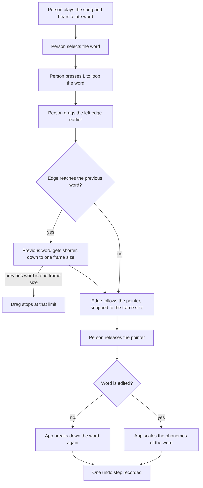
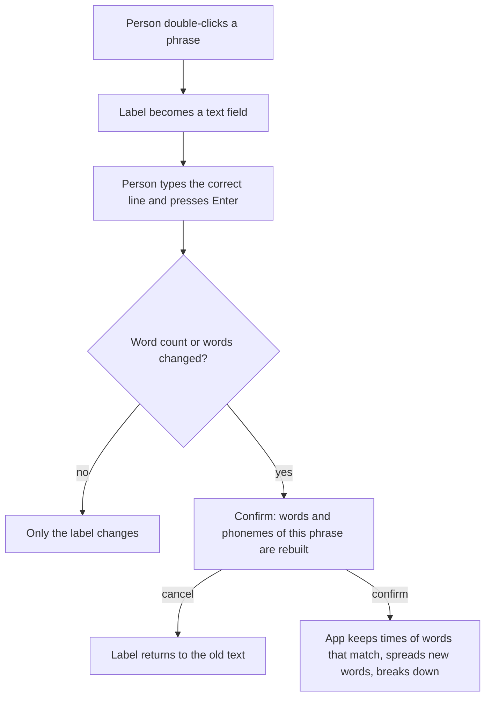

## Purpose

The editor is where the person checks and corrects the marks. It shows the
waveform and the three layers of the selected voice on one time scale. It shows a
face that sings during play, so the person sees the result before xLights does.

## User stories

- As the person, I want to drag the edge of a word to the right place, so that a
  wrong time takes one action to fix.
- As the person, I want to hear one word or one phrase in a loop, so that I can
  judge its time.
- As the person, I want a face that moves its mouth during play, so that I can see
  errors that I cannot hear.
- As the person, I want undo, so that an error in an edit costs nothing.

## Functional requirements

- FR-editor-1 — The editor shows the waveform, a time ruler and the three layers of
  the selected voice on one time scale.
- FR-editor-2 — The person zooms the time scale from 10 to 1 000 pixels for each
  second.
- FR-editor-3 — The person scrolls the time scale.
- FR-editor-4 — The editor shows a play cursor on the waveform and on all layers.
- FR-editor-5 — The editor follows the play cursor during play.
- FR-editor-6 — The person selects a mark with a click.
- FR-editor-7 — The person selects several marks on one layer.
- FR-editor-8 — The person drags an edge of a mark to change its start or its end.
- FR-editor-9 — The person drags the body of a mark to move it.
- FR-editor-10 — The editor snaps each dragged time to the frame size.
- FR-editor-11 — The editor keeps marks on one layer from overlapping.
- FR-editor-12 — A dragged edge that touches the adjacent mark moves the shared
  boundary of both marks.
- FR-editor-13 — The editor keeps each child mark inside its parent.
- FR-editor-14 — The app breaks down a word again after its times change, unless
  the word is edited.
- FR-editor-15 — The person edits the label of a phrase or a word in place.
- FR-editor-16 — The person changes the phoneme label of a phoneme from a list of
  the ten phoneme labels.
- FR-editor-17 — The person splits a mark at the play cursor.
- FR-editor-18 — The person merges a mark with the next mark on the same layer.
- FR-editor-19 — The person deletes the selected marks.
- FR-editor-20 — The person adds a mark in an empty range of a layer.
- FR-editor-21 — The person plays the selected mark in a loop.
- FR-editor-22 — The person sets the play speed to 50%, 75% or 100%.
- FR-editor-23 — The face preview shows the mouth shape of the phoneme at the play
  cursor.
- FR-editor-24 — The face preview shows the closed mouth when no phoneme is at the
  play cursor.
- FR-editor-25 — The person undoes and redoes each change, to a depth of 100.
- FR-editor-26 — The editor shows a word that is "estimated" or "unknown" with a
  distinct style.
- FR-editor-27 — The inspector shows the label, the start, the end and the length
  of the selected mark.
- FR-editor-28 — The person types a start time or an end time in the inspector.
- FR-editor-29 — The editor has a shortcut list that opens with the `?` key.
- FR-editor-30 — Editing a phrase label breaks down the phrase into words again
  after a confirm dialog.

## User flows

### Correct the time of a word



1. The person selects the word.
2. The person presses `L` to play the word in a loop.
3. The person drags the left edge of the word.
4. The editor snaps the edge and moves the adjacent word boundary if they touch.
5. The person releases the pointer.
6. The app updates the phonemes of the word and of the adjacent word.
7. The app records one undo step.

### Change the words of a phrase



1. The person double-clicks the phrase.
2. The person types the new text and presses `Enter`.
3. If the words changed, the app asks for confirmation.
4. The app aligns the new words with the old words of the phrase.
5. The app breaks down each new or changed word.

## Screens & states

**Editor** — mockup: [mockups/02-editor.html](../mockups/02-editor.html).

Regions:

- **Top bar.** Back to the song library, song name, save state ("Saved" or
  "Saving"), "Transcribe", "Run report", "Custom dictionary", "Export".
- **Voice rail** (left). The voices of the song. Defined in
  [05-voices-sections.md](05-voices-sections.md).
- **Stage** (centre). From top to bottom: the section band, the time ruler, the
  waveform, the phrase layer, the word layer, the phoneme layer.
- **Transport** (below the stage). Play, loop, speed, play time, zoom slider,
  frame size selector, undo, redo, unknown-word counter.
- **Inspector** (right). The face preview at the top. Under it, the fields of the
  selected mark.

States:

- empty: the layers show "No marks yet. Select Transcribe to find the words." with
  a "Transcribe" button.
- loading: skeleton layers while the song opens.
- populated: all regions as described.
- error: the waveform error state from [01-audio-import.md](01-audio-import.md).
  The layers stay usable without audio.
- narrow window (below 1024 px): a full-page note, "The editor needs a window that
  is 1024 px wide or more."

Mark styles on the layers: phrases are wide bars with the full text. Words are
bars with the word. Phonemes are short blocks with the phoneme label and one colour
for each phoneme label. A label that does not fit is cut with an ellipsis, and the
full label shows in a tooltip. An "unknown" word has a dotted border. An
"estimated" word has a dashed inner frame, and a screen reader gets the text
"(estimated time)".

Controls on the layers:

- Label field: named "Phrase label" or "Word label". `Enter` saves, `Escape`
  cancels.
- Phoneme list: named "Phoneme label". It has the ten phoneme labels.
- Confirm dialog for a phrase label that changes the words: "The app rebuilds the
  words and phonemes of this phrase." with "Continue" and "Cancel".
- "Break down again" in the transport, for the selected words. It is disabled
  when every selected word is edited. Tooltip: "An edited word keeps its
  phonemes."
- `Shift`+click selects the marks from the anchor to the clicked mark on one
  layer. A plain click sets the anchor.

## Behaviour rules

- **Shortcuts.** `Space` play or pause. `L` loop the selection. `S` split at the
  play cursor. `M` merge with the next mark. `Delete` delete. `Enter` or `F2` edit
  the label. `Tab` and `Shift+Tab` select the next or previous mark. `Up` and
  `Down` move the selection between layers. `Left` and `Right` nudge the selected
  mark by one frame size. `Alt+Left` and `Alt+Right` nudge the start only.
  `Shift+Alt+Left` and `Shift+Alt+Right` nudge the end only. `Ctrl+Z` undo.
  `Ctrl+Shift+Z` redo. `+` and `-` zoom. `?` shortcut list. On macOS, `Cmd`
  replaces `Ctrl`. With no selected mark, `Left` and `Right` move the play cursor
  by one frame size. `S`, `M`, the nudge keys, `Up` and `Down` act when exactly
  one mark is selected. `Up` selects the parent, and `Down` selects the first
  child. A shortcut does not act while the focus is in a field, a list or a
  dialog. The shortcut list has the title "Keyboard shortcuts", a "Close" button
  and the note "On macOS, use Cmd in place of Ctrl."
- **Transport.** "Loop" has the tooltip "Play the selection in a loop (L)". With
  more than one selected mark, the loop goes from the earliest start to the
  latest end. "Play speed" has "50%", "75%" and "100%", and the pitch does not
  change. "Frame size" has "25 ms" and "50 ms". A change of the frame size shows
  "The app moves every mark of this song to a multiple of 25 ms." (or 50 ms)
  with "Continue" and "Cancel", and it is one undo step. A song with no marks
  shows no dialog. "Undo" and "Redo" are buttons in the group "Undo and redo".
- **Inspector.** The region has the name "Inspector". "Face preview" shows the
  mouth shape of the phoneme under the play time, and the closed mouth between
  words. The fields "Label", "Start", "End" and "Length" show when exactly one
  mark is selected, under "Selected phrase", "Selected word" or "Selected
  phoneme". With a different selection, the hint is "Select one mark to see its
  fields." A time has the format `m:ss.mmm`. The length reads as
  "2000 ms · 40 frames".
- After a delete, a split, a merge, an undo or a redo, the selection holds only
  marks that exist.
- `Ctrl` with the mouse wheel zooms at the pointer. The wheel alone scrolls in
  time.
- A click on the ruler or the waveform moves the play cursor.
- A drag on the waveform makes a time selection.
- The shortest mark is one frame size.
- **Parent and child.**
  - Moving a phrase moves its words and their phonemes by the same amount.
  - Changing the length of a phrase does not scale its words. The phrase edge stops
    at the first or last word.
  - Deleting a phrase deletes its words and their phonemes.
  - Deleting a word deletes its phonemes.
  - Deleting the last phoneme of a word is not possible. The person deletes the
    word instead.
  - A split of a word at the play cursor makes two words with the label divided at
    the nearest character position, and breaks down both.
  - A merge of two words joins the labels with no space and breaks down the result.
  - A merge of two phrases joins the labels with one space and keeps the words.
- A phoneme edit by hand (label, edge, split, merge, delete) sets `edited` on its
  word.
- A mark that the person moves loses the "estimated" style.
- One drag, one typed value or one shortcut action is one undo step.
- Changing the frame size snaps every mark of the song after a confirm dialog. It
  is one undo step.
- The loop plays from the start of the selection to the end, with 150 ms of audio
  before the start.
- The face preview is a drawn cartoon face with ten mouth shapes, one for each
  phoneme label. The eyes blink during `rest`. The preview updates on each
  animation frame.
- The editor keeps the scroll position and the zoom for each song.

## Data touched

- Reads and writes `MARK`. Reads `SONG.frameMs` and writes it on a frame size
  change.
- The history stack is in memory only. A reload clears it.
- Stores zoom and scroll for each song in `localStorage`.

## Interfaces

**Store actions, `src/store/`.** Each action is one undo step and returns nothing.
An action that would break a rule in [Behaviour rules](#behaviour-rules) clamps the
value to the nearest legal value.

```ts
moveMark(id, deltaMs)
resizeMark(id, edge: 'start'|'end', toMs)
setMarkLabel(id, label)
setPhonemeLabel(id, label: PhonemeLabel)
splitMark(id, atMs)
mergeWithNext(id)
deleteMarks(ids)
addMark(voiceId, layer, startMs, endMs, label)
setFrameMs(songId, frameMs: 25 | 50)
undo(); redo()
```

**Time module, `src/lib/time/`:**

```ts
snap(ms: number, frameMs: number): number        // nearest multiple
formatTime(ms: number): string                   // m:ss.mmm
```

The waveform uses wavesurfer.js 8.1.1. The layers are React components that take
the zoom and the scroll offset from the store, so the waveform and the layers share
one scale. The engineer reads the wavesurfer.js API reference for the zoom and
scroll methods before use. Those names are not verified in this spec.

## Edge cases & failures

| Case | Result |
|---|---|
| Drag an edge past the parent edge | The edge stops at the parent edge. |
| Drag a word body over the adjacent word | The word stops at the adjacent word. It does not jump over. |
| Split with the play cursor outside the mark | The split action is disabled. |
| Merge on the last mark of a layer | The merge action is disabled. |
| Add a mark in a gap shorter than one frame size | The add action is disabled. |
| Add a word outside any phrase | The app creates a phrase of the same range with the same label. |
| Typed time that is not a number | Field error: "Use m:ss.mmm". The mark does not change. |
| Empty label on a phrase or a word | The app keeps the old label. |
| Audio missing | Play controls are disabled. Edits work. |
| 3 000 marks in view | Scroll and zoom stay at 60 frames per second. The editor draws only the marks in view. |

## Acceptance criteria

- The waveform peak for a word and the word mark sit at the same horizontal
  position at every zoom level. (FR-editor-1)
- The zoom slider stops at 10 and at 1 000 pixels for each second. (FR-editor-2)
- During play the play cursor stays in view. (FR-editor-4, 5)
- A click on a mark shows its fields in the inspector. (FR-editor-6, 27)
- `Shift`+click selects the range of marks between two clicks on one layer.
  (FR-editor-7)
- A dragged edge ends on a multiple of the frame size. (FR-editor-8, 10)
- A dragged word body keeps its length. (FR-editor-9)
- No two marks on a layer overlap after any action. (FR-editor-11)
- A dragged shared edge changes two marks and leaves no gap. (FR-editor-12)
- No word lies outside its phrase after any action, and no phoneme lies outside
  its word. (FR-editor-13)
- An unedited word that gets longer has phonemes that fill the new length.
  (FR-editor-14)
- A double-click on a word, new text and `Enter` change the label and the
  phonemes. (FR-editor-15)
- The phoneme list has exactly the ten phoneme labels. (FR-editor-16)
- `S` on a word at the play cursor gives two words. (FR-editor-17)
- `M` on a word gives one word that spans both. (FR-editor-18)
- `Delete` on a phrase removes its words and phonemes. (FR-editor-19)
- A double-click in an empty range of the word layer adds a word. (FR-editor-20)
- `L` repeats the selected mark until the person presses `Space`. (FR-editor-21)
- The speed control at 50% plays at half speed with the same pitch. (FR-editor-22)
- At a time inside an `O` phoneme the face preview shows the `O` mouth.
  (FR-editor-23)
- At a time between two words the face preview shows the closed mouth.
  (FR-editor-24)
- 100 edits followed by 100 undo actions restore the first state. (FR-editor-25)
- An "estimated" word and an "unknown" word each differ from a normal word in
  outline, not only in colour. (FR-editor-26)
- A typed start time of `0:12.350` with a 50 ms frame size sets the start to
  12 350 ms. (FR-editor-28)
- `?` opens the shortcut list, and `Escape` closes it. (FR-editor-29)
- A changed phrase label shows the confirm dialog, and confirm rebuilds the words.
  (FR-editor-30)

## Out of scope

- Editing two voices on the stage at the same time.
- Copy and paste of marks.
- A spectrogram view.
- A custom image for the face preview.
- Touch gestures.

## Open questions

None.
