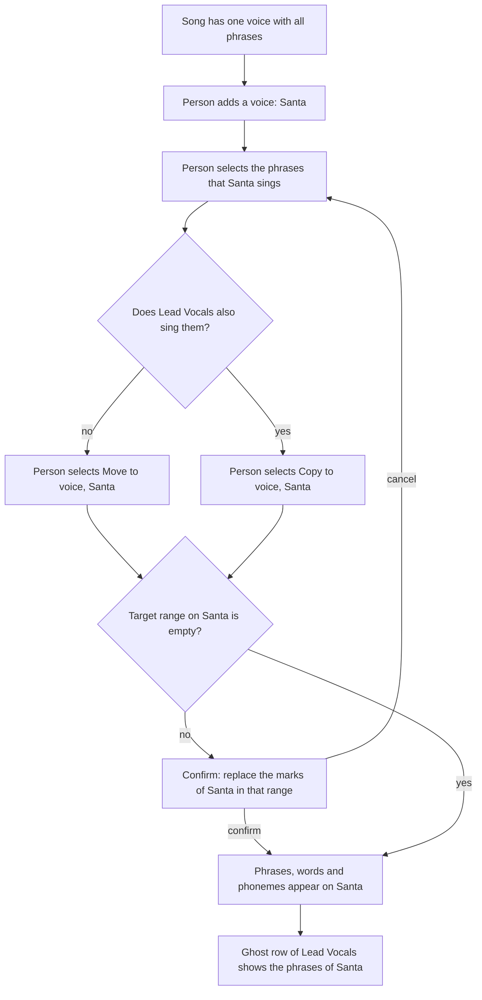
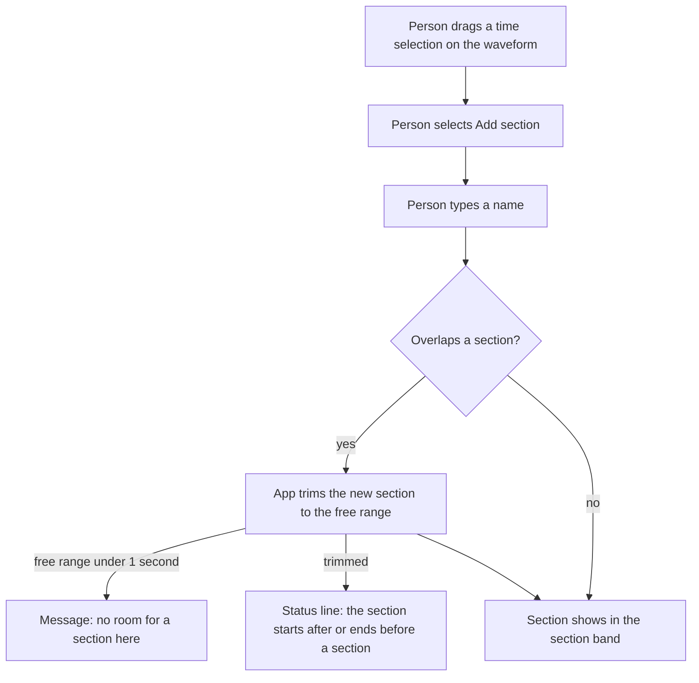

## Purpose

A show often has several face models, and each one sings a different part. A voice
holds the marks for one singer, and becomes one timing track in xLights. A section
names a time range of the song, so the person can work on, and export, one part of
the song at a time.

## User stories

- As the person, I want one timing track for each singer, so that each face model
  sings only its own lines.
- As the person, I want to move a line from one singer to another, so that I can
  divide one transcript between faces.
- As the person, I want a line that all singers sing to be on every voice, so that
  all faces sing the chorus.
- As the person, I want to name the parts of the song, so that I can find, review
  and export them.

## Functional requirements

- FR-voice-1 — The voice rail lists the voices of the song in their order.
- FR-voice-2 — The person adds a voice.
- FR-voice-3 — The person renames a voice.
- FR-voice-4 — The person changes the colour of a voice.
- FR-voice-5 — The person changes the order of the voices.
- FR-voice-6 — The person deletes a voice after a confirm dialog.
- FR-voice-7 — The person selects one voice to show on the layers.
- FR-voice-8 — The person moves the selected phrases to another voice.
- FR-voice-9 — The person copies the selected phrases to another voice.
- FR-voice-10 — A moved or copied phrase takes its words and their phonemes.
- FR-voice-11 — The stage shows the phrases of the other voices as thin bars in a
  "ghost" row under the phoneme layer.
- FR-voice-12 — The person mutes the face preview for a voice during play.
- FR-voice-13 — The face preview shows one face for each voice that is not muted,
  up to 4 faces.
- FR-voice-14 — The section band shows the sections of the song above the time
  ruler.
- FR-voice-15 — The person adds a section from the time selection.
- FR-voice-16 — The person renames a section.
- FR-voice-17 — The person drags an edge of a section.
- FR-voice-18 — The person deletes a section.
- FR-voice-19 — A click on a section selects its time range and scrolls to it.
- FR-voice-20 — The person adds sections from `[Name]` tags in pasted lyrics.
- FR-voice-21 — The person moves every phrase of a section to another voice with
  one action.
- FR-voice-22 — With "Put each singer on its own voice", a transcribe run gives each
  phrase of the run to the singers who sing it.
- FR-voice-23 — The voice of the run keeps the phrases of the first singer.
- FR-voice-24 — The app adds one voice for each other singer, with the name "Singer
  N" and the next unused colour.
- FR-voice-25 — The app moves each phrase of another singer to the voice of that
  singer, with its words and phonemes.
- FR-voice-26 — The app copies a phrase that more than one singer sings to the voice
  of each other singer.
- FR-voice-27 — The singer voices are one undo step after the marks of the run.
- FR-voice-28 — The singer step divides a phrase of the run where the singer changes
  inside it.
- FR-voice-29 — A second singer gets a copy of a phrase only when it sings almost as
  long as the top singer of the phrase.
- FR-voice-30 — A new run with the singer step replaces the marks of each voice of
  the last run in its range, so no phrase is on two voices because of an earlier
  run.
- FR-voice-31 — A singer voice of the last run goes when the replace removes its
  last mark, in the undo step of the marks of the run.
- FR-voice-32 — Each row of the voice rail shows its row number before the voice
  name.
- FR-voice-33 — The row of the shown voice has a mark that is not colour alone.
- FR-voice-34 — Each voice of a song with 12 voices gets a different preset colour.
- FR-voice-35 — A lost focus of the name field of a new section adds the section.
- FR-voice-36 — The status line names the section that makes a new section shorter.
- FR-voice-37 — Each menu of the editor stays inside the window.

## User flows

### Divide one transcript between two singers



1. The person adds a voice and names it.
2. The person selects one or more phrases on the phrase layer.
3. The person selects "Move to voice" or "Copy to voice" and the target voice.
4. If the target voice has marks in the same time range, the app asks for
   confirmation.
5. The app moves or copies the phrases with their words and phonemes.

### Put each singer on its own voice

1. The person selects "Separate the vocals first" and "Put each singer on its own
   voice (experimental)" in the transcribe dialog. See
   [02-transcription.md](02-transcription.md#put-each-singer-on-its-own-voice).
2. The run writes the marks to the selected voice.
3. The app finds the singers in the separated vocals. With a count in "Singers", the
   app finds that count of singers. With "Automatic", the app estimates the count.
4. The app divides each phrase in which the singer changes, at the word boundary
   nearest to the change.
5. The app adds "Singer 2", "Singer 3" … and moves or copies the phrases of each
   singer to its voice.
6. The person checks each voice. The person corrects a wrong phrase with "Move to
   voice" or "Copy to voice".
7. One undo removes the singer voices and the divisions, and puts each phrase back on
   the voice of the run. The marks of the run stay.

### Make sections



1. The person drags a time selection.
2. The person selects "Add section".
3. The person types a name. `Enter` or a click elsewhere adds the section.
   `Escape` cancels.
4. The app trims the section if it overlaps another section. The status line
   names the section in the way.
5. The section band shows the section.

## Screens & states

**Voice rail** (left region of the editor, see
[mockups/02-editor.html](../mockups/02-editor.html), owned by
[04-timeline-editor.md](04-timeline-editor.md)). Each voice row shows the row
number, the colour chip, the name, the phrase count, a mute button for the face
preview and a menu (rename, colour, move up, move down, delete).

- one voice: the row has no delete action.
- many voices: the row of the shown voice has a bar at its left edge, a border, a
  background and a bold name. It has `aria-current`.
- two voices or more: the hint under "Add voice".
- 12 voices: the "Add voice" button is disabled with the tooltip "A song has 12
  voices at most."

**Section band** (top of the stage).

- empty: a thin band with the hint "Drag on the waveform, then Add section".
- populated: one labelled block for each section.

**Phrase menu.** "Move to voice" and "Copy to voice" each open a list of the other
voices and "New voice".

## Behaviour rules

- A song has 1 to 12 voices.
- A voice name is unique in the song, without regard to letter case. It is 1 to 60
  characters.
- A voice name does not contain `<`, `>`, `&` or `"`. The file format can escape
  them, but the name shows in xLights menus and stays simple.
- A new voice gets the name "Voice N", where N is the lowest free number, and the
  next unused colour.
- Deleting a voice deletes its marks. It is one undo step.
- The person cannot delete the last voice.
- A copy makes new marks with new ids. The copies are independent after the copy.
- A copied or moved phrase keeps its `edited`, `estimated` and `unknown` states.
- "Transcribe" writes to the selected voice only. With "Put each singer on its own
  voice", the singer step then moves or copies phrases of the run to new voices.
- A section is 1 second long or more.
- Sections do not overlap. Sections can have gaps between them.
- A section name is unique in the song. A duplicate name gets a number, for example
  "Chorus 2".
- A phrase belongs to a section when the middle of the phrase is inside the
  section.
- Sections are shared by all voices of the song.
- Lyrics tags: a line that is only `[Name]` starts a section at the first phrase
  after it. The section ends where the next tag starts, or at the last phrase.
- Voice and section changes are undo steps.
- The voice rail has the name "Voices". Each row has the voice name, its count of
  phrases, a mute button for the face preview ("Mute face preview of <voice
  name>") and a menu "Actions for <voice name>" with "Rename", "Colour", "Move
  up", "Move down" and "Delete". The 12 colours are Amber, Sky, Green, Pink,
  Violet, Red, Teal, Lime, Blue, Magenta, Silver and Brown. "Add voice" is disabled
  at 12 voices, with the note "A song has 12 voices at most."
- Each row of the voice rail shows its number in the rail, 1 to 12, before the
  name. The rail can cut a long name. The tooltip and the accessible name of the
  row have the full name. The number is not in the accessible name.
- The row of the shown voice has a bar at its left edge, a border, a background,
  a bold name and `aria-current`. The bar has the accent colour: 9.83:1 on the
  panel in the dark theme and 4.98:1 in the light theme.
- "Add voice" does not change the shown voice. The feature file stated no rule
  before issue #167, so the app keeps this behaviour.
- With two voices or more, or after a click on "Add voice", the rail shows the
  hint "Use one voice for each group of face models that sing together." under
  "Add voice".
- The mute button has the tooltip "Mute face preview of <voice name>". When the
  voice is muted, the button has `aria-pressed`, the glyph ⊘ in place of ☺, a
  border and a background.
- A new voice gets the first preset colour that no voice of the song has. When
  each preset colour is in use, it gets the colour at the voice count, modulo 12.
  So 12 voices have 12 colours. A stored colour that is not a preset colour stays.
  The colour list then checks no colour.
- The contrast of the preset colours, measured with the WCAG formula. The chip of
  a colour has a border in the muted text colour: 6.07:1 on the panel in the dark
  theme and 5.07:1 in the light theme. So each chip shows on the panel in both
  themes. The phrase text column is the dark text `#0b0f1a` on the colour.

  | Colour | Value | On the dark panel `#121829` | On the light panel `#fffaf0` | Dark text `#0b0f1a` on it |
  |---|---|---|---|---|
  | Amber | `#ffb238` | 9.83 | 1.73 | 10.64 |
  | Sky | `#4cc9f0` | 9.19 | 1.85 | 9.95 |
  | Green | `#7ae582` | 11.24 | 1.51 | 12.17 |
  | Pink | `#f472b6` | 6.67 | 2.55 | 7.22 |
  | Violet | `#a78bfa` | 6.49 | 2.62 | 7.03 |
  | Red | `#f87171` | 6.39 | 2.66 | 6.92 |
  | Teal | `#2dd4bf` | 9.49 | 1.79 | 10.28 |
  | Lime | `#c0ca33` | 9.88 | 1.72 | 10.69 |
  | Blue | `#5b8cff` | 5.59 | 3.04 | 6.05 |
  | Magenta | `#e05ad8` | 5.57 | 3.05 | 6.04 |
  | Silver | `#c3c9d6` | 10.64 | 1.60 | 11.52 |
  | Brown | `#b5835a` | 5.35 | 3.17 | 5.79 |

  The light text of the dark theme, `#f3ead7`, has 1.31:1 to 2.76:1 on the
  colours. So text on a voice colour uses the dark text in both themes.
- A wrong voice name shows "A voice name has 1 to 60 characters." or "A voice name
  cannot contain <, >, & or "."
- If the typed name in the voice name field or the section name field has a
  character that xLights removes on import, the field shows the hint "xLights
  shows this name as “<name after the import>”." The hint is not an error, and the
  app saves the name. See the checks in
  [06-xtiming-export.md](06-xtiming-export.md#behaviour-rules).
- A delete of a voice asks first: "The app deletes “<voice name>” and its marks."
  with "Delete" and "Cancel".
- A click on a voice shows its marks on the three layers and clears the mark
  selection.
- The "Phrase" button of the toolbar has "Move to voice" and "Copy to voice".
  Its tooltip is "Move or copy the selected phrases to a voice". If the
  selection is not only phrases, the button does not act, and its tooltip is
  "Select a phrase first." The rule for a button that cannot act is in
  [04-timeline-editor.md](04-timeline-editor.md#behaviour-rules).
  Each shows the other voices and "New voice". If phrases of the target voice
  overlap the range, the app asks: "<voice name> has <n> phrases in this range.
  Replace them?" with "Continue" and "Cancel". A replace removes each such phrase
  with its words and phonemes. A move or a copy with its replace is one undo
  step.
- The row "Other voices" shows a bar for each phrase of each other voice, in the
  colour of the voice. It shows when the song has two voices or more.
- The face preview shows one face for each voice that is not muted, with the
  voice name, for 4 voices at most. More voices give the note "+<n> more". With
  every voice muted, the note is "Every voice is muted. Select the mute button of
  a voice to show its face."
- The band "Sections" is above the time ruler. "Add section" makes a section
  from the time selection at the click, with the name "Section N" or a typed name
  of 40 characters at most. `Enter` or a lost focus of the name field adds the
  section. `Escape` cancels. A lost focus with a name of only spaces adds
  nothing. A reload while the field is open adds nothing.
- When the app makes a new section shorter than the time selection because of a
  section, the status line of the editor says "The section starts at <time>,
  after "<name>"." or "The section ends at <time>, before "<name>"." A section
  that is shorter at both ends gets both texts. A range that only snaps to the
  frame size or stops at the song end gets no text. The rule is
  `sectionTrimNote` in `src/lib/sections/sectionRules.ts`. With no free range of 1 second, the note is "No room for a
  section here. Select a free range of 1 second or more." The tooltip of "Add
  section" is "Add a section for the time selection". With no time selection,
  the button does not act, and its tooltip is "Drag on the waveform to select a
  time range first."
- A section has the menu "Actions for <section name>" with "Rename", "Move
  section to voice" and "Delete". A delete has no confirm dialog. A click on a
  section selects its time range and scrolls the stage to its start. A dragged
  edge snaps to the frame size and stops at the adjacent section.
- **Menus.** Each menu of the editor follows one rule, `menuPosition` in
  `src/lib/layout/menuPosition.ts`: the voice menu and its colour list, the
  phrase menu and its list of voices, the section menu and its list of voices,
  and the phoneme list.
  - The menu opens below its button, with its left edge at the left edge of the
    button.
  - With no room on the right, the right edge of the menu goes to the right edge
    of the button. With no room below, the menu opens above the button.
  - The menu never leaves the window.
  - The menu is in a portal with a fixed position, so the stage and the rail
    cannot clip it.
  - On a scroll or a resize, the menu follows its button. It does not close.
  - The keys stay the same. `Tab` moves on from the button and closes the menu.
    `Shift+Tab` gives the focus to the button and closes the menu.
- A change of the frame size snaps the sections in the same undo step. A section
  stays inside the song. A section that cannot stay 1 second long is removed.
- The transcribe dialog has the check box "Add sections from the [Name] tags". It
  shows when the lyrics have a tag and a word, and it is on by default. The
  sections are a second undo step after the marks of the run. A tag line is
  never a phrase or a word.
- **Singer count.** With a count in "Singers", the singer step gives exactly that
  count of singers when the vocals have enough sung parts. A chorus that sings
  together counts as one singer when the count says so. With "Automatic", the step
  keeps two singers apart only when their voices differ enough. See
  `docs/adr/0009-singer-voices-from-diarization.md`.
- **Singer rules.** The singer step gives each phrase of the run its singers. The
  rule is `assignSingers` in `src/lib/singers/assignSingers.ts`:
  - The time of a singer is the time of its ranges inside the phrase. Ranges of one
    singer that overlap count one time.
  - The singer with the most time sings the phrase. Two singers with the same top
    time both sing it.
  - A second singer also sings the phrase when its time is 80% of the top time or
    more (`SECOND_SINGER_RATIO`), and 1 second or more (`SECOND_SINGER_MS`).
  - A phrase that no range of a singer touches goes to the first singer.
  - Issue #148 replaced the rule of 30% of the phrase length. The measurement is in
    `docs/adr/0009-singer-voices-from-diarization.md`.
  - The app numbers the singers in the order of their first phrase. The first
    singer has the number 0.
  - A song has 12 voices at most. If the singers need more voices than the song has
    free, the first singer stays. The other singers with the most phrase time stay.
    Each other singer goes to the nearest earlier singer that stays.
- **Phrase division.** Before the rule above, the singer step divides each phrase of
  the run in which the singer changes. The rule is `divideAtSingers` in
  `src/lib/singers/divideAtSingers.ts`:
  - Each word gets the singer with the most time in the word.
  - Adjacent words with the same singer are one part. A word that no range touches
    joins the part before it.
  - A part with fewer than 1 word (`PART_MIN_WORDS`) or shorter than 1 second
    (`PART_MIN_MS`) joins its longer neighbour. The time of a part is from the start
    of its first word to the end of its last word.
  - The phrase divides at the start of the first word of each part after the first.
    So a change inside a word never divides the word.
  - The first part keeps the id of the phrase. Each other part is a new phrase.
  - Each word and each phoneme keeps its id and its times.
  - The label of each part is the labels of its words, with one space between them.
  - With one singer, the step divides no phrase.
- The voice of the run keeps the phrases of the first singer. Each other singer gets
  a new voice "Singer 2", "Singer 3" …, with the lowest free number and the next
  unused colour.
- A phrase moves to the voice of its first singer. A phrase with more than one
  singer goes to each other singer as a copy, with new ids. Each phrase takes its
  words and phonemes.
- The singer step changes only the phrases that the run wrote. Older marks of the
  voice of the run stay.
- A new run with the singer step first replaces the marks in the range of each
  voice of the last run, and removes a singer voice from which it removed the last
  mark. The rules are in
  [02-transcription.md](02-transcription.md#behaviour-rules), "Singer voices of the
  last run". (FR-voice-30, 31)
- A run has these undo steps, in this order: the marks of the run, the sections of
  the `[Name]` tags, and the singer voices with the phrase divisions. One undo after
  the run removes the singer voices and the divisions only, and the marks of the run
  stay on the voice of the run.

## Data touched

- Reads and writes `VOICE`, `SECTION` and `MARK`.
- `VOICE` gains `previewMuted: bool`, stored with the song.

## Interfaces

**Store actions, `src/store/`:**

```ts
addVoice(songId, name?): Voice
putSingersOnVoices(voiceId, phraseIds, segments, maxSingers): SingerStepResult   // { voiceCount, dividedCount, stats }
renameVoice(id, name)            // rejects a duplicate name
setVoiceColor(id, color)
reorderVoices(songId, orderedIds)
deleteVoice(id)
movePhrases(phraseIds, toVoiceId, mode: 'move' | 'copy', replace: boolean)
addSection(songId, name, startMs, endMs): Section
updateSection(id, patch)
deleteSection(id)
phrasesInSection(voiceId, sectionId): Mark[]
```

No external interface.

## Edge cases & failures

| Case | Result |
|---|---|
| Duplicate voice name | Field error: "A voice with this name exists." |
| Move to a voice with marks in the range | Confirm dialog: "Santa has 3 phrases in this range. Replace them?" |
| Move every phrase off a voice | The voice stays, with no marks. |
| Section edge dragged over another section | The edge stops at the other section. |
| Section shorter than 1 second after a drag | The edge stops at 1 second. |
| Delete a section | The marks stay. Only the section goes. |
| New section overlaps "Verse 1" at its start | The section starts where "Verse 1" ends. The status line: "The section starts at <time>, after "Verse 1"." |
| Click elsewhere while the name field of a new section is open | The app adds the section with the name in the field. |
| Menu of a section that ends at the song end | The menu opens inside the window. |
| Stored voice colour that is not a preset colour | The voice keeps the colour. |
| A phrase spans two sections | It belongs to the section that holds its middle. |
| Singer step finds one singer | No new voice. The phrases stay on the voice of the run. |
| Singer step finds more singers than free voices | The song keeps 12 voices. The singers with the least phrase time go to the nearest earlier singer. |
| Singer step on a range run | Only the phrases of the range get singers. A new voice holds only phrases of the range. |
| A phrase that two singers sing for the same time, or the second for 80% of the top time and 1 second or more | The phrase is on the voice of the first singer, and a copy is on the voice of the second singer. |
| A second singer sings a short part of a phrase | The phrase stays on the voice of the top singer only. |
| The singer changes inside a phrase, and each part is 1 second or longer | The phrase becomes one phrase for each part. Each part goes to the voice of its singer. |
| The singer changes inside a word | The word stays whole. It goes to the part of the singer with the most time in it. |
| A part of a phrase is shorter than 1 second | The part stays in the phrase of its longer neighbour. |
| Song has more than 4 unmuted voices | The face preview shows the first 4 in voice order and the note "+2 more". |

## Acceptance criteria

- The voice rail shows the voices in `order`. (FR-voice-1)
- "Add voice" adds "Voice 2" to a song with one voice. (FR-voice-2)
- A renamed voice shows the new name after a reload. (FR-voice-3)
- A changed colour shows on the rail and on the ghost row. (FR-voice-4)
- "Move up" on the second voice makes it the first. (FR-voice-5)
- A deleted voice is absent, and one undo restores it with its marks. (FR-voice-6)
- A click on a voice shows only its marks on the three layers. (FR-voice-7)
- After a move, the source voice does not have the phrases and the target voice
  has them at the same times. (FR-voice-8, 10)
- After a copy, both voices have the phrases, and an edit on one does not change
  the other. (FR-voice-9, 10)
- The ghost row shows a bar for each phrase of each other voice. (FR-voice-11)
- A muted voice has no face in the face preview. (FR-voice-12)
- A song with two unmuted voices shows two faces, each with its voice name.
  (FR-voice-13)
- The section band shows each section at its time range. (FR-voice-14)
- "Add section" on a time selection of 0:10 to 0:25 makes a section with those
  times. (FR-voice-15)
- A renamed section shows the new name. (FR-voice-16)
- The typed voice name `Noël` shows the hint "xLights shows this name as “Nol”."
  The app saves `Noël`. (FR-voice-3)
- The typed section name `Refrán` shows the hint "xLights shows this name as
  “Refrn”." The app saves `Refrán`. (FR-voice-16)
- A dragged section edge snaps to the frame size and stops at the adjacent
  section. (FR-voice-17)
- A deleted section leaves every mark unchanged. (FR-voice-18)
- A click on a section scrolls the stage to its start. (FR-voice-19)
- Lyrics with `[Verse 1]` and `[Chorus]` tags make two sections. (FR-voice-20)
- "Move section to voice" moves each phrase of the section. (FR-voice-21)
- With both options on, a song with two singers who take turns gives two voices, and
  each phrase that one singer sings is on one voice. (FR-voice-22, 23, 24, 25)
- A phrase that two singers sing is on both voices, and the copy has new ids.
  (FR-voice-26)
- The count of voices never goes above 12. (FR-voice-24)
- One undo after the run removes "Singer 2" and puts each phrase back on the voice
  of the run. (FR-voice-27)
- A phrase in which singer 1 sings the first two words and singer 2 the last two
  becomes two phrases on two voices. No word or phoneme changes its time.
  (FR-voice-28)
- A phrase in which a second singer sings 40% of the time of the top singer is on
  the voice of the top singer only. (FR-voice-29)
- Each mark rule holds after the singer step, and one undo removes the divisions too.
  (FR-voice-27, 28)
- Two runs with "Singers" 2 and then 4 on the demo song give 4 voices. The voice
  rail, the track rows and the run report agree. (FR-voice-30, 31)
- The undo steps of the second run restore the result of the first run exactly.
  (FR-voice-31)

- With 12 voices, each row shows a number and has a tooltip with the full name.
  (FR-voice-32)
- After a click on a voice, its row has `aria-current` and the bar, and the other
  rows do not. (FR-voice-33)
- 12 voices that each take the next colour have 12 different colours.
  (FR-voice-34)
- A click elsewhere after "Add section" adds the section with the name in the
  field, and it is there after a reload. (FR-voice-35)
- A section from 0:14 to 0:23 after "Verse 1" from 0:00 to 0:16 shows "The section
  starts at 0:16.000, after "Verse 1"." (FR-voice-36)
- The menu of a section that ends at the song end is inside the window at 1440 px
  and at 1024 px wide. (FR-voice-37)

## Out of scope

- The names of the singers. A singer voice has the name "Singer N".
- Two clean audio signals for singers who sing at the same time.
- Sections that differ for each voice.
- Nested sections.
- Separate audio files for each voice.

## Open questions

None.
