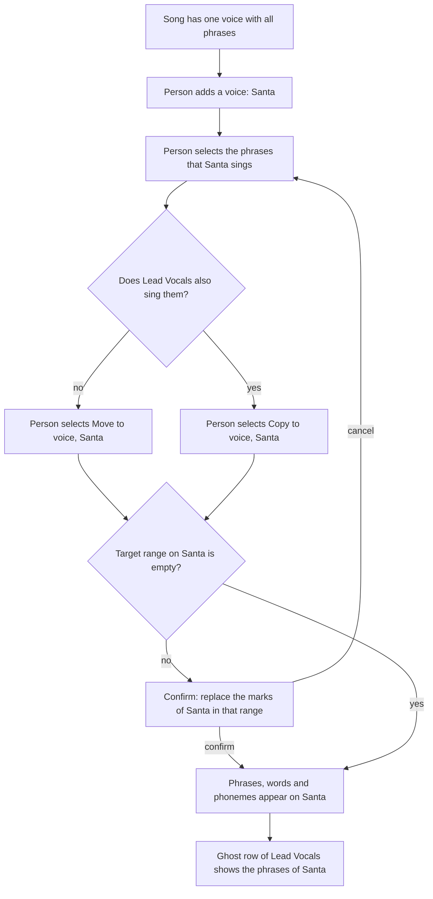
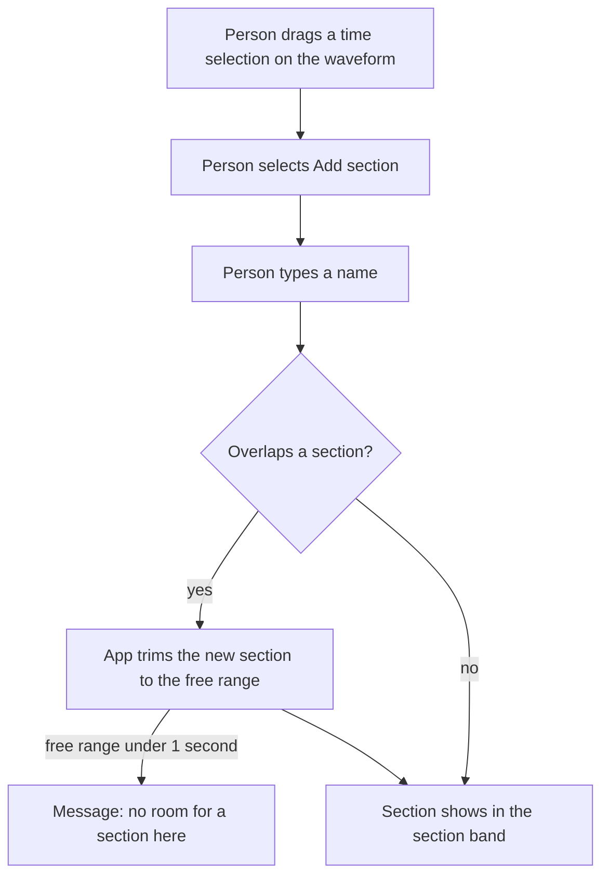

## Purpose

A show often has several face models, and each one sings a different part. A voice
holds the marks for one singer, and becomes one timing track in xLights. A section
names a time range of the song, so the person can work on, and export, one part of
the song at a time.

## User stories

- As the person, I want one timing track for each singer, so that each face model
  sings only its own lines.
- As the person, I want to move a line from one singer to another, so that I can
  divide one transcript between faces.
- As the person, I want a line that all singers sing to be on every voice, so that
  all faces sing the chorus.
- As the person, I want to name the parts of the song, so that I can find, review
  and export them.

## Functional requirements

- FR-voice-1 — The voice rail lists the voices of the song in their order.
- FR-voice-2 — The person adds a voice.
- FR-voice-3 — The person renames a voice.
- FR-voice-4 — The person changes the colour of a voice.
- FR-voice-5 — The person changes the order of the voices.
- FR-voice-6 — The person deletes a voice after a confirm dialog.
- FR-voice-7 — The person selects one voice to show on the layers.
- FR-voice-8 — The person moves the selected phrases to another voice.
- FR-voice-9 — The person copies the selected phrases to another voice.
- FR-voice-10 — A moved or copied phrase takes its words and their phonemes.
- FR-voice-11 — The stage shows the phrases of the other voices as thin bars in a
  "ghost" row under the phoneme layer.
- FR-voice-12 — The person mutes the face preview for a voice during play.
- FR-voice-13 — The face preview shows one face for each voice that is not muted,
  up to 4 faces.
- FR-voice-14 — The section band shows the sections of the song above the time
  ruler.
- FR-voice-15 — The person adds a section from the time selection.
- FR-voice-16 — The person renames a section.
- FR-voice-17 — The person drags an edge of a section.
- FR-voice-18 — The person deletes a section.
- FR-voice-19 — A click on a section selects its time range and scrolls to it.
- FR-voice-20 — The person adds sections from `[Name]` tags in pasted lyrics.
- FR-voice-21 — The person moves every phrase of a section to another voice with
  one action.

## User flows

### Divide one transcript between two singers



1. The person adds a voice and names it.
2. The person selects one or more phrases on the phrase layer.
3. The person selects "Move to voice" or "Copy to voice" and the target voice.
4. If the target voice has marks in the same time range, the app asks for
   confirmation.
5. The app moves or copies the phrases with their words and phonemes.

### Make sections



1. The person drags a time selection.
2. The person selects "Add section".
3. The person types a name.
4. The app trims the section if it overlaps another section.
5. The section band shows the section.

## Screens & states

**Voice rail** (left region of the editor, see
[mockups/02-editor.html](../mockups/02-editor.html), owned by
[04-timeline-editor.md](04-timeline-editor.md)). Each voice row shows the colour
chip, the name, the phrase count, a mute button for the face preview and a menu
(rename, colour, move up, move down, delete).

- one voice: the row has no delete action.
- many voices: the selected voice has a highlighted row.
- 12 voices: the "Add voice" button is disabled with the tooltip "A song has 12
  voices at most."

**Section band** (top of the stage).

- empty: a thin band with the hint "Drag on the waveform, then Add section".
- populated: one labelled block for each section.

**Phrase menu.** "Move to voice" and "Copy to voice" each open a list of the other
voices and "New voice".

## Behaviour rules

- A song has 1 to 12 voices.
- A voice name is unique in the song, without regard to letter case. It is 1 to 60
  characters.
- A voice name does not contain `<`, `>`, `&` or `"`. The file format can escape
  them, but the name shows in xLights menus and stays simple.
- A new voice gets the name "Voice N", where N is the lowest free number, and the
  next unused colour.
- Deleting a voice deletes its marks. It is one undo step.
- The person cannot delete the last voice.
- A copy makes new marks with new ids. The copies are independent after the copy.
- A copied or moved phrase keeps its `edited`, `estimated` and `unknown` states.
- "Transcribe" writes to the selected voice only.
- A section is 1 second long or more.
- Sections do not overlap. Sections can have gaps between them.
- A section name is unique in the song. A duplicate name gets a number, for example
  "Chorus 2".
- A phrase belongs to a section when the middle of the phrase is inside the
  section.
- Sections are shared by all voices of the song.
- Lyrics tags: a line that is only `[Name]` starts a section at the first phrase
  after it. The section ends where the next tag starts, or at the last phrase.
- Voice and section changes are undo steps.

## Data touched

- Reads and writes `VOICE`, `SECTION` and `MARK`.
- `VOICE` gains `previewMuted: bool`, stored with the song.

## Interfaces

**Store actions, `src/store/`:**

```ts
addVoice(songId, name?): Voice
renameVoice(id, name)            // rejects a duplicate name
setVoiceColor(id, color)
reorderVoices(songId, orderedIds)
deleteVoice(id)
movePhrases(phraseIds, toVoiceId, mode: 'move' | 'copy', replace: boolean)
addSection(songId, name, startMs, endMs): Section
updateSection(id, patch)
deleteSection(id)
phrasesInSection(voiceId, sectionId): Mark[]
```

No external interface.

## Edge cases & failures

| Case | Result |
|---|---|
| Duplicate voice name | Field error: "A voice with this name exists." |
| Move to a voice with marks in the range | Confirm dialog: "Santa has 3 phrases in this range. Replace them?" |
| Move every phrase off a voice | The voice stays, with no marks. |
| Section edge dragged over another section | The edge stops at the other section. |
| Section shorter than 1 second after a drag | The edge stops at 1 second. |
| Delete a section | The marks stay. Only the section goes. |
| A phrase spans two sections | It belongs to the section that holds its middle. |
| Song has more than 4 unmuted voices | The face preview shows the first 4 in voice order and the note "+2 more". |

## Acceptance criteria

- The voice rail shows the voices in `order`. (FR-voice-1)
- "Add voice" adds "Voice 2" to a song with one voice. (FR-voice-2)
- A renamed voice shows the new name after a reload. (FR-voice-3)
- A changed colour shows on the rail and on the ghost row. (FR-voice-4)
- "Move up" on the second voice makes it the first. (FR-voice-5)
- A deleted voice is absent, and one undo restores it with its marks. (FR-voice-6)
- A click on a voice shows only its marks on the three layers. (FR-voice-7)
- After a move, the source voice does not have the phrases and the target voice
  has them at the same times. (FR-voice-8, 10)
- After a copy, both voices have the phrases, and an edit on one does not change
  the other. (FR-voice-9, 10)
- The ghost row shows a bar for each phrase of each other voice. (FR-voice-11)
- A muted voice has no face in the face preview. (FR-voice-12)
- A song with two unmuted voices shows two faces, each with its voice name.
  (FR-voice-13)
- The section band shows each section at its time range. (FR-voice-14)
- "Add section" on a time selection of 0:10 to 0:25 makes a section with those
  times. (FR-voice-15)
- A renamed section shows the new name. (FR-voice-16)
- A dragged section edge snaps to the frame size and stops at the adjacent
  section. (FR-voice-17)
- A deleted section leaves every mark unchanged. (FR-voice-18)
- A click on a section scrolls the stage to its start. (FR-voice-19)
- Lyrics with `[Verse 1]` and `[Chorus]` tags make two sections. (FR-voice-20)
- "Move section to voice" moves each phrase of the section. (FR-voice-21)

## Out of scope

- Detecting singers automatically.
- Sections that differ for each voice.
- Nested sections.
- Separate audio files for each voice.

## Open questions

None.
