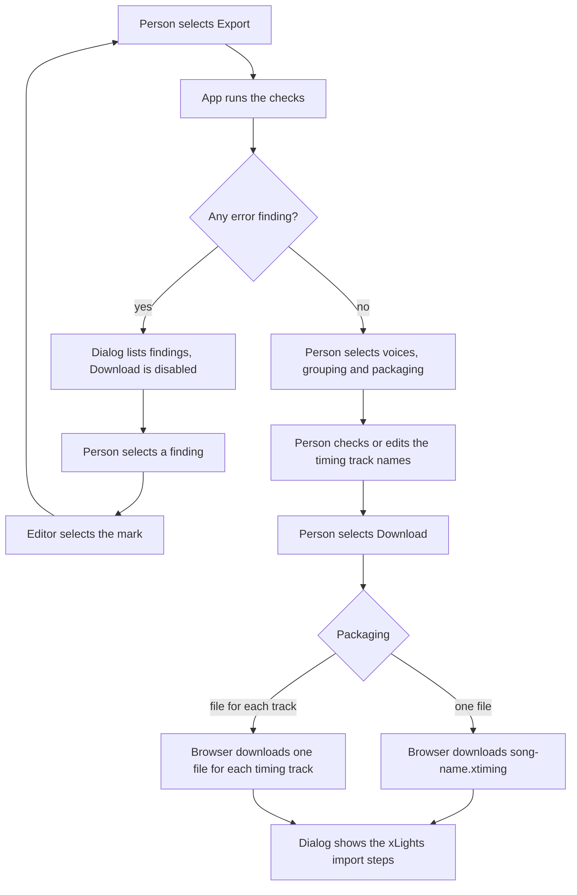
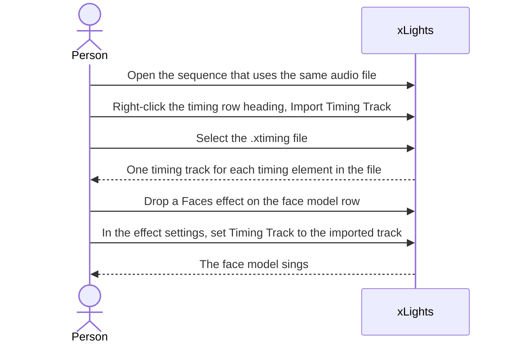

## Purpose

The app writes the marks as `.xtiming` files that xLights imports. The person
chooses how the voices and sections become timing tracks, so that the import fits
the face models of the show. The app also tells the person what to do in xLights
next.

## User stories

- As the person, I want one file with a timing track for each singer, so that I
  import once.
- As the person, I want a timing track for each section, so that I can import one
  part of a long song at a time.
- As the person, I want the app to check the marks before export, so that xLights
  does not show a closed mouth where I expect a word.
- As the person, I want the import steps for xLights beside the download, so that I
  do not search a manual.
- As the person, I want all files of a song in one download, so that I can keep a
  backup or move the song to another computer.
- As the person, I want the steps for a lead face model and chorus face models, so
  that one face model sings the lead and other face models sing the chorus together.

## Functional requirements

- FR-export-1 — The editor has an "Export" action that opens the export dialog.
- FR-export-2 — The export dialog lists every voice with a check box.
- FR-export-3 — The export dialog offers the grouping "One timing track for each
  voice".
- FR-export-4 — The export dialog offers the grouping "One timing track for each
  voice and section".
- FR-export-5 — The export dialog offers the packaging "One file with all timing
  tracks".
- FR-export-6 — The export dialog offers the packaging "One file for each timing
  track".
- FR-export-7 — The export dialog shows the name of each timing track that the
  export creates.
- FR-export-8 — The person edits the name of each timing track before export.
- FR-export-9 — The export dialog shows the frame size of the song.
- FR-export-10 — The export dialog has the option "Write rest phonemes in gaps",
  off by default.
- FR-export-11 — The app writes each timing track with exactly three
  `<EffectLayer>` elements: phrases, words, phonemes, in that order.
- FR-export-12 — The app writes every time as a whole number of milliseconds that
  is a multiple of the frame size.
- FR-export-13 — The app escapes the characters `&`, `<`, `>`, `"` and `'` in every
  label and name.
- FR-export-14 — The app writes one `<timing>` root element when the file has one
  timing track.
- FR-export-15 — The app writes one `<timings>` root element when the file has
  more than one timing track.
- FR-export-16 — The app runs the checks in [Behaviour rules](#behaviour-rules)
  before export and lists each finding.
- FR-export-17 — A click on a finding closes the dialog and selects the mark in the
  editor.
- FR-export-18 — The app blocks export while a finding of the type "error" exists.
- FR-export-19 — The app gives each file to the browser as a download.
- FR-export-20 — The export dialog shows the xLights import steps.
- FR-export-21 — The app remembers the export options for each song.
- FR-export-22 — The export dialog shows a text preview of the first 40 lines of
  the file.
- FR-export-23 — The "Files" group has the check box "Everything as one zip file".
- FR-export-24 — With the zip file selected, "Download zip" gives one file
  `<song name>.zip`.
- FR-export-25 — The zip file holds in `timing/` the `.xtiming` files of the
  selected export options, with the same bytes as a normal export.
- FR-export-26 — With "One file for each timing track", `timing/` also holds
  `<song name> - all.xtiming`.
- FR-export-27 — The zip file holds in `audio/` the audio file of the song, with
  its original name and bytes.
- FR-export-28 — The zip file holds `song.json` with the song, the voices, the
  sections and the marks.
- FR-export-29 — The zip file holds `lyrics.txt` when a voice has a phrase.
- FR-export-30 — The zip file holds `custom-dictionary.txt` when the custom
  dictionary has an entry.
- FR-export-31 — The zip file holds `README.txt` with one line for each file and
  the xLights import steps.
- FR-export-32 — The note under the zip file choice lists the files and the size
  of the zip file.
- FR-export-37 — If the app cannot read the audio tracks and the run report, the
  note under the zip file choice states it.
- FR-export-33 — The app writes the zip file in the browser. No request carries
  any part of it.
- FR-export-34 — The export dialog shows the steps for several face models under
  the import steps.
- FR-export-35 — `README.txt` holds the steps for several face models after the
  import steps.
- FR-export-36 — The "Voices" group shows the hint "Use one voice for each group of
  face models that sing together."
- FR-export-37 — The export dialog has a fixed head, a body that scrolls, and a
  fixed button row.
- FR-export-38 — The content of the export dialog fits the width of the dialog.
- FR-export-39 — The done line shows in the fixed button row.
- FR-export-40 — The dialog opens with no voice selected that has no marks.
- FR-export-41 — A disabled "Download" button shows the reason beside it.

## User flows

### Export a song with two voices



1. The person selects "Export".
2. The app runs the checks and lists the findings.
3. If an error finding exists, the person fixes it in the editor.
4. The person selects the voices, the grouping and the packaging.
5. The person checks the names of the timing tracks.
6. The person selects "Download".
7. The browser downloads the file or files.
8. The dialog shows the import steps.

### Import into xLights (shown to the person, performed in xLights)



## Screens & states

**Export dialog** — mockup: [mockups/03-export.html](../mockups/03-export.html).
Regions: voice list, grouping, packaging, options, timing track list, checks,
file preview, import steps, buttons.

Layout: the head with the title and the button row stay in view. Only the body
between them scrolls. The body has no scroll to the side at a width of 1024 px
or more. A long name or a long finding wraps. The file preview scrolls inside its
own box.

- ready: no error finding. "Download" is enabled.
- blocked: one or more error findings. "Download" is disabled, and the checks
  region is open.
- warnings only: "Download" is enabled. The checks region shows the count.
- empty: no voice has marks. The dialog shows "No marks to export. Transcribe the
  song first." and "Download" is disabled.
- done: a confirmation line, "2 timing tracks written to carol.xtiming", and the
  import steps expanded. The confirmation line is in the fixed button row, in a
  live region.
- zip file selected: the note under the check box lists the files of the zip file
  and its size. The button reads "Download zip". The footer count line counts
  1 file.

Labels:

- Dialog title: "Export to xLights". Beside it: "<song name> · Frame size: <frame size> ms".
- Group legends: "Voices", "Timing tracks", "Files", "Options".
- Timing track list heading: "Timing track names in xLights".
- Name of each name field: "Name of the timing track for <default timing track name>".
- Layer and mark count line of each timing track: "3 layers · 1 mark" or
  "3 layers · <count> marks".
- Checks heading: "Checks · <count> errors · <count> warnings". A count of 1 gives
  "1 error" and "1 warning".
- Preview heading: "Preview · <file name>". Name of the preview region: "File preview".
- Import steps heading: "Next, in xLights". Name of the first list: "Import steps".
- Heading and name of the second list: "Use the timing tracks with several face
  models".
- Hint under the voice list: "Use one voice for each group of face models that sing
  together."
- Footer count line: "<count> timing tracks · <count> files". A count of 1 gives
  "1 timing track" and "1 file".
- Done line for several files: "<count> timing tracks written to <count> files".
- No voice selected, beside the disabled "Download" button: "Select one voice or more."
- An error finding, beside the disabled "Download" button: "Correct the errors in
  "Checks" first."
- Buttons: "Close", "Download". With the zip file selected: "Close",
  "Download zip".
- Zip file choice in the "Files" group: "Everything as one zip file".
- Note under the zip file choice: "The zip file holds <count> files: <entry
  list>. Size: <size>." The entry list separates the paths with ", ". The size
  is "<count> KB" below 1 MB and "<count> MB" from 1 MB (1 MB = 1024 × 1024
  bytes).
- Note while the app reads the audio file: "The app reads the audio file of the
  song."
- Done line for the zip file: "<count> timing tracks written to <song name>.zip".

## Behaviour rules

**Names.**

- Grouping by voice: the timing track name is the voice name.
- Grouping by voice and section: the name is `<voice name> - <section name>`.
- A phrase outside every section goes to a timing track named
  `<voice name> - Unsectioned`. The app omits that track when it has no phrase.
- Timing track names in one export are unique. The dialog marks a duplicate as an
  error.
- File name, one file: `<song name>.xtiming`. File for each track:
  `<song name> - <timing track name>.xtiming`.
- In file names the app replaces each of `\ / : * ? " < > |` with `_`.

**File content.** The app writes exactly this shape, with `\n` line ends and UTF-8:

```xml
<?xml version="1.0" encoding="UTF-8"?>
<timings>
<timing name="Lead Vocals" subType="" SourceVersion="2024.01">
   <EffectLayer>
      <Effect label="Jingle bells" starttime="12350" endtime="13900" />
   </EffectLayer>
   <EffectLayer>
      <Effect label="Jingle" starttime="12350" endtime="13000" />
      <Effect label="bells" starttime="13000" endtime="13900" />
   </EffectLayer>
   <EffectLayer>
      <Effect label="etc" starttime="12350" endtime="12450" />
      <Effect label="AI" starttime="12450" endtime="12700" />
   </EffectLayer>
</timing>
</timings>
```

- The `<timings>` lines are absent when the file has one timing track.
- `subType` is an empty string.
- `SourceVersion` is `2024.01`. xLights does not read this attribute on import. The
  value matches the value in the xLights round-trip tests. xLights 2026.21 writes
  its own version, `2026.21`, in a file that it exports.
- Marks in a layer are in order of start time.
- A voice with no phoneme still gets three `<EffectLayer>` elements. The Faces
  effect needs three layers.
- With "Write rest phonemes in gaps" on, the app writes a `rest` phoneme in each
  gap of the phoneme layer between the first phrase start and the last phrase end.
- Grouping by section does not change times. Times stay relative to the start of
  the song.

**Checks.**

| Check | Type | Message |
|---|---|---|
| No selected voice has marks. | error | `No marks to export. Select a voice with marks.` |
| A selected voice has no marks, and another selected voice has marks. | warning | `“<voice name>” has no marks. Clear its check box, or add marks.` |
| Two timing tracks have the same name. | error | `Two timing tracks have the name “<timing track name>”.` |
| A timing track name is empty. | error | `A timing track of “<voice name>” has no name.` |
| A timing track name has only spaces after the xLights import. | error | `xLights cannot use the timing track name “<timing track name>”. Use letters from A to Z, digits or spaces.` |
| A phoneme label is not one of the ten phoneme labels. | error | `“<label>” at <time> is not a phoneme label.` |
| A mark has an end time that is not after its start time. | error | `“<label>” at <time> ends at or before its start.` |
| The xLights import changes a timing track name. | warning | `xLights shows the timing track “<timing track name>” as “<name after the import>”. xLights removes = < > & " ' and characters that are not ASCII from a name.` |
| Two different timing track names are the same after the xLights import. | warning | `xLights gives these timing tracks almost the same name: “<name after the import>” and “<name after the import>_1”. Change a voice name or a section name.` |
| A word has no phoneme. | warning | `“<label>” at <time> has no phoneme.` |
| A word is "unknown". | warning | `“<label>” at <time> is an unknown word. Its phonemes are a guess.` |
| A word is "estimated". | warning | `“<label>” at <time> has an estimated time.` |
| A mark is shorter than the frame size after the snap. | warning | `“<label>” at <time> is shorter than one frame. The export makes it one frame long.` |
| A mark ends after the end of the song. | warning | `“<label>” at <time> ends after the end of the song.` |

- The app snaps all times in the output with `snap`. The stored marks do not
  change.
- If the snap makes a mark zero length, the app extends the mark to one frame size
  and reports the warning.
- The xLights import removes each of `= < > & " '`, each control character and
  each character that is not ASCII from a timing track name. It keeps the spaces.
  The checks compare the names after this removal.
- If two names are the same after the removal, xLights adds `_1` to the second
  name. The person then cannot tell the two timing tracks apart.
- An empty timing track name, or a name that is the same before the import, has
  its own error. The import checks do not report it again.
- A selected voice with no marks gives a timing track with three empty
  `<EffectLayer>` elements in grouping by voice. This is a legal timing track.
  Grouping by voice and section omits the voice.
- If no selected voice has marks, the one error replaces the warnings.

**Voice selection.** The dialog selects only voices with marks when it opens.

- First export of the song: each voice with marks is selected.
- Later export: the voices of the previous export stay selected, and each voice
  that the person added after it is selected. A voice with no marks is not
  selected, also when the previous export selected it.
- The person can select a voice with no marks. The checks then give the warning.

**Import steps text.** The dialog shows these steps. The names of the controls are
the names in xLights 2026.21.

1. Open the sequence in xLights. Use the same audio file, so the times match.
2. Check the frame size: in "Sequence Settings", the tab "Info / Media" shows
   "Sequence Timing". It must match the frame size in this dialog: <frame size> ms.
   Note: If the song has a frame size of 25 ms and the sequence has 50 ms, xLights
   moves each time down to a multiple of 50 ms.
3. Right-click a timing row heading and select "Import Timing Track".
4. Select the `.xtiming` file. If the file has several timing tracks, xLights adds
   one timing track for each.
   Note: If a timing track with the same name exists in the sequence, xLights adds
   "_1" to the new name. xLights also removes & < > " ' = and each character that
   is not ASCII from a timing track name.
5. Drop a Faces effect on the row of the face model, from the start to the end of
   the song.
   Note: The effect moves the mouth only during its own time.
6. In the effect settings, under "Mouth Movements", select "Timing Track" and the
   timing track for that face model.
   Note: The list shows only the timing tracks with three layers.
7. Repeat steps 5 and 6 for each face model.

**Steps for several face models.** Under the import steps, the dialog shows the
heading "Use the timing tracks with several face models" and these steps. A face
model is, for example, a singing tree or a singing pumpkin.

1. Check that each face model has a face definition with a mouth for each phoneme
   label: AI, E, etc, FV, L, MBP, O, rest, U, WQ.
   Note: A singing tree or a singing pumpkin from a vendor comes with a face
   definition. xLights shows no mouth for a phoneme label that the face definition
   does not have.
2. Drop one Faces effect on the face model that sings the lead.
3. Under "Mouth Movements", select "Timing Track" and the timing track of the lead
   voice.
4. Drop one Faces effect on each face model that sings the chorus.
   Note: Put the effect on each face model, not on a model group. On a model group,
   xLights shows only a face definition of the type "Matrix".
5. In each of these effects, select the same timing track: the timing track of the
   chorus voice.

`README.txt` holds the same two lists as plain text. A blank line and the heading
with a colon separate the two lists. A file has no dialog, so step 2 in
`README.txt` ends with its own sentences: "The frame size of this song is
<frame size> ms. The frame size of the sequence must be the same." The line
before the steps reads: "To import a timing file into xLights, do these steps.
The app shows the same steps after an export." `README.txt` has no word "dialog".

Verified against the xLights source at tag `2026.21` (see
[Interfaces](#interfaces)), a real import into xLights 2026.21 (issue #79), and
https://manual.xlights.org/xlights/chapters/chapter-four-sequencer/singing-faces.md
and
https://manual.xlights.org/xlights/chapters/chapter-four-sequencer/timing-tracks.md
(retrieved 2026-11-24). The manual does not give the place of the frame size, the
ten phoneme labels, or the rule for a model group.

**Zip file.** With "Everything as one zip file" selected, "Download zip" gives
one file, `<song name>.zip`. It holds these entries, in this order:

| Entry | When | Content |
|---|---|---|
| `timing/<file name>.xtiming` | Always | The files of the selected export options, as `exportFiles` writes them. |
| `timing/<song name> - all.xtiming` | "One file for each timing track" | One file with all timing tracks. |
| `audio/<audio file name>` | Always | The audio file of the song, with its original bytes. |
| `song.json` | Always | The song data. See [Interfaces](#interfaces). |
| `lyrics.txt` | A voice has a phrase | For each voice in order: the voice name as a heading line, then one line for each phrase label in time order. A blank line separates two voices. |
| `custom-dictionary.txt` | The custom dictionary has an entry | The custom dictionary in the format of its export. |
| `tracks/vocals.wav` | The last run kept the audio tracks | The vocals of the last vocal separation: a WAV file of 16-bit PCM in one channel, at the stored sample rate. |
| `tracks/instruments.wav` | The last run kept the audio tracks | The instruments of the last vocal separation, in the same form. |
| `report.txt` | The song has a run report | The text of the run report, as "Copy report" gives it. |
| `README.txt` | Always | One line for each entry of this zip file, then the import steps text and the steps for several face models. |

- The `README.txt` line of each audio track states its sample rate and the song
  time of its first sample. A range run gives the start of the range.
- The note under "Everything as one zip file" counts the bytes of the two WAV files
  with no conversion of the audio.
- The zip file stores each entry with no compression. Audio files are compressed
  already.
- In an entry name the app replaces each of these with `_`: a control
  character, `/`, `\`, `: * ? " < > |`, and a `.` at the start. Other Unicode
  characters stay. An empty name becomes `_`.
- Entry names are unique in the zip file. The comparison ignores case. The app
  adds ` (2)`, ` (3)` and so on before the extension.
- The zip file name is `<song name>.zip`, with the same replacements.
- The errors of the checks that disable "Download" also disable "Download zip".
- The app remembers the zip file choice with the export options of the song.
- The peak memory of a download is two copies of the audio file: the bytes that
  the app reads from storage, and the zip file.

## Data touched

- Reads `SONG`, `VOICE`, `SECTION` and `MARK`. Writes none of them.
- Reads `AUDIO_FILE` and the custom entries for the zip file. Writes neither.
- Stores the export options for each song in the `settings` object store, with
  the zip file choice as `zip`.

## Interfaces

**The `.xtiming` format.** Verified against the xLights source at tag `2026.21`,
commit `a123de002e04b9fe9a8e56a7da92ebbf831615ba`, of
https://github.com/xLightsSequencer/xLights (issue #138). The earlier check used
commit `99a289bf`. That commit is the parent of the tag, and the tag commit changes
only the version files, so no rule changed. Paths and lines are at the tag.

| Rule | Source at `2026.21` | Result |
|---|---|---|
| The XML declaration, `<timings>` for more than one timing track, and `<timing name subType SourceVersion>` in this order | `src-ui-wx/sequencer/RowHeading.cpp:1816-1834` | Confirmed |
| `<EffectLayer>` with 3 spaces, `<Effect label starttime endtime />` with 6 spaces, `\n` line ends | `src-core/render/Element.cpp:824-840` | Confirmed |
| The import reads `<timing>` or `<timings>` and adds every timing track. It asks nothing. | `src-core/render/SequenceFile.cpp:1002-1017` | Confirmed |
| The import reads `name` and `subType`. It does not read `SourceVersion`. | `src-core/render/SequenceFile.cpp:931-934` | Confirmed |
| The import takes each `<EffectLayer>` in order. Layer 1 is the first layer of the new timing track. | `src-core/render/SequenceFile.cpp:942-955` | Confirmed |
| The import moves each time down to a multiple of the frame size. | `src-core/render/SequenceFile.cpp:966-973` | Confirmed |
| `XmlSafe` writes `&amp;`, `&lt;`, `&gt;`, `&apos;`, `&quot;`, and `&#9;`, `&#10;`, `&#13;`. It removes the other control characters and keeps UTF-8 bytes. | `src-core/utils/UtilFunctions.cpp:179-205` | Confirmed: the same as `escapeXml` |
| A timing track name that exists gets `_1`, `_2` and so on. | `src-core/render/SequenceFile.cpp:903-926` | Different: the spec said "renames". Now exact. |
| The import removes `= < > & " '` and each character that is not ASCII from a timing track name. | `src-core/render/SequenceFile.cpp:905`, `src-core/utils/UtilFunctions.cpp:315-328` | Different: not in the spec before. The import steps state it. The checks warn about it (issue #143). |
| The removal compares each byte as a signed `char`. It removes each byte below 32 and each UTF-8 byte above 127. It keeps byte 127 and does not trim spaces. A second name that is the same after the removal gets `_1`. An empty name makes a timing track with no name. | `src-core/utils/UtilFunctions.cpp:315-328`, `src-core/render/SequenceFile.cpp:903-936`, `src-ui-wx/sequencer/tabSequencer.cpp:3822-3836` | Confirmed from the source for issue #143. Not confirmed by a real import. |
| The "Timing Track" list of the Faces effect shows only timing tracks with exactly 3 layers. | `src-ui-wx/effectpanels/FacesPanel.cpp:166-177` | Confirmed: the reason for three layers |
| The Faces effect reads layer index 2. With no phoneme at a time, or an empty label, it shows `rest`. | `src-core/effects/FacesEffect.cpp:1164-1194` | Confirmed |
| The phoneme labels are `AI`, `E`, `FV`, `L`, `MBP`, `O`, `U`, `WQ`, `etc`, `rest`, and `(off)`. The comparison is case-sensitive. | `src-core/effects/FacesEffect.cpp:609-631` | Confirmed |
| A face definition key is `Mouth-<label>`, for example `Mouth-AI`. A label with no key lights no mouth node. | `src-core/effects/FacesEffect.cpp:1211-1220` | Confirmed |
| On a model group, the Faces effect draws only a face definition of the type `Matrix`. | `src-core/effects/FacesEffect.cpp:1060-1068`, `:1160` | Confirmed, also by a real render |
| The face definition types in the model dialog are "Single Nodes", "Node Ranges" and "Matrix". | `src-ui-wx/model/ModelFacesPanel.cpp:408-410` | Confirmed |
| The frame size is "Sequence Timing" on the tab "Info / Media" of "Sequence Settings". | `src-ui-wx/sequencer/SeqSettingsDialog.cpp:321`, `:451` | Confirmed, also in the program |

A real import into xLights 2026.21 on Linux confirmed the format (issue #79):

- xLights imports one file with all timing tracks, and one file for each timing
  track, with no message. Each timing track has three layers.
- xLights exports the imported timing tracks with the same bytes as the file of the
  app, except `SourceVersion`. `tests/fixtures/xtiming/xlights-2026.21-export.xtiming`
  is that file. `xlightsFile.test.ts` compares it with `writeXtiming`.
- A label with `&`, `<`, `>`, `"`, `'` and `café` imports and exports unchanged.
  The sequencer grid of 2026.21 shows `café` as `caf??`. The bytes do not change.
- A Faces effect on each of three face models with a "Node Ranges" face definition
  shows the mouth of the phoneme of its timing track in each of 557 frames.
- A Faces effect on a model group of two such face models lights no node.

**Module contract, `src/lib/xtiming/`:**

```ts
interface ExportTrack {
  name: string
  layers: [ExportMark[], ExportMark[], ExportMark[]]   // phrases, words, phonemes
  key: string                            // voiceId or voiceId:sectionId
  voiceId?: string
}
interface ExportMark {
  label: string
  startMs: number
  endMs: number
  markId?: string                        // the id of the stored mark
  unknown?: boolean                      // words only
  estimated?: boolean                    // words only
}
interface ExportOptions {
  voiceIds: string[]
  grouping: 'voice' | 'voice-section'
  packaging: 'one-file' | 'file-per-track'
  writeRest: boolean
  trackNames: Record<string, string>     // key: voiceId or voiceId:sectionId
}
interface Finding {
  type: 'error' | 'warning'
  check: string
  message: string
  markId?: string
  voiceId?: string
}
interface ExportFile { name: string; text: string }

buildTracks(
  song: Song,
  voices: readonly Voice[],
  sections: readonly Section[],
  marks: readonly Mark[],
  options: ExportOptions,
): ExportTrack[]
checkTracks(
  tracks: readonly ExportTrack[],
  song: Song,
  voices: readonly Voice[],
  marks: readonly Mark[],
  options: ExportOptions,
): Finding[]
writeXtiming(tracks: ExportTrack[], sourceVersion: string): string   // XML text
escapeXml(text: string): string
exportFiles(
  tracks: ExportTrack[],
  songName: string,
  packaging: ExportOptions['packaging'],
): ExportFile[]
```

`writeXtiming` reads only `label`, `startMs` and `endMs` of a mark.
`writeXtiming` is a pure function with no browser API, so the unit tests compare
its output with golden files.

**The zip format.** Verified against the PKWARE APPNOTE, version 6.3.10
(https://pkware.cachefly.net/webdocs/casestudies/APPNOTE.TXT, retrieved
2026-11-24):

- 4.3.7 — the local file header. 4.3.12 — the central directory header. 4.3.16 —
  the end of central directory record.
- 4.4.2 and 4.4.3 — "version made by" 2.0 on UNIX, "version needed to extract"
  2.0. Info-ZIP converts the names of an MS-DOS entry from a code page, so the
  app states UNIX.
- 4.4.4 — general purpose bit 11: the file name is UTF-8.
- 4.4.5 — method 0: stored, with no compression.
- 4.4.6 — the MS-DOS date and time, in local time, with steps of 2 seconds. A
  date before 1980 becomes 1980-01-01 00:00.
- 4.4.7 — CRC-32 with the polynomial `0xEDB88320`.
- 4.4.15 — the external attributes of a UNIX entry hold the file mode `0o100644`.
- 4.4.1.4 — the value `0xFFFF` or `0xFFFFFFFF` in a field means ZIP64. The app
  writes no ZIP64, so it refuses more than 65 534 entries, and a file, an offset or
  a size of `0xFFFFFFFF` bytes or more.

**`song.json`.** The file is for backup and for other programs. The app does not
import it. It holds no audio. The keys have this order:

```text
{
  "format": "singing-face-timing-song",
  "version": 1,
  "song": { "id", "name", "durationMs", "frameMs", "createdAt", "updatedAt" },
  "voices": [{ "id", "songId", "name", "order", "color" }],
  "sections": [{ "id", "songId", "name", "startMs", "endMs" }],
  "marks": [{ "id", "voiceId", "layer", "label", "startMs", "endMs", "parentId",
              "edited", "estimated"?, "unknown"? }]
}
```

- The values are the values of the store. Times are whole milliseconds.
- A mark has `estimated` and `unknown` only when the store has a value.
- The file omits `previewMuted` of a voice, because it is view state.
- A change to the shape that a reader can break on adds 1 to `version`.

**Module contract, `src/lib/zip/` and `src/lib/songArchive/`:**

```ts
interface ZipEntry { name: string; data: Uint8Array<ArrayBuffer>; modified: Date }
class ZipLimitError extends Error {}
writeZip(entries: readonly ZipEntry[]): Uint8Array<ArrayBuffer>[]   // the parts of a Blob
zipLength(entries: readonly { name: string; size: number }[]): number
safeEntryName(name: string): string
entryPath(folder: string | null, fileName: string): string
uniquePathMaker(): (path: string) => string

interface ArchiveFile {
  folder: string | null; fileName: string; description: string
  data: Uint8Array<ArrayBuffer>
}
songArchiveEntries(input: {
  content: SongContent
  tracks: ExportTrack[]
  packaging: ExportOptions['packaging']
  audio: { fileName: string; data: Uint8Array<ArrayBuffer> }
  customEntries: readonly CustomDictionaryLine[]
  extraFiles: readonly ArchiveFile[]     // issue #129
  modified: Date
}): ZipEntry[]
songArchiveName(songName: string): string
songJson(content: SongContent): string
lyricsText(voices: readonly Voice[], marks: readonly Mark[]): string
importSteps(frameMs: number): ImportStep[]     // the dialog and README.txt
importStepsText(frameMs: number): string
```

`writeZip` refers to the bytes of each entry and does not copy them.

## Edge cases & failures

| Case | Result |
|---|---|
| Label contains `&` | The file has `&amp;`. xLights shows `&`. A real import confirms it. |
| Label has non-ASCII text, for example `café` | The file has the UTF-8 bytes unchanged. xLights keeps the bytes. The sequencer grid of xLights 2026.21 shows `caf??`. |
| Voice with phrases and words but no phonemes | Three layers, the third is empty. Warning for each word. |
| Section grouping with no sections | The dialog disables that grouping with the hint "This song has no sections." |
| The browser can block several downloads | The dialog shows a standing hint beside "One file for each timing track": "The browser can block several downloads. If files are missing, allow downloads for this site, or select One file." A page cannot detect a blocked download. |
| A label has a control character | The file omits the characters that XML 1.0 forbids. A tab or a line break in a label is kept. |
| 12 voices and 10 sections | 120 timing tracks at most. The timing track list scrolls. |
| A timing track name exists in the xLights sequence | xLights adds `_1` to the name on import, then `_2` and so on. The import steps state this. |
| A timing track name has `&`, `<`, `>`, `"`, `'`, `=` or a character that is not ASCII | xLights removes those characters from the name on import. `Lead & "Co" <café>` becomes `Lead  Co caf`. The import steps state this. |
| A phoneme label that the face definition of the face model does not have | xLights lights no mouth node for that phoneme. |
| A Faces effect on a model group | xLights draws only a face definition of the type "Matrix". The steps for several face models state this. |
| Song with frame size 25 ms imported into a 50 ms sequence | xLights moves times down to 50 ms. The import steps warn about it in step 2. |
| The app cannot read the audio file of the song for the zip file | The dialog shows "The app could not read the audio file of this song. Download the timing files without the zip." The dialog stays open. |
| The app cannot read the separated tracks and the run report of the song for the zip file | The note under the zip file choice starts with "The app could not read the separated tracks and the run report of this song. The zip file does not hold them." The list of the note has no track and no report. "Download zip" stays enabled. |
| The zip file needs ZIP64 | The dialog shows "The song is too large for one zip file. Download the files one at a time." The dialog stays open. |
| The audio file name has `/` or a character that is not ASCII | The entry name replaces `/` with `_` and keeps the other characters. |
| The custom dictionary has no entry | The zip file has no `custom-dictionary.txt`. |

## Acceptance criteria

- "Export" opens the dialog. (FR-export-1)
- A song with 3 voices with marks shows 3 check boxes, all checked. (FR-export-2)
- Grouping by voice with 2 voices lists 2 timing tracks. (FR-export-3, 7)
- Grouping by voice and section with 2 voices and 3 sections lists 6 timing
  tracks, without empty ones. (FR-export-4, 7)
- "One file" downloads 1 file. "One file for each timing track" with 2 tracks
  downloads 2 files. (FR-export-5, 6, 19)
- An edited timing track name is the `name` attribute in the file. (FR-export-8)
- The dialog shows "Frame size: 50 ms" for a 50 ms song. (FR-export-9)
- With the rest option on, the phoneme layer in the file has no gap between the
  first phrase start and the last phrase end. (FR-export-10)
- Each `<timing>` in every output has exactly 3 `<EffectLayer>` children.
  (FR-export-11)
- Every `starttime` and `endtime` in the output is a whole number and a multiple
  of the frame size. (FR-export-12)
- A label `Tom & "Jerry's" <3` round-trips through an XML parser to the same text.
  (FR-export-13)
- A one-track file has the root `<timing>`. A two-track file has the root
  `<timings>`. (FR-export-14, 15)
- The output of `writeXtiming` for the fixture song equals the golden file byte
  for byte. (FR-export-11 to 15)
- A song with a word that has no phoneme lists one warning. (FR-export-16)
- A click on a finding selects the mark in the editor. (FR-export-17)
- Two timing tracks with one name disable "Download". (FR-export-18)
- A timing track name `Café` gives one warning in the checks. "Download" stays
  enabled. (FR-export-16)
- A timing track name `Lead Vocals` gives no warning. (FR-export-16)
- A timing track name `Ééé` disables "Download". (FR-export-18)
- The dialog shows the 7 import steps after a download. (FR-export-20)
- The dialog shows the 5 steps for several face models under the import steps.
  (FR-export-34)
- `README.txt` ends with the 5 steps for several face models. (FR-export-35)
- The "Voices" group shows the hint for face models that sing together.
  (FR-export-36)
- `writeXtiming` writes the same bytes as xLights 2026.21 for the timing tracks of
  a file that xLights exported. (FR-export-11 to 15)
- The dialog opens with the options of the previous export of that song.
  (FR-export-21)
- The preview shows the first 40 lines of the file text. (FR-export-22)
- "Everything as one zip file" downloads one file `<song name>.zip`.
  (FR-export-23, 24)
- `unzip -t` reports no error for the zip file, and each entry has the correct
  size and CRC. (FR-export-24)
- The `.xtiming` entries are the same bytes as the files of a normal export with
  the same options. (FR-export-25, 26)
- The audio entry has the same bytes as the audio file that the person added.
  (FR-export-27)
- An audio file name with a character that is not ASCII, or with `/`, gives a
  legal entry name. (FR-export-27)
- The zip file of the demo song lists `timing/Silent Night.xtiming`,
  `audio/silent-night.ogg`, `song.json`, `lyrics.txt` and `README.txt`.
  (FR-export-28 to 31)
- With the zip file selected, the note lists the files and the size.
  (FR-export-32)
- After a transcribe run with the audio tracks kept, the zip file also holds
  `tracks/vocals.wav`, `tracks/instruments.wav` and `report.txt`. A song with no
  run holds none of them. (FR-export-32)
- At 1440x900 and at 1024x768, the scroll width of the export dialog is equal to
  its client width, with two voices and with warnings. (FR-export-37, 38)
- After a download of two files, the confirmation line is in the viewport.
  (FR-export-39)
- A new voice with no marks is not selected, and "Download" stays enabled.
  (FR-export-40)
- A selected voice with no marks gives a warning, and "Download" stays enabled.
  (FR-export-16)
- An error finding shows "Correct the errors in "Checks" first." beside the
  disabled "Download". (FR-export-41)
- `README.txt` has no word "dialog". (FR-export-35)
- **Manual check.** xLights imports the two-voice export of the demo song with no
  error message. A Faces effect on each of two face models animates from its timing
  track. The check records the xLights version. A real import into xLights 2026.21
  on an isolated display met this criterion on 2026-11-24 (issue #79).

## Out of scope

- Papagayo `.pgo` export.
- Import of `.xtiming` or `.pgo` files into the app.
- Import of a zip file or of `song.json`.
- Compression in the zip file.
- Writing into an `.xsq` sequence file.
- xLights `subType` values other than an empty string.

## Open questions

None.
