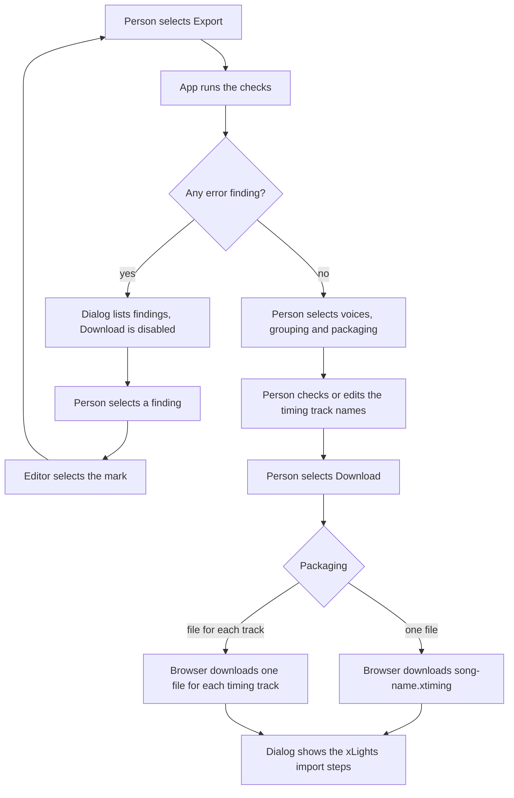
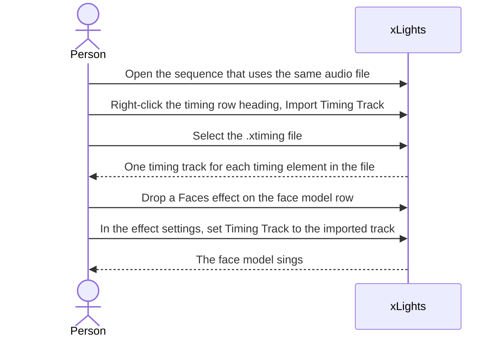

## Purpose

The app writes the marks as `.xtiming` files that xLights imports. The person
chooses how the voices and sections become timing tracks, so that the import fits
the face models of the show. The app also tells the person what to do in xLights
next.

## User stories

- As the person, I want one file with a timing track for each singer, so that I
  import once.
- As the person, I want a timing track for each section, so that I can import one
  part of a long song at a time.
- As the person, I want the app to check the marks before export, so that xLights
  does not show a closed mouth where I expect a word.
- As the person, I want the import steps for xLights beside the download, so that I
  do not search a manual.

## Functional requirements

- FR-export-1 — The editor has an "Export" action that opens the export dialog.
- FR-export-2 — The export dialog lists every voice with a check box.
- FR-export-3 — The export dialog offers the grouping "One timing track for each
  voice".
- FR-export-4 — The export dialog offers the grouping "One timing track for each
  voice and section".
- FR-export-5 — The export dialog offers the packaging "One file with all timing
  tracks".
- FR-export-6 — The export dialog offers the packaging "One file for each timing
  track".
- FR-export-7 — The export dialog shows the name of each timing track that the
  export creates.
- FR-export-8 — The person edits the name of each timing track before export.
- FR-export-9 — The export dialog shows the frame size of the song.
- FR-export-10 — The export dialog has the option "Write rest phonemes in gaps",
  off by default.
- FR-export-11 — The app writes each timing track with exactly three
  `<EffectLayer>` elements: phrases, words, phonemes, in that order.
- FR-export-12 — The app writes every time as a whole number of milliseconds that
  is a multiple of the frame size.
- FR-export-13 — The app escapes the characters `&`, `<`, `>`, `"` and `'` in every
  label and name.
- FR-export-14 — The app writes one `<timing>` root element when the file has one
  timing track.
- FR-export-15 — The app writes one `<timings>` root element when the file has
  more than one timing track.
- FR-export-16 — The app runs the checks in [Behaviour rules](#behaviour-rules)
  before export and lists each finding.
- FR-export-17 — A click on a finding closes the dialog and selects the mark in the
  editor.
- FR-export-18 — The app blocks export while a finding of the type "error" exists.
- FR-export-19 — The app gives each file to the browser as a download.
- FR-export-20 — The export dialog shows the xLights import steps.
- FR-export-21 — The app remembers the export options for each song.
- FR-export-22 — The export dialog shows a text preview of the first 40 lines of
  the file.

## User flows

### Export a song with two voices



1. The person selects "Export".
2. The app runs the checks and lists the findings.
3. If an error finding exists, the person fixes it in the editor.
4. The person selects the voices, the grouping and the packaging.
5. The person checks the names of the timing tracks.
6. The person selects "Download".
7. The browser downloads the file or files.
8. The dialog shows the import steps.

### Import into xLights (shown to the person, performed in xLights)



## Screens & states

**Export dialog** — mockup: [mockups/03-export.html](../mockups/03-export.html).
Regions: voice list, grouping, packaging, options, timing track list, checks,
file preview, import steps, buttons.

- ready: no error finding. "Download" is enabled.
- blocked: one or more error findings. "Download" is disabled, and the checks
  region is open.
- warnings only: "Download" is enabled. The checks region shows the count.
- empty: no voice has marks. The dialog shows "No marks to export. Transcribe the
  song first." and "Download" is disabled.
- done: a confirmation line, "2 timing tracks written to carol.xtiming", and the
  import steps expanded.

Labels:

- Dialog title: "Export to xLights". Beside it: "<song name> · Frame size: <frame size> ms".
- Group legends: "Voices", "Timing tracks", "Files", "Options".
- Timing track list heading: "Timing track names in xLights".
- Name of each name field: "Name of the timing track for <default timing track name>".
- Layer and mark count line of each timing track: "3 layers · 1 mark" or
  "3 layers · <count> marks".
- Checks heading: "Checks · <count> errors · <count> warnings". A count of 1 gives
  "1 error" and "1 warning".
- Preview heading: "Preview · <file name>". Name of the preview region: "File preview".
- Import steps heading: "Next, in xLights".
- Footer count line: "<count> timing tracks · <count> files". A count of 1 gives
  "1 timing track" and "1 file".
- Done line for several files: "<count> timing tracks written to <count> files".
- No voice selected, beside the disabled "Download" button: "Select one voice or more."
- Buttons: "Close", "Download".

## Behaviour rules

**Names.**

- Grouping by voice: the timing track name is the voice name.
- Grouping by voice and section: the name is `<voice name> - <section name>`.
- A phrase outside every section goes to a timing track named
  `<voice name> - Unsectioned`. The app omits that track when it has no phrase.
- Timing track names in one export are unique. The dialog marks a duplicate as an
  error.
- File name, one file: `<song name>.xtiming`. File for each track:
  `<song name> - <timing track name>.xtiming`.
- In file names the app replaces each of `\ / : * ? " < > |` with `_`.

**File content.** The app writes exactly this shape, with `\n` line ends and UTF-8:

```xml
<?xml version="1.0" encoding="UTF-8"?>
<timings>
<timing name="Lead Vocals" subType="" SourceVersion="2024.01">
   <EffectLayer>
      <Effect label="Jingle bells" starttime="12350" endtime="13900" />
   </EffectLayer>
   <EffectLayer>
      <Effect label="Jingle" starttime="12350" endtime="13000" />
      <Effect label="bells" starttime="13000" endtime="13900" />
   </EffectLayer>
   <EffectLayer>
      <Effect label="etc" starttime="12350" endtime="12450" />
      <Effect label="AI" starttime="12450" endtime="12700" />
   </EffectLayer>
</timing>
</timings>
```

- The `<timings>` lines are absent when the file has one timing track.
- `subType` is an empty string.
- `SourceVersion` is `2024.01`. xLights does not read this attribute on import. The
  value matches the value in the xLights round-trip tests.
- Marks in a layer are in order of start time.
- A voice with no phoneme still gets three `<EffectLayer>` elements. The Faces
  effect needs three layers.
- With "Write rest phonemes in gaps" on, the app writes a `rest` phoneme in each
  gap of the phoneme layer between the first phrase start and the last phrase end.
- Grouping by section does not change times. Times stay relative to the start of
  the song.

**Checks.**

| Check | Type | Message |
|---|---|---|
| A selected voice has no marks. | error | `“<voice name>” has no marks.` |
| Two timing tracks have the same name. | error | `Two timing tracks have the name “<timing track name>”.` |
| A timing track name is empty. | error | `A timing track of “<voice name>” has no name.` |
| A phoneme label is not one of the ten phoneme labels. | error | `“<label>” at <time> is not a phoneme label.` |
| A mark has an end time that is not after its start time. | error | `“<label>” at <time> ends at or before its start.` |
| A word has no phoneme. | warning | `“<label>” at <time> has no phoneme.` |
| A word is "unknown". | warning | `“<label>” at <time> is an unknown word. Its phonemes are a guess.` |
| A word is "estimated". | warning | `“<label>” at <time> has an estimated time.` |
| A mark is shorter than the frame size after the snap. | warning | `“<label>” at <time> is shorter than one frame. The export makes it one frame long.` |
| A mark ends after the end of the song. | warning | `“<label>” at <time> ends after the end of the song.` |

- The app snaps all times in the output with `snap`. The stored marks do not
  change.
- If the snap makes a mark zero length, the app extends the mark to one frame size
  and reports the warning.

**Import steps text.** The dialog shows these steps:

1. Open the sequence in xLights. Use the same audio file, so the times match.
2. Check the frame size: Sequence Settings shows 25 ms or 50 ms. It must match the
   frame size in this dialog.
3. Right-click a timing row heading and select "Import Timing Track".
4. Select the `.xtiming` file. If the file has several timing tracks, xLights adds
   one timing track for each.
5. Drop a Faces effect on the row of the face model.
6. In the effect settings, under "Mouth Movements", select the timing track for
   that face model.
7. Repeat steps 5 and 6 for each face model.

Verified against:
https://manual.xlights.org/xlights/chapters/chapter-four-sequencer/singing-faces.md
and
https://manual.xlights.org/xlights/chapters/chapter-four-sequencer/timing-tracks.md
(retrieved 2026-11-24). The manual does not give the menu path for the frame size.
Epic 6 confirms the wording of step 2 in xLights.

## Data touched

- Reads `SONG`, `VOICE`, `SECTION` and `MARK`. Writes none of them.
- Stores the export options for each song in the `settings` object store.

## Interfaces

**The `.xtiming` format.** Verified against the xLights source at commit `99a289bf`
of https://github.com/xLightsSequencer/xLights:

- `src-core/render/Element.cpp`, `TimingElement::GetExport()` — the
  `<EffectLayer>` and `<Effect label starttime endtime />` lines and their
  indentation.
- `src-ui-wx/sequencer/RowHeading.cpp` — the XML declaration, the `<timings>`
  wrapper for more than one timing track, and the `<timing name subType
  SourceVersion>` line.
- `src-core/render/SequenceFile.cpp`, `SequenceFile::ProcessXTiming` — the import:
  it reads `name` and `subType`, takes each `<EffectLayer>` in order, reads
  `label`, `starttime` and `endtime`, and moves each time down to a multiple of the
  frame size.
- `src-core/effects/FacesEffect.cpp` — the Faces effect reads layer index 2 and
  shows `rest` when the timing track has fewer than 3 layers.
- `tests/unit/core/test_roundtrip_misc.cpp` — labels with `&`, `<`, `"`, `'` and
  non-ASCII text survive export and import.

The exact output of the xLights `XmlSafe` function for each character is not
verified. The app writes standard XML entities (`&amp;`, `&lt;`, `&gt;`, `&quot;`,
`&apos;`). Epic 6 confirms in xLights that a label with each of the five characters
imports unchanged.

**Module contract, `src/lib/xtiming/`:**

```ts
interface ExportTrack {
  name: string
  layers: [ExportMark[], ExportMark[], ExportMark[]]   // phrases, words, phonemes
  key: string                            // voiceId or voiceId:sectionId
  voiceId?: string
}
interface ExportMark {
  label: string
  startMs: number
  endMs: number
  markId?: string                        // the id of the stored mark
  unknown?: boolean                      // words only
  estimated?: boolean                    // words only
}
interface ExportOptions {
  voiceIds: string[]
  grouping: 'voice' | 'voice-section'
  packaging: 'one-file' | 'file-per-track'
  writeRest: boolean
  trackNames: Record<string, string>     // key: voiceId or voiceId:sectionId
}
interface Finding {
  type: 'error' | 'warning'
  check: string
  message: string
  markId?: string
  voiceId?: string
}
interface ExportFile { name: string; text: string }

buildTracks(
  song: Song,
  voices: readonly Voice[],
  sections: readonly Section[],
  marks: readonly Mark[],
  options: ExportOptions,
): ExportTrack[]
checkTracks(
  tracks: readonly ExportTrack[],
  song: Song,
  voices: readonly Voice[],
  marks: readonly Mark[],
  options: ExportOptions,
): Finding[]
writeXtiming(tracks: ExportTrack[], sourceVersion: string): string   // XML text
escapeXml(text: string): string
exportFiles(
  tracks: ExportTrack[],
  songName: string,
  packaging: ExportOptions['packaging'],
): ExportFile[]
```

`writeXtiming` reads only `label`, `startMs` and `endMs` of a mark.
`writeXtiming` is a pure function with no browser API, so the unit tests compare
its output with golden files.

## Edge cases & failures

| Case | Result |
|---|---|
| Label contains `&` | The file has `&amp;`. xLights shows `&`. |
| Label has non-ASCII text, for example `café` | The file has the UTF-8 bytes unchanged. |
| Voice with phrases and words but no phonemes | Three layers, the third is empty. Warning for each word. |
| Section grouping with no sections | The dialog disables that grouping with the hint "This song has no sections." |
| The browser can block several downloads | The dialog shows a standing hint beside "One file for each timing track": "The browser can block several downloads. If files are missing, allow downloads for this site, or select One file." A page cannot detect a blocked download. |
| A label has a control character | The file omits the characters that XML 1.0 forbids. A tab or a line break in a label is kept. |
| 12 voices and 10 sections | 120 timing tracks at most. The timing track list scrolls. |
| A timing track name exists in the xLights sequence | xLights renames the track on import. The import steps state this. |
| Song with frame size 25 ms imported into a 50 ms sequence | xLights moves times down to 50 ms. The import steps warn about it in step 2. |

## Acceptance criteria

- "Export" opens the dialog. (FR-export-1)
- A song with 3 voices shows 3 check boxes, all checked. (FR-export-2)
- Grouping by voice with 2 voices lists 2 timing tracks. (FR-export-3, 7)
- Grouping by voice and section with 2 voices and 3 sections lists 6 timing
  tracks, without empty ones. (FR-export-4, 7)
- "One file" downloads 1 file. "One file for each timing track" with 2 tracks
  downloads 2 files. (FR-export-5, 6, 19)
- An edited timing track name is the `name` attribute in the file. (FR-export-8)
- The dialog shows "Frame size: 50 ms" for a 50 ms song. (FR-export-9)
- With the rest option on, the phoneme layer in the file has no gap between the
  first phrase start and the last phrase end. (FR-export-10)
- Each `<timing>` in every output has exactly 3 `<EffectLayer>` children.
  (FR-export-11)
- Every `starttime` and `endtime` in the output is a whole number and a multiple
  of the frame size. (FR-export-12)
- A label `Tom & "Jerry's" <3` round-trips through an XML parser to the same text.
  (FR-export-13)
- A one-track file has the root `<timing>`. A two-track file has the root
  `<timings>`. (FR-export-14, 15)
- The output of `writeXtiming` for the fixture song equals the golden file byte
  for byte. (FR-export-11 to 15)
- A song with a word that has no phoneme lists one warning. (FR-export-16)
- A click on a finding selects the mark in the editor. (FR-export-17)
- Two timing tracks with one name disable "Download". (FR-export-18)
- The dialog shows the 7 import steps after a download. (FR-export-20)
- The dialog opens with the options of the previous export of that song.
  (FR-export-21)
- The preview shows the first 40 lines of the file text. (FR-export-22)
- **Manual check.** xLights imports the two-voice export of the demo song with no
  error message. A Faces effect on each of two face models animates from its timing
  track. The check records the xLights version.

## Out of scope

- Papagayo `.pgo` export.
- Import of `.xtiming` or `.pgo` files into the app.
- A zip file of several exports.
- Writing into an `.xsq` sequence file.
- xLights `subType` values other than an empty string.

## Open questions

None.
