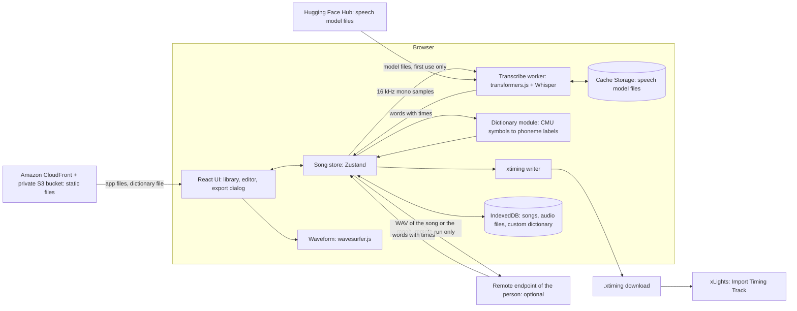
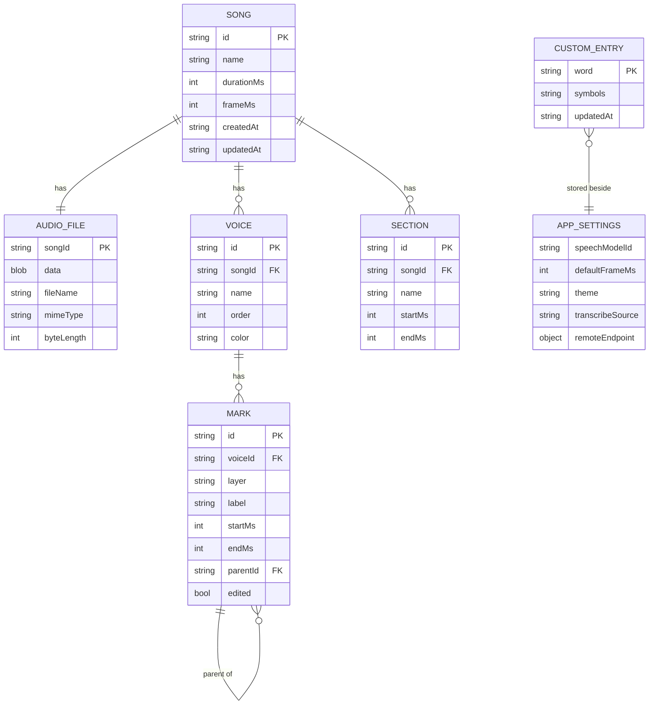

# xLights Singing Face Timing Generator

## Overview

The app is a web application for people who build light shows with xLights. The
person loads an audio file of a song. The app finds each sung word and the time of
each word. The app then converts each word into the mouth shapes that xLights uses
to animate a singing face.

The app writes the result as an `.xtiming` file. xLights imports that file as a
timing track that has three layers: phrases, words and phonemes. The Faces effect in
xLights reads the phoneme layer and moves the mouth of a face model.

The same work in xLights is manual today. The person types the lyrics, then drags
each phrase, each word and each phoneme into position by ear. A three-minute song can
take several hours. The app does the first pass in minutes and gives the person an
editor to correct the result. Audio leaves the browser only when the person selects
a remote endpoint, and the app shows the host first. The app has no server that
receives audio.

The user's request, verbatim:

> I want to create a web-based project that will help me synchronize recordings
> word-by-word into an xlights compatable .xtiming to anamate singing faces. Ideally
> I can upload the audio file to the website and then have the xtimings file
> generate. Extra points if we can help generate the files however it would be
> easiest to import for multile faces/sections of the song. Include a nice GUI.
> Analyze xlights; and all relivant settings.

## Terms

| Term | Part of speech | Meaning in this project | Do not use |
|---|---|---|---|
| app | noun | The web application that this spec describes. | tool, site, system, product |
| person | noun | The human who uses the app. | user, sequencer, customer |
| song | noun | One audio file plus all voices, sections and marks that belong to it. The app saves a song in the browser. | project, session, document |
| audio file | noun | The file that the person loads. It holds the recording. | track, media, upload |
| voice | noun | One singer or one vocal part in a song. One voice becomes one timing track. | singer, face, character, part |
| section | noun | A named time range of the song, for example "Chorus 1". | segment, region, part |
| timing track | noun | The xLights element that holds layers of marks. One `<timing>` element in an `.xtiming` file. | lyric track, timing element |
| layer | noun | One of the three rows of a voice: the phrase layer, the word layer or the phoneme layer. | row, tier, level |
| mark | noun | One labelled time interval on a layer. It has a label, a start time and an end time. xLights stores it as an `<Effect>` element. | effect, cue, timing, region |
| phrase | noun | A mark on the phrase layer. It holds one line of lyrics. | line, sentence |
| word | noun | A mark on the word layer. It holds one sung word. | token |
| phoneme | noun | A mark on the phoneme layer. Its label is one of the ten xLights mouth shapes. | viseme, mouth shape mark |
| phoneme label | noun | One of `AI`, `E`, `etc`, `FV`, `L`, `MBP`, `O`, `rest`, `U`, `WQ`. | viseme name |
| CMU symbol | noun | One sound symbol from the CMU Pronouncing Dictionary, for example `AY1`. | ARPAbet, CMU phoneme |
| dictionary | noun | The table that gives the CMU symbols for a word. | lexicon |
| custom dictionary | noun | The table of words that the person adds or changes. It takes priority over the dictionary. | user library, overrides |
| speech model | noun | A Whisper model that transcribes the audio: a model file that the browser downloads and runs, or the model of a remote endpoint. | model, AI, engine |
| remote endpoint | noun | A server that the person selects to transcribe the audio in place of the speech model in the browser. It is compatible with the OpenAI transcription API. | cloud, API server, backend, service |
| base URL | noun | The address of a remote endpoint, for example `https://api.openai.com/v1`. The app adds `/audio/transcriptions`. | endpoint URL, server address |
| CORS | noun | Cross-Origin Resource Sharing: the HTTP headers that let a server accept a request from a page of another origin. A remote endpoint needs them for the app. | cross-site permission |
| API key | noun | The secret text that a remote endpoint can ask for. The app sends it only to the base URL of the remote endpoint. | token, password, secret |
| device | noun | The part of the computer that runs the speech model: the graphics card (`webgpu`) or the CPU (`wasm`). | backend, processor, hardware |
| transcribe | verb | To run the speech model on the audio file and get words with times. | recognise, sync, analyse |
| align | verb | To match the transcribed words with lyrics that the person supplies. | reconcile, merge |
| break down | verb | To convert a word into phonemes. | split, expand, decompose |
| snap | verb | To move a time to the nearest multiple of the frame size. | quantise, round |
| frame size | noun | The length of one xLights frame in milliseconds. | frame rate, FPS, tick |
| export | verb | To write an `.xtiming` file and give it to the person as a download. | save, generate, publish |
| face model | noun | The xLights model that shows a singing face. | prop, face |
| editor | noun | The screen that shows the waveform and the layers of the selected voice. | timeline, workspace |

## Goals

1. A person gets a first-pass `.xtiming` file from an audio file in less than 10
   minutes for a 4-minute song on a desktop computer with WebGPU.
2. xLights imports every exported file without an error message, with three layers
   for each timing track.
3. The Faces effect in xLights animates a face model from an exported timing track
   with no manual edit in xLights.
4. A person corrects a wrong word time in the editor in one drag action.
5. A person exports one file that holds one timing track for each voice.
6. Audio leaves the browser only when the person selects a remote endpoint, and the
   app shows the host first.

## Non-goals

- The app does not edit xLights sequences (`.xsq`), layouts or face definitions.
- The app does not place Faces effects on models. The person does that in xLights.
- The app does not separate vocals from instruments in v1.
- The app does not have accounts, a server database or shared songs.
- The app does not read or write Papagayo `.pgo` files in v1.
- The app does not support phone-size screens in v1. The minimum width is 1024 px.
- The app does not include a paid speech service. A remote endpoint belongs to the
  person.
- The app does not support dictionaries for languages other than English in v1.

## Users & personas

**The sequencer.** A hobbyist or a professional who builds xLights shows. This person
knows xLights timing tracks and face models. This person does not know phonetics or
speech models. This is the only persona. Every person has every permission, because
all data stays in that person's browser.

The sequencer needs to:

- load a song and get words with times without a setup step,
- see and hear where each word starts and ends,
- correct errors fast with the mouse and the keyboard,
- give each singer a separate timing track,
- get a file that xLights imports on the first attempt.

## Feature map

| Feature set | Spec file | Epic | Mockups |
|---|---|---|---|
| Foundation | [features/00-foundation.md](features/00-foundation.md) | Epic 0: Foundation | none |
| Audio import | [features/01-audio-import.md](features/01-audio-import.md) | Epic 1: Song and waveform | [mockups/01-song-library.html](mockups/01-song-library.html) |
| Transcription | [features/02-transcription.md](features/02-transcription.md) | Epic 2: Transcription | none |
| Phoneme breakdown | [features/03-phoneme-breakdown.md](features/03-phoneme-breakdown.md) | Epic 3: Phoneme breakdown | none |
| Timeline editor | [features/04-timeline-editor.md](features/04-timeline-editor.md) | Epic 4: Editor | [mockups/02-editor.html](mockups/02-editor.html) |
| Voices and sections | [features/05-voices-sections.md](features/05-voices-sections.md) | Epic 5: Voices and sections | none |
| xtiming export | [features/06-xtiming-export.md](features/06-xtiming-export.md) | Epic 6: Export | [mockups/03-export.html](mockups/03-export.html) |

## Architecture & stack

The app is a static single-page application. It has no backend. Each component:

- **React UI.** React 19.3 with TypeScript 7.0, built with Vite 8.3. React with Vite
  is the user's choice. Next.js adds a server that the app does not need.
- **Song store.** Zustand 5.1 holds the open song in memory. A plain store keeps the
  undo history simple. Redux adds ceremony that one screen does not need.
- **Waveform.** wavesurfer.js 8.1.1 (BSD-3-Clause) draws the waveform and plays the
  audio. The app draws the three layers with its own React components above the
  waveform, on the same time scale. The Regions plugin of wavesurfer.js puts all
  regions on the waveform itself, which does not fit three stacked layers.
  Verified against: https://wavesurfer.xyz/docs/ (retrieved 2026-11-24) and
  `npm view wavesurfer.js version` (8.1.1).
- **Transcribe worker.** A Web Worker runs `@huggingface/transformers` 4.3.2
  (Apache-2.0) with a Whisper speech model. The worker keeps the UI responsive. The
  library accepts `device: 'webgpu'` and returns word times when the call passes
  `return_timestamps: 'word'`. Browser Whisper is the user's choice and the default.
  The person can select a remote endpoint that is compatible with the OpenAI
  transcription API, for example a self-hosted server (issue #101,
  `docs/adr/0007-remote-whisper-endpoint.md`).
  Verified against: https://huggingface.co/docs/transformers.js/api/pipelines and
  https://huggingface.co/docs/transformers.js/en/guides/webgpu (retrieved
  2026-11-24), `npm view @huggingface/transformers version` (4.3.2).
- **Dictionary module.** Pure TypeScript. It looks up CMU symbols and maps each
  symbol to a phoneme label with the table that xLights uses.
  Verified against: `resources/dictionaries/phoneme_mapping` in
  https://github.com/xLightsSequencer/xLights (commit `99a289bf`).
- **xtiming writer.** Pure TypeScript. It produces the XML text that
  `TimingElement::GetExport()` and `RowHeading.cpp` produce in xLights.
  Verified against: `src-core/render/Element.cpp`,
  `src-ui-wx/sequencer/RowHeading.cpp` and `src-core/render/SequenceFile.cpp` in
  https://github.com/xLightsSequencer/xLights (commit `99a289bf`).
- **IndexedDB.** The browser database stores songs, audio files and the custom
  dictionary. The app uses the native IndexedDB API behind one small module.
- **Hosting.** A private Amazon S3 bucket holds the built files. An Amazon
  CloudFront distribution serves them through an origin access control. A
  CloudFront response headers policy sets the security headers. A GitHub Actions
  workflow deploys each commit on `main`. S3 with CloudFront is the user's choice
  over AWS Amplify Hosting: it gives more control and a lower cost at scale. One
  CloudFormation template, `infra/hosting.yml`, declares all hosting resources.
  Verified against:
  https://docs.aws.amazon.com/AWSCloudFormation/latest/TemplateReference/aws-resource-cloudfront-originaccesscontrol.md,
  https://docs.aws.amazon.com/AWSCloudFormation/latest/TemplateReference/aws-properties-cloudfront-responseheaderspolicy-securityheadersconfig.md,
  https://docs.aws.amazon.com/IAM/latest/UserGuide/id_roles_create_for-idp_oidc.html
  (retrieved 2026-11-24), and `aws s3 sync help`,
  `aws cloudfront create-invalidation help` (aws-cli/2.37.9).

### What xLights requires (analysis of the xLights source)

These facts drive the design. Each one comes from the xLights source at commit
`99a289bf`.

- An `.xtiming` file is XML. The root is one `<timing>` element, or one `<timings>`
  element that holds several `<timing>` elements.
- A `<timing>` element has the attributes `name`, `subType` and `SourceVersion`.
  The import code reads `name` and `subType` only.
- Each `<EffectLayer>` child is one layer. Each `<Effect>` child of a layer is one
  mark with the attributes `label`, `starttime` and `endtime`. Times are whole
  milliseconds.
- The import code moves each time down to a multiple of the sequence frame size
  (`s -= s % GetFrameMS()`). A mark shorter than one frame can become zero length.
- The import code renames a timing track when the name exists in the sequence.
- The Faces effect reads layer index 2, the third layer, for the mouth. It shows
  `rest` when the timing track has fewer than three layers.
- The Faces effect shows `rest` at any time that has no phoneme. A gap between
  phonemes is a closed mouth.
- The phoneme labels are `AI`, `E`, `etc`, `FV`, `L`, `MBP`, `O`, `rest`, `U`, `WQ`.
  Labels are case-sensitive: `etc` and `rest` are lower case.
- The eyes of a face blink in `Auto` mode while the phoneme is `rest`.
- xLights exports a Papagayo file only from a timing track with exactly 3 layers.

## Data model

- **Song.** `id` is a UUID. `name` defaults to the audio file name without the
  extension. `durationMs` comes from the decoded audio. `frameMs` is 25 or 50, and
  the default is 50. A song lives until the person deletes it.
- **Audio file.** The original bytes of the file, stored once for each song.
- **Voice.** `name` is unique in a song, 1 to 60 characters. `order` sets the row
  order and the export order. `color` is one of 8 preset colours. A new song has one
  voice named "Lead Vocals".
- **Section.** `name` is 1 to 40 characters. `startMs` is less than `endMs`. Sections
  of one song do not overlap.
- **Mark.** `layer` is `phrase`, `word` or `phoneme`. `startMs` is less than `endMs`.
  A word has a phrase as its parent. A phoneme has a word as its parent. A phrase
  has no parent. Marks on one layer of one voice do not overlap. A child stays
  inside the time range of its parent. `edited` is true after the person changes the
  mark by hand.
- **Custom entry.** `word` is upper case. `symbols` is a list of CMU symbols
  separated by spaces. Custom entries belong to the browser, not to one song.
- **App settings.** One record. `speechModelId` is one of the three supported speech
  models. The app does not store `device`. The app derives the device from the
  browser on each visit. `transcribeSource` is `browser` or `remote`, and the
  default is `browser`. `remoteEndpoint` holds `baseUrl`, `apiKey` and `model`. The
  API key stays in this record. No export and no custom dictionary file holds it.

## Cross-cutting concerns

- **Auth.** None. The app has no accounts and no server data.
- **Privacy.** Audio leaves the browser only when the person selects a remote
  endpoint, and the app shows the host first. A remote run sends the audio of the
  song or of the range to that host only. The app sends no lyrics and no marks to
  any server. The other network requests are for the app files and the speech model
  files. The API key goes only to the base URL of the remote endpoint.
- **Error handling.** Each failure shows a message that states the cause and the
  next action. The app never fails without a message. Feature files give the copy.
- **Validation.** The app validates at two boundaries only: files that the person
  loads, and text that the person types.
- **Persistence.** The app saves the open song to IndexedDB 1 second after the last
  change. A reload restores the song.
- **Undo.** Every change to marks, voices and sections goes through one history
  stack with 100 steps.
- **Accessibility.** Every control has a keyboard path and a visible focus ring.
  Text contrast is 4.5:1 or more. The editor does not rely on colour alone: each
  phoneme shows its label as text.
- **Themes.** The app has a light theme and a dark theme. The default follows the
  operating system setting.
- **i18n.** The UI is English only in v1. Labels accept any Unicode text.
- **Performance targets.** The editor scrolls and zooms at 60 frames per second
  with 3 000 marks on screen-size hardware from 2020 or later. The first load of the
  app transfers less than 500 kB compressed, without the dictionary and the speech
  model.
- **Security posture.** The app has no secrets. The app escapes every label that it
  writes into XML. The hosting sends a Content-Security-Policy header that allows
  scripts from the app origin only.
- **Browser support.** Current Chrome, Edge and Firefox on desktop. Safari is best
  effort. A browser without WebGPU uses the `wasm` device.

## Environments & config

| Environment | Purpose | URL |
|---|---|---|
| local | Development with `npm run dev`. | `http://localhost:5173` |
| production | The `main` branch on S3 with CloudFront. | The default `*.cloudfront.net` domain of the distribution. Recorded in `docs/external.md` by Epic 0. No custom domain in v1. |

The app reads one environment variable. It is build-time and optional:

| Name | Purpose | Default |
|---|---|---|
| `VITE_APP_VERSION` | Version text that the app writes into `SourceVersion`. | The `version` field of `package.json`. |

The deploy workflow reads three GitHub Actions repository variables. They are
names of resources, not secrets:

| Name | Purpose |
|---|---|
| `AWS_DEPLOY_ROLE_ARN` | The IAM role that the workflow assumes through GitHub OIDC. |
| `SITE_BUCKET` | The name of the S3 bucket. |
| `CLOUDFRONT_DISTRIBUTION_ID` | The id of the CloudFront distribution. |

The app has no secrets. The workflow uses GitHub OIDC, so the repository stores no
AWS access key. Demo data is one short public-domain audio
clip in `public/demo/`, with its marks, for the E2E tests and for the "Try the demo
song" button.

## Testing strategy

- **Unit (Vitest).** The xtiming writer, the dictionary module, the align
  function, the snap function, the store actions and the history stack. These hold
  the logic, so coverage of these modules is 90% of lines or more.
- **Golden files.** The writer tests compare output with `.xtiming` files in
  `tests/fixtures/` that match the xLights export format byte for byte.
- **Component (Vitest + Testing Library).** Layer rows, drag handles, dialogs.
- **E2E (Playwright).** Load the demo song, edit a mark, export, and compare the
  download with a golden file. The E2E tests replace the transcribe worker with a
  fixture, because the speech model is too large for CI.
- **Manual check, once per epic that changes the export.** Import the exported file
  into xLights and play a Faces effect. The epic records the xLights version.

A change is done when lint, typecheck, unit tests and E2E tests pass, and each
acceptance criterion of the issue has a test or a recorded manual check.

## Epics

| Epic | Goal | Feature files | Depends on | Exit criteria |
|---|---|---|---|---|
| Epic 0: Foundation | A fresh clone installs, tests, builds, starts and deploys. | 00-foundation | none | CI is green on a pull request. The production URL serves the app shell. |
| Epic 1: Song and waveform | The person loads an audio file, sees the waveform and plays it. Songs persist. | 01-audio-import | Epic 0 | A loaded song survives a reload. |
| Epic 2: Transcription | The app transcribes a song into phrases and words with times. | 02-transcription | Epic 1 | The demo song yields words on the word layer. |
| Epic 3: Phoneme breakdown | The app breaks down each word into phonemes. The person manages the custom dictionary. | 03-phoneme-breakdown | Epic 2 | Every word of the demo song has phonemes. |
| Epic 4: Editor | The person edits marks on three layers with mouse and keyboard, with undo. | 04-timeline-editor | Epic 3 | The person fixes a word time and the phonemes follow. |
| Epic 5: Voices and sections | The person makes voices and sections and moves phrases between voices. | 05-voices-sections | Epic 4 | A song has two voices with separate marks. |
| Epic 6: Export | The app exports `.xtiming` files that xLights imports. | 06-xtiming-export | Epic 3 | xLights imports a two-voice file and a Faces effect animates. |

Epic 6 depends on Epic 3 only, so it can ship before Epic 4 and Epic 5. In that
order the app is useful end to end after four epics.

## Milestones

1. **M0, skeleton (Epic 0).** Shippable means: the pipeline works and the URL is up.
2. **M1, first file (Epics 1, 2, 3, 6).** Shippable means: audio in, `.xtiming`
   out, one voice, no manual edits. This is the first demo.
3. **M2, correctable (Epic 4).** Shippable means: the person fixes errors in the
   app, not in xLights.
4. **M3, multi-face (Epic 5).** Shippable means: one file serves several face
   models, and the person can export by section.

## Assumptions

- The app uses hash routes (`#/song/<id>`), so the hosting needs no rewrite rule.
- The repository is on GitHub, because the user's tools point there.
- The licence of the project is MIT. The project writes its own phoneme table from
  the facts in the xLights `phoneme_mapping` file and does not copy that GPL file.
- The default frame size is 50 ms (20 frames per second). The person can select
  25 ms.
- The app spreads the phonemes of a word evenly across the word. The speech model
  gives word times only.
- The app writes no `rest` marks by default, because xLights shows `rest` in gaps.
- The speech model files come from the Hugging Face Hub at run time. The app does
  not copy them to the hosting.
- The largest audio file is 200 MB and the longest song is 15 minutes.
- English lyrics only in v1.
- No analytics and no error reports leave the browser in v1.

## Risks & open questions

None of these blocks approval. Each one names the epic that settles it.

1. **Speech model accuracy on songs.** Whisper is trained on speech. Music and
   harmony lower the accuracy of words and times. Mitigation: the lyrics align flow
   in [features/02-transcription.md](features/02-transcription.md) and the editor.
   Epic 2 measured the demo song: the base speech model returned 15 words for the
   choir clip, with one wrong line. The spec has no accuracy criterion for a
   song. Vocal separation (to transcribe the voice without the instruments) is an
   accepted later option. It is not in v1. A spec update adds it if real songs
   show the need.
2. **Word times need the right model export.** The docs confirm
   `return_timestamps: 'word'`. They do not state which model repositories support
   it. The `onnx-community/whisper-*_timestamped` repositories are the candidates.
   Epic 2 confirms this before any other work.
3. **Download progress.** The fetched docs do not describe the `progress_callback`
   option. Epic 2 confirms the option name and the event shape.
4. **Audio input format for the speech model.** The docs list `Float32Array` as an
   input type. They do not state the sample rate on the pages read. Epic 2 confirms
   16 kHz mono before the resample code is written.
5. **Cross-origin isolation.** Multi-thread WASM needs the
   `Cross-Origin-Opener-Policy` and `Cross-Origin-Embedder-Policy` headers. Those
   headers can block model downloads from another origin. Epic 0 sets no such
   header. The response headers policy can add them later. Epic 2 tests the `wasm` device speed and decides.
6. **CMU dictionary format and size.** The repository
   https://github.com/cmusphinx/cmudict holds `cmudict.dict`. The entry format and
   the entry count were not on the page read. Epic 3 confirms both from the file.
7. **Dictionary licence text.** The README states unrestricted use with
   acknowledgement. Epic 3 copies the LICENSE file into the repository.
8. **AWS account and region.** The user names the AWS account and the region of
   the S3 bucket in Epic 0. Any command that creates an AWS resource needs the
   user's confirmation first. The CloudFormation property names for the origin
   access control and the response headers policy are confirmed on the pages
   cited. The full template is not verified until Epic 0 deploys it.
9. **Browser storage limits.** A browser can evict IndexedDB data under storage
   pressure. Epic 1 requests persistent storage and shows the result.

## Changelog

- 2026-11-24 — Draft 1. First version from the interview and the xLights source
  analysis.
- 2026-11-24 — Review round 1. The user approved the spec. The user chose S3 with
  CloudFront over AWS Amplify Hosting. The user chose the default domain, with no
  custom domain in v1. The foundation feature and the hosting sections changed to
  match.
- 2026-11-24 — Issues created. The user chose the AWS region `us-east-1` for the
  hosting stack. The user chose a public-domain recording for the demo song, and
  confirms its licence before the file is committed. The editor epic became two
  tracker epics.
- 2026-11-24 — Epic 0 batch. The user accepted "Silent Night" by the United States
  Army Chorus (2010) as the demo recording. Its public-domain status is for the
  United States only. The batch ships without issue #7 (create the hosting stack),
  which waits for the user's AWS account and approval. The project compiles with
  TypeScript 7 and lints with the TypeScript 6 API (`docs/adr/0003`). The
  distribution redirects HTTP to HTTPS.
- 2026-11-24 — The MIME type rule for audio files changed: `video/ogg`,
  `application/ogg` and an empty type are accepted (issue #58).
- 2026-11-24 — Epic 1 batch. The size limit of 200 MB means 200 × 1024 × 1024
  bytes. The demo song has the name "Silent Night". The editor saves a pending
  change when the person leaves it and when the page is hidden. Issue #58 joined
  the batch of epic #8.
- 2026-11-24 — Epic 2 batch. The 150 ms accuracy criterion for the demo song is
  removed (issue #77): it measured the speech model and unchecked demo marks, not
  the code. The user accepts vocal separation as a later option. A transcribe run
  stops by terminating the worker (`docs/adr/0004`). The variable
  `VITE_MODEL_HOST` is removed. The app does not store the device. Issues #64 and
  #77 joined the batch of epic #14. The real speech model runs under the
  production Content-Security-Policy with no violation.
- 2026-11-24 — Export batch. The export code shipped without the manual check in
  xLights, which waits for the user (issue #79). The export omits characters that
  XML 1.0 forbids in a label. A page cannot detect a blocked download, so the
  dialog shows a standing hint. A click on a finding selects the voice and the
  mark, and the layers draw a selected mark. The export batch started before the
  phoneme epic ended, and it carried issues #21 and #22 of epic #20 into `main`.
- 2026-11-24 — Phoneme batch. The store normalises the word of a custom entry on
  each write. A change of a custom entry is not an undo step, and the break down
  that follows it is one. A break down that fails keeps the words of the run. The
  control for "Break down again" (FR-phoneme-19) moves to issue #30. The link from
  a moved word to its edited phonemes (FR-phoneme-20) moves to issue #27. The
  control for a range run (FR-transcribe-19) is in issue #29, and the style for an
  estimated word (FR-transcribe-16) is in issue #30.
- 2026-11-24 — The transcribe dialog shows the stages before the first chunk, the
  elapsed time, finer progress and the device (issue #91, from the review of the
  maintainer in Firefox).
- 2026-11-24 — The maintainer asked for "an API call ability to go to a whisper
  endpoint" (issue #101). The person can select a remote endpoint that is
  compatible with the OpenAI transcription API, for example a self-hosted server.
  The privacy promise changes: audio leaves the browser only when the person
  selects a remote endpoint, and the app shows the host first. The
  Content-Security-Policy `connect-src` allows any `https` address and `http` on
  `localhost` (`docs/adr/0007`).

## Issue map

Written by `/spec-to-issues` on 2026-11-24. Repository: `sniper7kills/xlights-singing-face-timing`.

The spec has one editor epic. The tracker has two, because 30 requirements do not fit one batch.

| Epic | Epic issue | Sub-issues |
|---|---|---|
| Foundation | #1 | #2, #3, #4, #5, #6, #7 |
| Song and waveform | #8 | #9, #10, #11, #12, #13, #58 |
| Transcription | #14 | #15, #16, #17, #18, #19, #64, #77 |
| Phoneme breakdown | #20 | #21, #22, #23, #24, #25 |
| Editor — edit marks | #26 | #27, #28, #29, #30 |
| Editor — play tools | #31 | #32, #33, #34 |
| Voices and sections | #35 | #36, #37, #38, #39, #40 |
| Export | #41 | #42, #43, #44, #45, #46, #79 |

| Requirement | Issues |
|---|---|
| FR-foundation-1 | #2 |
| FR-foundation-2 | #2 |
| FR-foundation-3 | #2 |
| FR-foundation-4 | #2 |
| FR-foundation-5 | #3 |
| FR-foundation-6 | #3 |
| FR-foundation-7 | #3 |
| FR-foundation-8 | #3 |
| FR-foundation-9 | #3 |
| FR-foundation-10 | #4 |
| FR-foundation-11 | #6, #7 |
| FR-foundation-12 | #6, #7 |
| FR-foundation-13 | #2 |
| FR-foundation-14 | #5 |
| FR-foundation-15 | #6, #7 |
| FR-foundation-16 | #2 |
| FR-foundation-17 | #6, #7 |
| FR-foundation-18 | #6 |
| FR-audio-1 | #11 |
| FR-audio-2 | #10 |
| FR-audio-3 | #10 |
| FR-audio-4 | #10 |
| FR-audio-5 | #10 |
| FR-audio-6 | #10 |
| FR-audio-7 | #10 |
| FR-audio-8 | #10 |
| FR-audio-9 | #10 |
| FR-audio-10 | #9 |
| FR-audio-11 | #10 |
| FR-audio-12 | #12 |
| FR-audio-13 | #12 |
| FR-audio-14 | #12 |
| FR-audio-15 | #11 |
| FR-audio-16 | #11 |
| FR-audio-17 | #13 |
| FR-audio-18 | #11 |
| FR-audio-19 | #9 |
| FR-audio-20 | #11 |
| FR-transcribe-1 | #17 |
| FR-transcribe-2 | #17 |
| FR-transcribe-3 | #17 |
| FR-transcribe-4 | #17 |
| FR-transcribe-5 | #15 |
| FR-transcribe-6 | #15 |
| FR-transcribe-7 | #15 |
| FR-transcribe-8 | #17 |
| FR-transcribe-9 | #17 |
| FR-transcribe-10 | #17 |
| FR-transcribe-11 | #15 |
| FR-transcribe-12 | #18 |
| FR-transcribe-13 | #16 |
| FR-transcribe-14 | #16 |
| FR-transcribe-15 | #16 |
| FR-transcribe-16 | #16 |
| FR-transcribe-17 | #23 |
| FR-transcribe-18 | #18 |
| FR-transcribe-19 | #18 |
| FR-transcribe-20 | #15 |
| FR-transcribe-21 | #16, #18 |
| FR-transcribe-22 | #18 |
| FR-phoneme-1 | #21 |
| FR-phoneme-2 | #22 |
| FR-phoneme-3 | #22 |
| FR-phoneme-4 | #22 |
| FR-phoneme-5 | #22 |
| FR-phoneme-6 | #22 |
| FR-phoneme-7 | #22 |
| FR-phoneme-8 | #22 |
| FR-phoneme-9 | #23 |
| FR-phoneme-10 | #25 |
| FR-phoneme-11 | #25 |
| FR-phoneme-12 | #24 |
| FR-phoneme-13 | #24 |
| FR-phoneme-14 | #24 |
| FR-phoneme-15 | #24 |
| FR-phoneme-16 | #23, #24 |
| FR-phoneme-17 | #24 |
| FR-phoneme-18 | #24 |
| FR-phoneme-19 | #23 |
| FR-phoneme-20 | #23 |
| FR-editor-1 | #19, #29 |
| FR-editor-2 | #29 |
| FR-editor-3 | #29 |
| FR-editor-4 | #29 |
| FR-editor-5 | #29 |
| FR-editor-6 | #30 |
| FR-editor-7 | #30 |
| FR-editor-8 | #30 |
| FR-editor-9 | #30 |
| FR-editor-10 | #27 |
| FR-editor-11 | #27 |
| FR-editor-12 | #27 |
| FR-editor-13 | #27 |
| FR-editor-14 | #27 |
| FR-editor-15 | #30 |
| FR-editor-16 | #28, #30 |
| FR-editor-17 | #28, #32 |
| FR-editor-18 | #28, #32 |
| FR-editor-19 | #28, #32 |
| FR-editor-20 | #28, #30 |
| FR-editor-21 | #33 |
| FR-editor-22 | #33 |
| FR-editor-23 | #34 |
| FR-editor-24 | #34 |
| FR-editor-25 | #32 |
| FR-editor-26 | #30 |
| FR-editor-27 | #34 |
| FR-editor-28 | #34 |
| FR-editor-29 | #32 |
| FR-editor-30 | #28, #30 |
| FR-voice-1 | #36 |
| FR-voice-2 | #36 |
| FR-voice-3 | #36 |
| FR-voice-4 | #36 |
| FR-voice-5 | #36 |
| FR-voice-6 | #36 |
| FR-voice-7 | #36 |
| FR-voice-8 | #37 |
| FR-voice-9 | #37 |
| FR-voice-10 | #37 |
| FR-voice-11 | #38 |
| FR-voice-12 | #38 |
| FR-voice-13 | #38 |
| FR-voice-14 | #39 |
| FR-voice-15 | #39 |
| FR-voice-16 | #39 |
| FR-voice-17 | #39 |
| FR-voice-18 | #39 |
| FR-voice-19 | #39 |
| FR-voice-20 | #40 |
| FR-voice-21 | #39 |
| FR-export-1 | #45 |
| FR-export-2 | #45 |
| FR-export-3 | #43 |
| FR-export-4 | #43 |
| FR-export-5 | #45 |
| FR-export-6 | #45 |
| FR-export-7 | #45 |
| FR-export-8 | #45 |
| FR-export-9 | #45 |
| FR-export-10 | #43 |
| FR-export-11 | #42 |
| FR-export-12 | #43 |
| FR-export-13 | #42 |
| FR-export-14 | #42 |
| FR-export-15 | #42 |
| FR-export-16 | #44 |
| FR-export-17 | #45 |
| FR-export-18 | #44 |
| FR-export-19 | #46 |
| FR-export-20 | #46 |
| FR-export-21 | #45 |
| FR-export-22 | #45 |
- 2026-11-24 — Batch gate of epic #26. A range run replaces the marks that overlap
  the range, not only the marks fully inside it (issues #97 and #98). The editor
  loads the dictionary when it opens a song that has a word. The acceptance
  criterion "A click on a mark shows its fields in the inspector" moved from issue
  #30 to issue #34.
